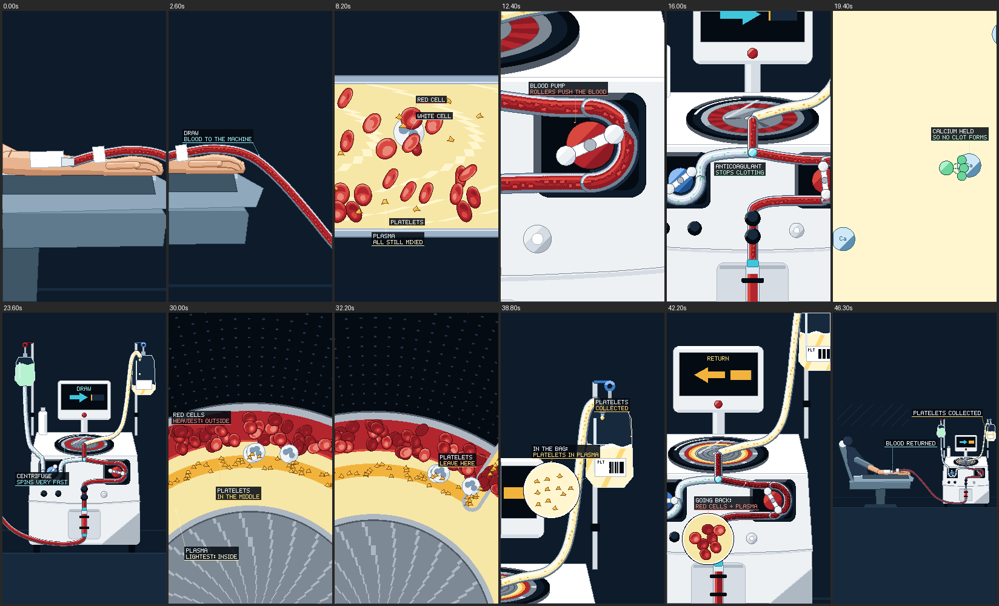

# How an Apheresis Machine Takes Platelets and Returns Your Blood

A 48-second looping vertical medical-science short in 2D 8-bit retro medical-tech pixel art, with an original
120 BPM chiptune and synced sound effects.

The film follows one calm donor's blood through one machine. It leaves the arm and goes through the blood pump. It
gets anticoagulant and is spun apart. The platelets go into a golden bag, and the rest of the blood goes back into
the same arm. The hero shot is the separation inside the spinning channel. The film then shows both outputs
clearly: what is in the bag (platelets in plasma) and what goes back to the donor (red cells and plasma). The last
frame flows straight back into the first.

The machine is a generic bedside apheresis console with no brand or logo. Its shape follows the common layout of
real consoles: a wide, low cabinet with the pumps on a sloped front deck, the centrifuge under a round lid on top,
a touchscreen on a post and two IV poles.



Labels in Bahasa Indonesia (`--lang id`): [docs/storyboard_id.png](docs/storyboard_id.png)

## Ringkasan (Bahasa Indonesia)

Video 48 detik, vertikal 1080×1920, pixel art 8-bit bergaya alat medis retro, berulang (loop) tanpa sambungan:

1. **0–4,4 dtk.** Close-up lengan donor dengan tangan yang rileks. Jarum sudah tertutup plester, dan selang bening
   berisi darah yang mengalir bertumpu di atas tangan. Kamera mengikuti selang menuju mesin (label AMBIL / DARAH KE
   MESIN).
2. **4,4–10,6 dtk.** Sebuah lensa pembesar bulat terbuka di atas selang. Di dalamnya sel darah merah, trombosit, sel
   darah putih dan plasma masih tercampur. Lensa lalu menutup ke darah yang masuk ke pompa.
3. **10,6–14,4 dtk.** Pompa darah (rotor merah) dalam tampilan potong. Dua roller menekan selang bergantian dan
   mendorong darah ("klik-klik").
4. **14,4–21 dtk.** Pompa antikoagulan (rotor biru), dan selangnya bergabung di sambungan Y. Lensa terbuka: sitrat
   mengikat ion kalsium ("tik"), jadi darah tidak membeku.
5. **21–26,4 dtk.** Darah masuk ke sentrifus di bawah tutup bundar. Kamera mundur memperlihatkan seluruh mesin saat
   rotor mulai berputar, lalu lensa terbuka ke saluran pemisah.
6. **26,4–34,4 dtk.** Inti film. Sel darah merah (paling berat) ke dinding luar, plasma (paling ringan) di dalam,
   dan pita trombosit emas di tengah. Pita trombosit keluar lewat lubangnya sendiri.
7. **34,4–40 dtk.** **Keluaran 1:** aliran trombosit naik ke kantong. Tetesan jatuh ke dalam kantong dan isinya
   naik. Gelembung pembesar memperlihatkan isinya: trombosit dalam plasma.
8. **40–45 dtk.** **Keluaran 2:** layar berganti ke KEMBALI dan pompa berputar balik. Gelembung pembesar
   memperlihatkan yang dikembalikan: sel darah merah + plasma. Kamera mengikuti darah kembali ke lengan.
9. **45–48 dtk.** Kamera mundur memperlihatkan seluruh sistem dengan kedua keluaran (TROMBOSIT TERKUMPUL, DARAH
   DIKEMBALIKAN), lalu meluncur kembali ke close-up lengan.

**Yang direvisi di versi ini:**
- **Lengan dan tangan:** bentuknya lebih alami. Lengan atas, siku dan lengan bawah dibuat meruncing ke pergelangan,
  dan tangannya rileks dengan ibu jari, garis jari dan kuku.
- **Selang:** sekarang berupa tabung bening yang halus, dengan sisi terang dan sisi gelap, kilap, dan sel darah yang
  mengalir di dalamnya. Tidak lagi seperti rantai manik-manik.
- **Transisi antar adegan:** lensa pembesar bulat yang membuka dan menutup dengan tenang (sekitar 1 detik), tanpa
  potongan blok yang berkedip. Gerak kamera juga lebih pelan.
- **Penjelasan:** label menempel pada bendanya dan kini berisi nama plus satu baris penjelasan singkat, misalnya
  "POMPA DARAH / ROLLER MENDORONG DARAH". Keluaran darah (isi kantong, dan yang dikembalikan ke donor) ditampilkan
  dengan gelembung pembesar.
- **Durasi:** 48 detik (sebelumnya 32), supaya setiap langkah sempat terbaca.

**Bentuk mesin:** konsol apheresis generik tanpa merek atau logo, mengikuti bentuk mesin sungguhan. Badannya lebar dan
rendah, berwarna putih keabu-abuan dengan panel diagonal abu-abu. Dua pompa (rotor biru dan merah) ada di panel depan
yang miring, bersama klem hitam dan drip chamber di ceruk depan. Sentrifus ada di bawah tutup bundar di atas mesin,
layar sentuh berdiri di atas tiang dengan tombol stop merah, dan ada dua tiang infus berkait merah dan biru.

Tidak ada narasi dan tidak ada kotak caption, hanya label yang menempel pada bendanya. Default bahasa Inggris,
`--lang id` untuk Bahasa Indonesia, `--clean` tanpa label sama sekali.

## Render it yourself (copy-paste)

Working directory: the `apheresis-animation` folder of this repository (branch `claude/tes-45y4ej`), that is
`belajar-python/apheresis-animation`. Needs Python 3.9 or newer. ffmpeg comes from `pip` (imageio-ffmpeg); a system
ffmpeg on PATH is used first if you have one.

```bash
git clone -b claude/tes-45y4ej https://github.com/Pudidil-dev/belajar-python.git
cd belajar-python/apheresis-animation
pip install -r requirements.txt
python render.py --preview
python render.py
```

| Step | Command (run inside `belajar-python/apheresis-animation`) | Result |
|---|---|---|
| Install | `pip install -r requirements.txt` | numpy, Pillow, imageio-ffmpeg |
| Preview | `python render.py --preview` | `out/preview.mp4`: half size (540×960) with sound, under a minute to make |
| Render | `python render.py` | `out/apheresis.mp4`: the final film |

**Output path:** `belajar-python/apheresis-animation/out/apheresis.mp4`. It is a vertical 9:16 H.264 MP4, 1080×1920,
30 fps, exactly 48.000 s (1440 frames), with synchronized AAC 48 kHz stereo audio. On a 4-core machine it takes
about one to two minutes; slower machines take a few minutes.

Already have the repository? Use these commands instead of the clone:

```bash
cd belajar-python
git fetch origin claude/tes-45y4ej
git checkout claude/tes-45y4ej
git pull origin claude/tes-45y4ej
cd apheresis-animation
```

Other versions (each writes its own file):

```bash
python render.py --lang id      # labels in Bahasa Indonesia -> out/apheresis_ID.mp4
python render.py --clean        # no labels at all -> out/apheresis_clean.mp4
python render.py --assets       # key-frame sprites + cell sprite sheet -> assets/sprites/, audio stems -> assets/audio/
```

On Windows, write `py` instead of `python` if `python` is not found. On some Linux and macOS systems the commands are
`python3` and `pip3`.

More options:

```bash
python render.py --stills 0,12.4,31,38.8        # full-size PNG frames -> out/stills/
python render.py --sheet 0:48:2 --cols 8        # contact sheet -> out/sheet.png
python render.py --from 26 --to 34 --out out/slice.mp4   # just a slice (with its part of the soundtrack)
python render.py --audio-only                   # soundtrack only -> out/music.wav, out/sfx.wav, out/mix.wav
python render.py --scale 8                      # 2160x3840 (4K vertical) instead of 1080x1920
```

## Scene by scene (120 BPM, one bar = 2 s, 24 bars, looping)

| Time (s) | Scene | What you see | Sound |
|---|---|---|---|
| 0–4.4 | 1 The arm | Close-up of the donor's arm on the armrest, with a relaxed hand. The needle is already in place under tape, and the clear tube rests on the hand with red blood already moving in it. After two quiet seconds the camera follows the tube toward the machine. | a soft double pulse, a gentle flow, the calm first bar |
| 4.4–10.6 | 2 Inside the tube | A round magnifier lens opens on the tube (about 1 s). Inside, deep-red biconcave red cells tumble past with small gold platelets and a white cell, all in pale-yellow plasma, still mixed and fastest in the middle. The lens then closes onto the blood entering the pump. | a soft rising bloop in, little sparkle tones, a falling bloop out |
| 10.6–14.4 | 3 Blood pump | The blood pump on the front deck, in cutaway: a black housing, a red rotor with a white bar and a roller at each end, and the tube running round the raceway. Each roller pinches the tube and pushes a pocket of blood forward, and the tube springs open again behind it. | a click for every roller (on the eighth notes), a soft motor hum, an arpeggio locked to the clicks |
| 14.4–21 | 4 Anticoagulant | The camera glides to the anticoagulant pump (blue rotor) and the Y fitting where its mint line joins the blood. A lens opens on the fitting: a citrate molecule closes onto a calcium ion (two-frame gold flash), then the lens closes again. | one **tik** at 18.6 s over a soft held chord |
| 21–26.4 | 5 Into the centrifuge | The blood runs into the centrifuge under the round lid. The camera pulls out to the whole machine as the rotor spins up, then pushes back in, and a lens opens on the separation channel. | a rising whirr, then a steady spin tone |
| 26.4–34.4 | 6 Separation (hero) | A curved section of the spinning channel. The mixed blood sorts itself: red cells drift to the outer wall, plasma stays inside, and a gold platelet band forms between them with the white cells close by. The camera drifts to the port where the platelet band leaves, and the lens closes onto the platelet outlet. | a spinning 16th-note arpeggio, small rising ticks, a rising tone as the platelets leave |
| 34.4–40 | 7 Output 1: the bag | The gold platelet line runs up into the bag on the right pole. Drops fall in, each with a ripple, and the level rises. A magnifier bubble beside the bag shows what is inside: platelets in plasma. | a plip for each drop, a soft pop for the bubble, a reward tone at 39.4 s |
| 40–45 | 8 Output 2: back to the donor | The screen flips to RETURN, and the blood pump turns the other way while the anticoagulant pump rests. A bubble shows what goes back: red cells and plasma. The camera follows that blood along the same tube into the same arm. | a phase-switch click, the pump clicking backwards, a soft flow |
| 45–48 | 9 Both outputs, then the loop | The screen flips back to DRAW and the camera pulls out to the whole setup, labelled PLATELETS COLLECTED and BLOOD RETURNED. Then it glides back into the opening close-up. The last frame flows into the first. | the phase click, a crash, a three-note success chime, a fill back into bar 1 |

## Labels (default; `--clean` removes them)

There is no narration and no caption box. Each label is a name and, where it helps, one short line about what the
thing does. It sits on a small dark plate joined to the thing by a dotted leader line, types in quickly and follows
it on screen. The first line is white; the second is in the colour of the subject.

| Time (s) | English | Indonesian (`--lang id`) | Pinned to |
|---|---|---|---|
| 2.0–4.3 | DRAW / BLOOD TO THE MACHINE | AMBIL / DARAH KE MESIN | the tube |
| 6.0–9.3 | RED CELL · PLATELETS · WHITE CELL · PLASMA / ALL STILL MIXED | SEL DARAH MERAH · TROMBOSIT · SEL DARAH PUTIH · PLASMA / MASIH TERCAMPUR | one cell of each kind, moving with the flow |
| 11.2–14.2 | BLOOD PUMP / ROLLERS PUSH THE BLOOD | POMPA DARAH / ROLLER MENDORONG DARAH | the pump rotor |
| 15.0–16.55 | ANTICOAGULANT / STOPS CLOTTING | ANTIKOAGULAN / CEGAH PEMBEKUAN | the anticoagulant line |
| 17.8–19.95 | CITRATE · CALCIUM, then CALCIUM HELD / SO NO CLOT FORMS | SITRAT · KALSIUM, then KALSIUM DIIKAT / JADI TIDAK MEMBEKU | the molecule and the ion |
| 22.6–24.4 | CENTRIFUGE / SPINS VERY FAST | SENTRIFUS / BERPUTAR SANGAT CEPAT | the lid |
| 28.0–33.2 | RED CELLS / HEAVIEST: OUTSIDE · PLATELETS / IN THE MIDDLE · PLASMA / LIGHTEST: INSIDE · PLATELETS / LEAVE HERE | SEL DARAH MERAH / PALING BERAT: LUAR · TROMBOSIT / DI TENGAH · PLASMA / PALING RINGAN: DALAM · TROMBOSIT / KELUAR DI SINI | the three layers and the platelet port |
| 36.6–39.95 | PLATELETS / COLLECTED · IN THE BAG: / PLATELETS IN PLASMA | TROMBOSIT / TERKUMPUL · ISI KANTONG: / TROMBOSIT + PLASMA | the bag and its bubble |
| 41.4–44.95 | GOING BACK: / RED CELLS + PLASMA · BACK TO / THE DONOR | DIKEMBALIKAN: / SEL MERAH + PLASMA · KEMBALI / KE DONOR | the return bubble and the arm |
| 45.7–46.8 | PLATELETS COLLECTED · BLOOD RETURNED | TROMBOSIT TERKUMPUL · DARAH DIKEMBALIKAN | the bag and the arm in the wide shot |

The machine screen also shows the phase as a word, an arrow and a gold yield bar: DRAW (arrow toward the machine)
or RETURN (arrow toward the donor).

## The science shown

- **Apheresis.** Blood is drawn, one component is collected, and everything else goes back to the donor. Here the
  collected component is platelets (plateletpheresis).
- **Single needle: DRAW, then RETURN, never both.** With one needle the machine alternates. It draws for a while,
  then returns, then draws again, and the screen always shows which phase is running. The film shows one full
  cycle. (Some machines use two needles, one in each arm, to draw and return at the same time.)
- **Peristaltic pumps.** Rollers squeeze the outside of the tube, so the blood only ever touches the sterile,
  single-use tubing set, never the pump. The blood pump moves the blood; a second, slower pump meters the
  anticoagulant.
- **Anticoagulant.** Citrate binds the calcium ions that the clotting reaction needs, so the blood does not clot in
  the tubing. The close-up shows that one idea: citrate catches calcium.
- **Separation by spinning, not by a filter.** The spinning channel pushes the denser parts outward. Red cells are
  the densest, so they pack against the outer wall. Plasma is the lightest and stays on the inner side. Platelets
  form a band in between, with the few white cells close by. The platelet band is led out through its own port.
  Nothing passes through a membrane, and it is not dialysis.
- **Nothing changes into anything else.** The platelets were in the blood from the start; the machine only sorts.
  No red cell turns into a platelet.
- **What is collected and what goes back.** The bag holds platelets in some plasma, a pale golden product. The red
  cells and the rest of the plasma return to the donor through the same needle.
- **Red blood cells are biconcave discs.** They use a measured red cell thickness profile (Evans & Fung): a thick
  rim and a thin centre. They tumble in the flow, so some are seen tilted or edge-on. From the side the rim hides the
  thin middle, so an edge-on cell looks like a rounded bar.
- **Simplified on purpose.**
  - Time is compressed. A real platelet donation repeats many draw/return cycles and takes well over an hour; the
    film shows one cycle in 48 seconds.
  - In real machines the anticoagulant usually joins the draw line close to the needle, before the blood pump, so
    the blood is anticoagulated from the very start. The film puts the junction after the pump (the order of the
    brief), so the pump and the anticoagulant each get their own scene.
  - In RETURN the film's blood pump simply turns the other way and the blood goes back the way it came, as many
    single-needle machines do. Others collect blood in a reservoir and send it back with a separate return pump.
  - The citrate molecule is a small icon that closes like a claw. Cells, molecules and the channel are not to scale,
    and the colours are stylized (real platelet concentrate is a pale straw colour).
- **The donor** is shown only as an arm with a relaxed hand and a calm silhouette under a blanket, with no drawn
  face (huashu-art-motion character rule). Nothing graphic is shown: the needle is already in place under tape.

## The machine

A generic bedside apheresis console with no brand, logo or model name. Its shape follows the common layout of real
consoles (the reference photo in the request was one of them):
- a wide, low off-white cabinet with feet and a darker gray diagonal panel at the lower right;
- a sloped front deck with two pump heads in black housings: a blue rotor for the anticoagulant and a red rotor for
  the blood (each rotor has a white bar with a roller at each end);
- black pinch clamps on the donor line, an air detector, and a cyan Y fitting where the two lines meet;
- a recess in the lower front with a drip chamber (cyan caps, two black clips) on the donor line;
- the centrifuge under a round lid on top, seen through smoked glass in a 3/4 view from slightly above;
- a touchscreen on a post with a red stop button; the screen shows DRAW or RETURN, an arrow and a gold yield bar;
- a white bottle at the back, and two IV poles with a red and a blue hook carrying the anticoagulant bag (left)
  and the platelet collection bag (right).

## Format and style

- 270×480 working canvas, upscaled exactly 4× (nearest neighbour) to 1080×1920; 30 fps; 48.000 s; H.264 (yuv420p,
  CRF 16) + AAC 256 kb/s 48 kHz stereo.
- 2D 8-bit retro medical-tech style:
  - chunky pixel sprites with 1-px outlines and flat pixel-cluster shading (no gradients, no glow);
  - every shape is drawn per canvas pixel at the current zoom, so the art stays crisp at every scale;
  - separate artwork for the clinic, the blood stream inside the tube, the citrate–calcium close-up and the spinning
    separation channel;
  - between those artworks, a round magnifier lens opens over the spot being explained and grows to fill the screen
    (about 1 s, eased), then shrinks back onto the next spot; no flashes, no block cuts, no cross-fades;
  - the tubing is drawn per pixel as one smooth clear tube: a lit and a shaded side, a glossy band, an outline, and
    cells (or gold and mint flecks) moving inside at the speed of the flow; under a pump roller it squeezes flat;
  - the arm is built from tapered limbs (upper arm, elbow, forearm narrowing to the wrist) with a relaxed hand, a
    thumb, finger lines and a nail, and two strips of tape.
- Palette:
  - dark navy #0D1B2A background;
  - off-white machine #EEF1F4;
  - deep red #B3262E red cells;
  - pale yellow #F6E7A6 plasma;
  - gold #F2B33D platelets;
  - blue-gray #9FB3C8 tubing;
  - pump rotors in blue #3A7BC8 (anticoagulant) and red (blood), a red stop button, cyan fittings;
  - muted cool chair and blanket.

## Sound

The music is an original 24-bar chiptune in F major at 120 BPM (chords F Dm Bb C | F Dm Bb C | Dm Bb F C |
F Dm Bb C | Bb C Am Dm | Bb C F C):
- a square-wave lead with a short echo;
- a bouncy triangle octave bass;
- light arcade drums.

The arrangement follows the picture:
- The first bar is calm: a half-time kick under the soft pulse.
- In the pump bars the melody rests and an eighth-note arpeggio locks to the pump clicks.
- In the citrate bar the beat thins to a soft held chord, and the music ducks around the tik.
- The separation bars add a spinning 16th-note arpeggio, and the bag bars add little bell answers.
- A short snare fill in the last bar leads back into bar 1, so the loop restarts on the downbeat.

**Sound effects:**
- a soft pulse and a gentle flow on the opening;
- a soft rising "bloop" when a magnifier lens opens and a falling one when it closes (no whooshes);
- sparkle tones in the stream;
- one click per roller, with a soft pump hum;
- one tik when citrate catches calcium;
- the rising spin-up whirr and the steady spin tone;
- small ticks as the layers separate, a rising tone as the platelets leave;
- a plip for each drop that lands in the bag, a soft pop for each bubble, the reward tone;
- phase-switch clicks, the pump clicking backwards, the return flow;
- the success chime on the wide shot;
- tiny pops when a label appears (left out with `--clean`).

All of it is synthesized from code on a circular bus, so the end flows into the start. It is mastered to −14 LUFS
with a −1 dBTP ceiling.

## Files

| File | What it is |
|---|---|
| `render.py` | Command line: film, preview, stills, contact sheet, slices, audio only, asset export. |
| `requirements.txt` | numpy, Pillow, imageio-ffmpeg. |
| `镜头表.md` | The shot list (huashu-art-motion workflow) with the style lock. |
| `docs/storyboard.png`, `docs/storyboard_id.png` | Twelve key frames with English and Indonesian labels. |
| `assets/sprites/` | Exported key frames (arm, blood stream, pump, citrate–calcium, the whole machine, separation, platelet bag, return, wide reveal) and a sprite sheet of the blood cells (red cell at four angles, two platelets, a white cell). |
| `assets/audio/` | Not in git: `python render.py --assets` writes the music, effects and mix stems here. |
| `out/` | Renders go here (not in git). |
| `engine/timeline.py` | The clock, the machine layout and the choreography: events on the beat grid, tube paths, flows, both pump rotors, the centrifuge rotor, separation progress, bag level, DRAW/RETURN phase, every camera move. |
| `engine/world.py` | The clinic: room, chair and donor silhouette, the arm and hand, the per-pixel tubing with cells flowing inside, and the machine: cabinet, deck, both pump heads, clamps, drip chamber, centrifuge lid, touchscreen, IV poles, bags (with drops falling in). |
| `engine/micro.py` | The close-ups: biconcave red cells, platelets, white cells, the stream inside the tube, citrate and calcium, the separation channel. |
| `engine/scene.py` | Which view is on screen, the magnifier lens between views, the two 'what comes out' bubbles, the labels. |
| `engine/labels.py` | The explanation labels: name plus one short line, English and Indonesian, anchors, placement. |
| `engine/audio.py`, `engine/synth.py` | Music and sound effects. |
| `engine/pen.py`, `engine/gfx.py`, `engine/view.py`, `engine/palette.py`, `engine/pixfont.py` | Pixel helpers, camera, palette, bitmap font. |

## Checks run on this project

These checks ran on the code and on half-size previews:

- **Shot list lint** (`storyboard_lint.py`): 12 shots, 48 s, no red. One yellow: the first shot has a label. It
  appears only after two seconds of picture, and it names what the whole film is about (DRAW: blood to the
  machine).
- **Film gate** (`film_gate.py --no-template`) on a half-size preview: **pass**. Fast-motion frames 38.2%, no empty
  frames, no blue-purple, no cross-fades. One yellow note: about 9 push-ins per minute (down from 11 before the
  pushes under the lenses were softened). Those are the three magnifier lenses opening; each is followed by the
  lens closing and a pull back, so the camera never just keeps pushing.
- **Muted, phone-size check** (360×640 frames): the story reads without sound (arm → magnifier into the tube →
  pump → mint line joins → layers in the channel → bag with its bubble → return bubble → wide shot), and the
  two-line labels are readable at that size and stay clear of the frame edges.
- **Loop seam:** the frame at 48.0 s is pixel-identical to frame 0. The step from the last frame to the first
  changes 0.32% of the pixels, the same as a normal frame step (0.31–0.42%). The camera lands on the opening framing
  three frames early, and the cells in each tube move a whole number of spacings per loop.
- **Determinism:** the same frames rendered twice are identical.
- **Audio** (measured, not listened to): 48.000 s, 48 kHz stereo, −14.0 LUFS, true peak −1.15 dBTP. The loop point
  has no click.
