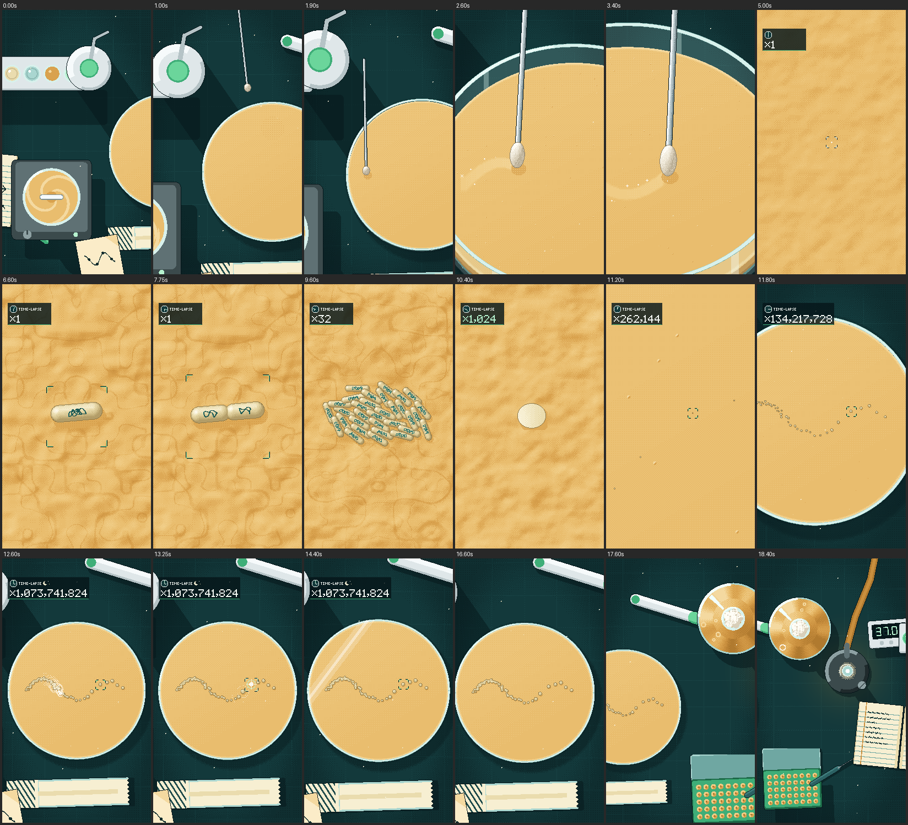

# How Bacterial Colonies Grow on Agar

A 20-second vertical science short in clean 2D 8-bit pixel art (1080×1920, 30 fps), with an original 120 BPM
chiptune, synced sound effects and the sounds of the lab bench. It loops seamlessly: the last frame runs straight
into the first, so on a phone it plays forever without a visible restart.

The whole film is **one continuous camera journey**, with no cuts and no transitions:
- it opens looking straight down at a lab bench, still panning past a magnetic stirrer, test tubes and a wash
  bottle, and stops over a fresh Petri dish; only then does the cotton swab come in from the top and touch down;
- the camera tilts down and rides beside the tip as it streaks an S across the agar;
- it dives into the swab's trail down to a single rod-shaped bacterium, and a target bracket locks onto it;
- the cell grows, copies its DNA, pinches in the middle and splits in two;
- the divisions speed up on the beat (2, 4, 8, 16 …) while the cells pile into a dome that pushes the camera back;
- the camera pulls out and tilts back up to look straight down: the dome is now one cream dot, and colonies pop up
  along the whole streak, crowded where it started and single dots where it ended;
- it slides off the finished culture and pans along the bench again, past a flask of broth, a Bunsen burner, a lab
  notebook, a 37.0 °C display and the stirrer, to the next fresh dish: the pan the film opened on.

The bench is a small world of its own: the burner's flame flickers and throws warm light, the stir bar spins a
vortex into the broth, the flask bubbles, LEDs blink, dust drifts in the air, and each of them is heard when the
camera passes it.

No title card, no subtitles, no voiceover. The only text is a tiny `TIME-LAPSE` tag and the cell counter
(×1 … ×1,073,741,824); `--clean` leaves both out.



## Ringkasan (Bahasa Indonesia)

Video 20 detik, vertikal 1080×1920, pixel art 8-bit, berulang tanpa sambungan (frame terakhir langsung
menyambung ke frame pertama). Seluruh video adalah **satu perjalanan kamera tanpa potongan dan tanpa transisi**.

1. **0–2 dtk.** Kamera melihat lurus dari atas ke meja lab dan masih bergeser: magnetic stirrer dengan pusaran,
   rak tabung reaksi, botol semprot. Kamera berhenti di atas cawan petri baru, **baru kemudian kapas (swab) masuk**
   dari atas dan mendarat.
2. **2–4 dtk.** Kamera memiring turun dan ikut berlari di samping ujung kapas yang menggores agar membentuk garis S.
   Jejak basah dan kilau kecil jatuh dari serat kapas.
3. **4–6 dtk.** Swab terangkat. Kamera menyelam ke jejak goresan sampai ukuran sel; satu bakteri berbentuk batang
   dikunci oleh bracket target (×1).
4. **6–8 dtk.** Satu sel menjadi dua: sel memanjang, DNA-nya disalin ke kedua ujung, bagian tengah menyempit, lalu
   terbelah (×2). Jam kecil dan label TIME-LAPSE muncul.
5. **8–12 dtk.** Pembelahan makin cepat mengikuti ketukan (2, 4, 8, 16 …). Sel menumpuk jadi kubah dan "mendorong"
   kamera mundur; kamera mundur dan memiring sampai melihat lurus dari atas. Penghitung berhenti di ×1.073.741.824
   (sekitar 30 kali membelah ≈ semalam pada 37 °C), jam berhenti, bulan muncul.
6. **12–14 dtk.** Koloni muncul berurutan sepanjang jalur goresan: rapat di awal goresan, titik-titik terpisah di
   akhir. Koloni kita berkilau.
7. **14–16 dtk.** Diam sejenak di atas biakan; kilau cahaya menyapu cawan.
8. **16–20 dtk.** **Dari biakan agar, kamera bergeser lagi** sepanjang meja lab (world building): labu berisi kaldu
   yang bergelembung, pembakar Bunsen dengan api berkedip dan cahaya hangat, buku catatan lab dengan coretan sel,
   layar 37.0 °C, rak tabung, stirrer. Pergeseran ini tersambung langsung ke awal video: loop tanpa potongan.

Meja lab dibuat hidup: api Bunsen berkedip, batang pengaduk berputar membuat pusaran, labu bergelembung, lampu LED
berkedip, debu melayang, dan suara tiap alat terdengar saat kamera melewatinya.

Akurasi: bakteri tumbuh **di permukaan** agar; koloni baru terlihat setelah lama (bukan langsung); tidak ada zona
bening (halo) di sekitar koloni; warna agar tidak berubah (jejak basah dari kapas mengering dalam dua detik).

## Render it yourself (copy-paste)

Needs Python 3.9+, numpy, Pillow and ffmpeg (on PATH, or `pip install imageio-ffmpeg` and it is found
automatically).

```bash
cd bacteria-colony-animation
python3 -m pip install -r requirements.txt

python3 render.py                    # the film      -> out/colony.mp4        (1080x1920, 30 fps, stereo, 20 s)
python3 render.py --preview          # quick check   -> out/preview.mp4       (540x960)
python3 render.py --loops 3          # 60 s upload   -> out/colony_x3.mp4     (three loops back to back)
python3 render.py --clean            # no text       -> out/colony_clean.mp4  (no counter, clock or bracket)
python3 render.py --stills 0,3,6.6,13.25          # full-size PNG frames -> out/stills/
python3 render.py --sheet 0:20:1     # contact sheet of the canvas -> out/sheet.png
python3 render.py --from 6 --to 12 --out out/slice.mp4               # just a slice
python3 render.py --audio-only       # soundtrack    -> out/music.wav, out/sfx.wav, out/mix.wav
python3 render.py --assets           # key frames, a fission sprite sheet, audio stems -> assets/
```

The full render takes about half a minute on 4 CPU cores (`--jobs N` sets the number of worker processes). The
first run also runs the small cell-growth model once (about 8 s) and caches it in `out/cache/`.

## The camera journey (120 BPM, one bar = 2 s, 10 bars)

| time | what you see | camera |
|---|---|---|
| 0–1.6 | the end of the pan along the bench: stirrer, test tubes, wash bottle; the fresh dish slides in | straight down, easing to a stop over the dish |
| 0.45–2 | the cotton swab comes in from the top, its shadow closing in, and touches down at 2.0 | still |
| 2–3.6 | the tip streaks an S across the agar; a wet trail behind it, glints drop from the fibres and blink out | tilts down to 52° and zooms in, rides beside the tip |
| 3.6–6.5 | the swab lifts away; the cells left in the trail twinkle; the bracket locks onto ours at 4.95 | dives from 7 px/mm to 36 px/µm, tilts to 62° |
| 6–8 | one cell grows from 2 to 4 µm, copies its DNA, pinches and splits at 8.0 | holds, a slow push |
| 8–9.9 | divisions on the beat: 8.5, 9.0, then eighths and sixteenths; 256 single cells, then a dome of packed cells | pulls back as the pile grows (the colony stays about 80 px wide) |
| 9.9–12.5 | the dome shrinks to one cream dot; the other colonies appear along the streak and swell with ours as the last doublings run on thirty-seconds; the counter reaches ×1,073,741,824 at 11.94 and the clock stops; the dish and the bench come into view | pulls out (fast among the cells, gently onto the dish) and tilts back to straight down |
| 12–13.6 | colonies pop along the streak, start to end; ours glints at 13.2 | settles onto the whole dish by 12.5 |
| 13.6–16 | a light sweep across the plate (14.0); the counter goes away (15.6) | a very slow push |
| 16–20 | the bench: marker, tip box, flask of broth, Bunsen burner, loop, notebook, 37.0 display, test-tube rack, stirrer | slides off the culture and pans along the bench, pulling back a little on the way (on to 1.6 of the next loop) |

How the loop works: the bench is a strip that repeats every 320 mm, one dish and one set of props per stretch, and
every dish runs the same story on its own clock (`tau = t - 20 n`). At t = 20 the camera is exactly one stretch
further along than at t = 0 and the next dish is exactly where this one was, so frame 600 would be frame 0 moved
by one stretch. Every animation on the bench (flame, stir bar, vortex, bubbles, LEDs, dust) runs a whole number of
cycles in 20 s. The sound runs on buses exactly 20 s long, so echoes and the bench sounds wrap across the loop
point.

## The science shown

- **Streaking.** The swab drags cells across the gel. Most come off at the start of the streak, fewer and fewer
  along it, so the start grows into a crowded band and the end into single, separate colonies.
- **One cell → one colony.** Our colony grows from the one cell the bracket locks onto: every cell in it is a copy
  of that cell (a clone).
- **Binary fission.** The rod grows longer, copies its DNA (the nucleoid, drawn as a teal squiggle), the two
  copies move to each end, a wall forms across the middle (the septum) and the cell splits into two identical
  daughters.
- **Doubling.** E. coli in rich medium at 37 °C can double about every 20 minutes. Thirty doublings (about 10 hours,
  overnight) turn one cell into 2^30 = 1,073,741,824 cells: a cream colony about 2 mm across. The clock in the
  corner moves 20 minutes per division, from 6 pm to 4 am.
- **On the surface.** The cells sit and grow on top of the gel and feed on nutrients from below; they do not sink
  into it. The colony is a low, glossy dome.
- **Visible over time.** A colony only becomes visible to the eye after many hours. The film shows the cells at
  their own scale while they are few and only shows the dot once the camera is back at dish scale.
- **No halo, no colour change.** There is no clear zone around the colonies (that would mean an antibiotic or
  blood being broken down) and the agar keeps its colour. The wet trail behind the swab is moisture that dries
  within two seconds.
- **Simplified on purpose.** Time is compressed (a night in about 6 s), the divisions get faster only because the
  time-lapse speeds up, and the cells split together on the beat; real cells split one by one. Colours are
  stylised (cells and colonies cream, the gel pale amber).

## Format and style

- 270×480 canvas, every frame scaled exactly 4× (nearest neighbour) to 1080×1920. H.264 (yuv420p, BT.709, CRF 16),
  AAC 256 kb/s 48 kHz stereo.
- Clean 2D 8-bit pixel art: 1-px outlines, flat pixel-cluster shading with ordered (Bayer) dither, no
  anti-aliasing. The camera is orthographic (2D pixel art has no perspective) and can look from a low angle to
  straight down. The Bayer pattern is pinned to the dish (or, at cell size, to our cell) and the camera snaps to
  whole pixels there, so the world and its dither scroll together like a pixel-art game.
- Palette: dark teal lab `#0E2A2C`, pale amber agar `#E9BD6E`, cream colonies `#EADCAE`, swab white `#FFFDF6`, one
  mint accent `#6BD59B` for the bracket, the counter and the lab plastics; a cool steel ramp for the hardware. All
  ramps are in `engine/palette.py`.
- Everything is drawn at the scale the camera reaches: the bench and its props (`engine/props.py`), the dish, the
  agar, the swab, single cells (a small physical model of 8 doublings, `engine/cells.py`), the packed cells on the
  dome, and the colonies. Finer textures fade in as the camera gets closer, so the pans, the dive and the pull-out
  are one continuous move.

## The lab bench

Each prop is drawn per pixel in its own coordinates (so it pans and zooms with the world) and casts a shadow on the
bench toward the front right, like the dishes: the empty swab packet and a marker next to the dish, a pipette-tip
box (lid open), an Erlenmeyer flask of broth with a cotton plug (bubbling), a Bunsen burner (flickering flame, a
warm pool of light), an inoculating loop, an open lab notebook (notes, a rod cell dividing, the streak plan, a pen),
a 37.0 °C display (its heater light blinks), a test-tube rack, a magnetic stirrer with a beaker of broth (spinning
stir bar, vortex, blinking LED), a wash bottle and a sticky note with the streak plan. Dust motes drift above it all
on a parallax layer.

## Sound

Original, synthesized from code (`engine/synth.py`): square-wave lead, triangle bass, noise drums, FM bells.
Chords per bar: C | Am | F | F | G | Am G | C | Am F | F | G. The last bar (G) is a pickup into the first (C), under
the pan.

- 0–2: the groove is already going under the pan; a whoosh as the swab comes in, a soft landing at 2.0.
- 2–4: the hook melody, racing bass and hats; the swab's soft "shff" (slow at first, then dragging at full speed), a
  glassy tink for every glint that blinks out.
- 4–6: a riser into the dive, two scan beeps and a click-beep when the bracket locks on, a falling glide and little
  bubbles on the way down.
- 6–8: a slow stretch tone, blip pairs while the DNA is copied, a squeeze while the cell pinches, a tick and a pop on
  the split.
- 8–12: one tick per division, climbing the scale, then a roll on the thirty-seconds; drums build underneath; a
  riser; a chime when the clock stops, a sixteenth before the drop.
- 12–13.6: the drop (a bright chord, a boom, a crash), then a pop for every sixteenth that has colonies popping in
  it, the pitch climbing along the streak; a sparkle for ours.
- 14–16: a shimmer with the light sweep, a soft blip when the counter goes.
- 16–20 (and 0–2): the bench, heard where it is seen: the Bunsen burner's roar breathing with the flame, the
  stirrer's hum and whirr, a bloop for every bubble that pops in the flask, a tick each second from the 37.0
  display, and a quiet room. Each swells and pans as the camera passes it.

Mastered to −14 LUFS with a −1 dBTP ceiling; the limiter runs round the loop too, so there is no click at the loop
point.

## Files

```
bacteria-colony-animation/
  render.py            the CLI (film, preview, loops, stills, contact sheets, slices, audio, assets)
  镜头表.md             shot list (huashu-art-motion format)
  engine/
    timeline.py        clocks, the dish, the streak, the seeds, the growth curve, the swab path, the camera,
                       where the dither is pinned
    world.py           bench, dishes, agar, wet trail, colonies, glints, cell markers, swab, near wall
    props.py           the lab bench: props, their shadows, the burner's light, dust motes
    micro.py           the gel close up, single cells with DNA, packed cells on the dome
    cells.py           the small physical model of the first 8 doublings (cached in out/cache/)
    hud.py             target bracket, counter, time-lapse clock, pop rings, sparkle, light sweep
    scene.py           one frame: passes in depth order, then the 4x upscale
    audio.py           music, effects and bench sounds on loop-length buses, mastering
    synth.py, gfx.py, pixfont.py, palette.py
  docs/storyboard.png  key frames
  assets/sprites/      key frames and a sprite sheet of one cell dividing (python3 render.py --assets)
```

## Checks run on this project

- Shot list: `storyboard_lint.py 镜头表.md` (huashu-art-motion): 8 shots, all green.
- Film gate: `film_gate.py out/colony.mp4 --no-template`: passed. 1 shot, 0 hard cuts, 0 fades, 45 % fast-motion
  frames, no empty frames, no blue-violet background. (The pull-out was reshaped for this: its fast part happens
  among the cells, and the dish and the bench arrive over the last second.)
- Loop seam: in the final MP4 the change from the last frame to the first (15.4 mean absolute difference on the
  canvas, mid-pan) is the size of the frame steps next to it (13.0 and 15.6); the camera at t = 20 is the camera at
  t = 0 moved by exactly one stretch of bench.
- Audio seam: the step from the last sample to the first (0.134) is below the 99th percentile of all steps (0.139).
  Loudness −14.1 LUFS, true peak −1.3 dBTP.
- No jumps: frame-to-frame differences have no spikes except the counter blinking out at 15.35–15.6 (intended) and
  two whole-picture 1-px scroll steps where the pans start and end slowly (1.37 s, 16.2 s), checked to be pure
  shifts.
- Determinism: the same frame rendered twice is byte-identical.
- Legibility: the counter's digits are 56 px tall in the 1080×1920 video.
