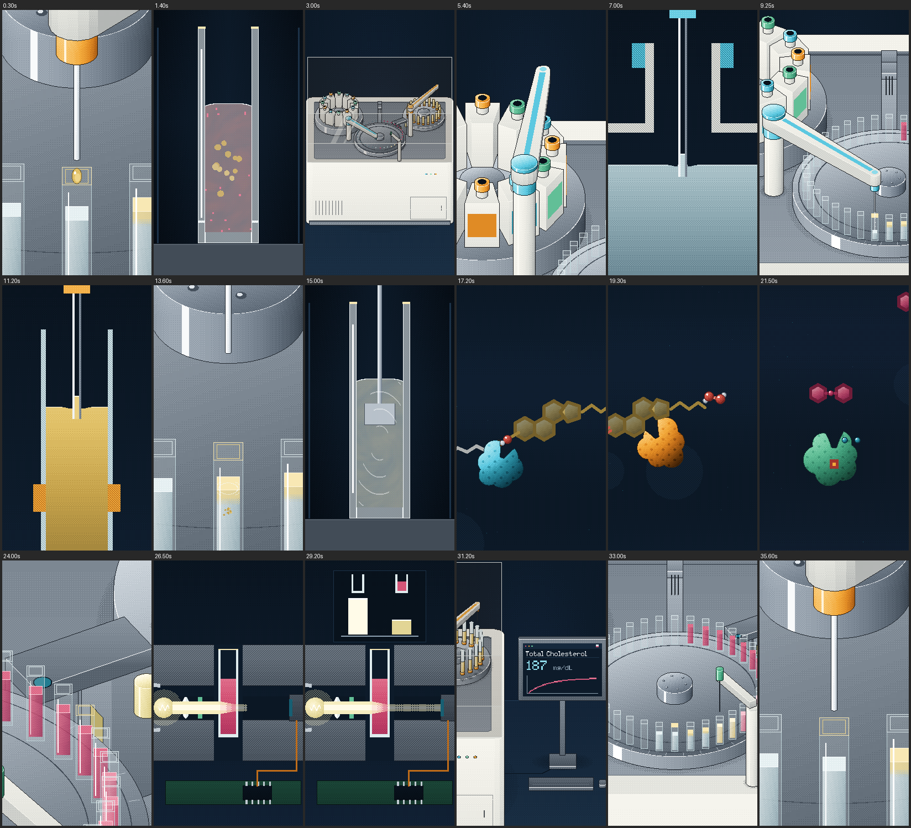

# How a Biochemistry Analyzer Measures Cholesterol

A 36-second looping, vertical medical-science short in 8-bit/16-bit pixel-art lab-game style, with an original
120 BPM chiptune (18 bars) and synced sound effects. It follows one serum sample through one total cholesterol test:
- reagent and serum are pipetted into a cuvette on the reaction ring;
- the cuvette is stirred;
- three enzymes turn cholesterol into a rose dye;
- light through the cuvette is measured;
- the workstation shows the result.

The last frame leads straight into the first, so the video loops without a visible seam.

There is no title card, narration or subtitles. The only text in the film is on the workstation screen
("Total Cholesterol" and one illustrative value in mg/dL).



## Ringkasan (Bahasa Indonesia)

**Isi video (36 detik, berulang/loop tanpa sambungan terlihat):**

1. **0–4 dtk (cuplikan).** Setetes serum kuning pucat jatuh dari ujung pipet ke kuvet ("plip" di 0,375 dtk). Kamera
   ikut turun ke dalam kuvet (potongan samping) dan warnanya berubah menjadi merah muda. Kamera lalu mundur dan
   memperlihatkan seluruh alat. *Match cut* kembali ke kuvet yang sama, masih kosong.
2. **4–14 dtk (urutan kerja).**
   - Baki reagen berputar satu posisi. Lengan reagen (aksen **teal**) menyedot reagen dari botol dan mengisinya ke
     kuvet.
   - Lengan sampel (aksen **amber**) menyedot serum dari tabung, lalu kembali ke komposisi pembuka. Detik 13,25
     memotong tepat setelah tetesan mendarat.
3. **14–23 dtk (reaksi).** Pengaduk mencampur serum dan reagen. Kamera masuk ke tingkat molekul:
   - kolesterol esterase memutus ester kolesterol;
   - kolesterol oksidase menghasilkan hidrogen peroksida (H₂O₂);
   - peroksidase memakai H₂O₂ untuk membentuk zat warna merah muda.
4. **23–30 dtk (pengukuran).** Cincin reaksi membawa kuvet ke unit optik. Sinar dari lampu melewati cairan merah
   muda, dan sinar yang lebih lemah sampai ke detektor. Detektor mengirim satu pulsa ke elektronik, lalu cahaya
   referensi dibandingkan dengan cahaya terukur.
5. **30–36 dtk (hasil dan loop).**
   - Layar workstation menampilkan "Total Cholesterol 187 mg/dL" (angka ilustrasi, bunyi "ding" dua nada).
   - Kuvet baru maju ke posisi sampel. Pipet kembali ke komposisi pembuka, jadi video bisa diputar berulang.

**Cara render (salin-tempel):** lihat bagian berikut. Video akhir tidak dirender di sini; kamu render sendiri.

## Render it yourself (copy-paste)

Working directory: the `biochemistry-analyzer-animation` folder of this repository (branch `claude/tes-45y4ej`).
Needs Python 3.9 or newer. ffmpeg is installed by `pip` (imageio-ffmpeg); a system ffmpeg on PATH is used first if
you have one.

```bash
git clone -b claude/tes-45y4ej https://github.com/Pudidil-dev/belajar-python.git
cd belajar-python/biochemistry-analyzer-animation
pip install -r requirements.txt
python render.py --preview
python render.py
```

- `python render.py --preview` makes a quick half-size check: `output/preview.mp4` (540×960, takes under a minute on 4
  cores).
- `python render.py` makes the film:

  `belajar-python/biochemistry-analyzer-animation/output/How_a_Biochemistry_Analyzer_Measures_Cholesterol.mp4`

  This is H.264 1080×1920, 30 fps, 36.000 s, with AAC 48 kHz stereo audio. It takes a few minutes, using all CPU cores.

Already have the repository? Use these commands instead of the clone:

```bash
cd belajar-python
git fetch origin claude/tes-45y4ej
git checkout claude/tes-45y4ej
git pull origin claude/tes-45y4ej
cd biochemistry-analyzer-animation
```

On Windows, write `py` instead of `python` if `python` is not found. On some Linux and macOS systems the commands are
`python3` and `pip3`.

More options:

```bash
python render.py --stills 0,13.5,31.2        # full-size PNG frames -> output/stills/
python render.py --sheet 0:36:2 --cols 6     # contact sheet -> output/sheet.png
python render.py --from 8 --to 15 --out output/slice.mp4   # just a slice (8-15 s)
python render.py --audio-only                # soundtrack only -> output/music.wav, sfx.wav, mix.wav
python render.py --scale 8                   # 2160x3840 (4K vertical) instead of 1080x1920
python render.py --crf 18 --preset slow      # encoder settings (defaults: crf 16, preset medium)
```

## What the film shows

### The analyzer

The machine is a 2D pixel drawing in 3/4 top-down view, made to look like a 3D pixel model (like the centrifuge
film). Every part is drawn in 2D: cylinders, boxes and wedges with dithered shading, 1-px outlines, bright top-front
edges and contact shadows.

It is a compact benchtop clinical chemistry analyzer in the spirit of the one described in the brief (CA-310 class).
It has an off-white body, a smoky lid and two circular trays:
- reagent bottles on the left (wide wedge bottles with coloured caps);
- sample tubes on the right (tall round tubes with pale-gold serum).

The two pipette arms have different accent colours:
- the **teal** reagent arm works between the reagent tray and the reagent position of the ring;
- the **amber** sample arm works between the sample tray and the sample position of the ring.

The **reaction ring** in the middle holds 36 small square cuvettes. Around it sit the stirrer, the optical unit (lamp
housing outside the ring, detector inside) and a wash station. The workstation stands beside the analyzer on the bench.

The layout shows a representative workflow. It is not a service diagram of any real model. There are no logos or brand
marks.

The hero cuvette has a subtle pale-gold rim highlight in every view. At 32.4 s the highlight passes to the fresh
cuvette at the sample position: this is the cuvette the opening drop falls into when the loop starts again.

### The chemistry (enzymatic total cholesterol method)

1. **Cholesterol esterase** splits cholesteryl esters (cholesterol with a fatty acid attached) into free cholesterol
   and the fatty acid. Total cholesterol therefore counts both forms.
2. **Cholesterol oxidase** oxidises free cholesterol with oxygen and releases **hydrogen peroxide** (H₂O₂).
3. **Peroxidase** uses the hydrogen peroxide to join two small dye precursors into a **rose (red-pink) dye**.

More cholesterol gives more peroxide, and more peroxide gives more dye.

### The measurement

Light passes through the coloured mixture, and the dye absorbs part of it, so a weaker beam reaches the detector. The
analyzer compares the measured light with a reference light level. This gives the absorbance, and a calibration turns
the absorbance into a concentration. The film shows this as:
- one detector pulse;
- two bars: reference vs measured light;
- one data packet that travels to the workstation.

### What is simplified or illustrative (on purpose)

- **187 mg/dL is an illustrative number.** It is not a patient result. There is no patient information, no diagnosis
  and no healthy/unhealthy badge.
- No volumes, incubation times, temperatures or wavelengths are shown. These depend on the analyzer and the reagent kit.
- The sample is **serum** (pale gold), not whole blood.
- The serum drop is drawn much bigger than it is. Until the stirrer runs, the sample sits as a thin gold layer on top
  of the reagent. The intermediate colours (reagent light blue, mixed pale gold) are chosen for readability. The rose
  colour of the dye is the real cue.
- Molecules are simple icons: steroid rings, enzymes as lumpy shapes with a groove, and peroxide and oxygen as atom
  beads. They are not to scale and have no faces.
- The light beam is a teaching overlay (the real beam is not visible). The optical path is reduced to lamp → lens →
  filter → cuvette → detector.
- The workflow is shortened to one test. Real analyzers run many tests in parallel, read each cuvette several times
  and use calibrators and controls.

## Shot by shot (120 BPM, one bar = 2 s)

| Time (s) | Beat | What happens |
|---|---|---|
| 0–0.65 | 01 drop | Macro: the amber sample probe tip, the hero cuvette rim and its neighbours. A pale-gold drop stretches, detaches and lands with a pixel ripple ("plip" at 0.375). |
| 0.65–2.1 | 02 colour preview | The camera follows the drop down; the cuvette wall becomes a side cutaway; time-lapse from nearly clear to rose. |
| 2.1–4 | 03 reveal | Pull back through the rim to the whole analyzer at work; match cut (3.85) back to the same cuvette, still empty. |
| 4–6 | 04 reagent tray | Track across the deck; the reagent tray indexes one position (servo whirr, clack at 5.5). |
| 6–8 | 05 draw reagent | The teal probe lowers into a bottle; cutaway of the bottle neck: reagent rises in the tip. |
| 8–10 | 06 fill cuvette | The arm swings to the ring (bottle behind, cuvette in front) and dispenses reagent. |
| 10–12 | 07 draw serum | Pan to the amber sample arm; its tip lowers into a serum tube; cutaway: a small volume is drawn. |
| 12–14 | 08 rejoin | The arm swings back to the opening composition; match cut (13.25) lands just after the drop; the probe retracts. |
| 14–16 | 09 mix | Side cutaway: the stirrer paddle lowers, turns (short flutter) and blends serum and reagent. |
| 16–18 | 10 esterase | Zoom through the wall: esterase snaps the ester; free cholesterol (combo sound 1). |
| 18–20.5 | 11 oxidase | Oxidase + O₂ act on cholesterol and release H₂O₂ (combo sound 2). |
| 20.5–23 | 12 peroxidase | Peroxidase uses H₂O₂ to make the rose dye; dye accumulates (combo sound 3); pull out to the cuvette, which develops colour. |
| 23–25.5 | 13 optical station | The ring indexes the hero into the optical unit; dither dissolve into the optics cutaway: lamp, lens, filter, cuvette, detector. |
| 25.5–28 | 14 beam | The lamp clicks on; a bright beam enters the rose mixture and a weaker, thinner beam reaches the detector (music thins out). |
| 28–30 | 15 detector | One dry bip and one pulse to the electronics; the reference vs measured light levels; a data packet leaves. |
| 30–32 | 16 result | The camera finds the workstation: "Total Cholesterol 187 mg/dL" (two-note ding at 30.75). |
| 32–34 | 17 next cuvette | Back at the ring: the fresh cuvette takes the sample position and the highlight; finished rose cuvettes move on. |
| 34–36 | 18 loop | The sample arm returns; the camera pushes into the opening composition; the drop starts to form (carousel click at 35.75 leads into the opening plip). |

## Sound

The music and sound effects are original: an F major chiptune at 120 BPM in 4/4, 18 bars = exactly 36 s. It uses
pulse leads, a triangle bass and noise drums.

**Music.**
- A pocket of silence before the plip.
- A bouncy lab-game groove for the workflow.
- A molecular section (bars 8–11) with a thinner lead, a higher arpeggio and long bass notes.
- A thinned-out bed during the measurement, so the dry detector bip stands alone.

**Sound effects.**
- The plip.
- Servo whirrs and clacks for the trays and the ring.
- Slurps (aspiration) and a pour (dispense).
- A short stirrer flutter.
- Three related molecular combo sounds that rise in pitch (snap → pop → bell chord).
- The lamp click and the beam tone.
- The detector bip, comparison blips and the packet whoosh.
- The two-note reward ding.
- A carousel click that leads into the first beat.

The soundtrack is built on a circular bus: reverb and echo tails wrap around the loop point, so the loop has no gap
or click. It is mastered to −14 LUFS integrated with a true-peak ceiling around −1 dBTP.

## Format and style

- 270×480 pixel canvas, scaled exactly 4× (nearest neighbour) to 1080×1920; 30 fps; 36.000 s; H.264 (yuv420p) + AAC
  256 kb/s stereo.
- 16-bit lab-game look with chunky 8-bit silhouettes, Bayer dither, 1-px outlines and a dark navy background.
- Each scale has its own artwork, redrawn at its own zoom rather than enlarged pixels:
  - wide and medium analyzer shots;
  - the macro drop;
  - the side cutaways;
  - the molecular scene;
  - the optics cutaway;
  - the screen.
- Palette:
  - navy background;
  - off-white machine body;
  - pale-gold serum #E0C067;
  - light-teal reagent;
  - rose dye #D45577;
  - teal (#5CC8E0) and amber (#F2A93B) arm accents.
- Transitions: tracking moves, zooms, SNES-style dither dissolves and two match cuts (3.85 s and 13.25 s).

## Files

| File | What it is |
|---|---|
| `render.py` | Command line: film, preview, stills, contact sheet, slices, audio only. |
| `requirements.txt` | numpy, Pillow, imageio-ffmpeg. |
| `镜头表.md` | The shot list (huashu-art-motion workflow) with style lock and lint notes. |
| `docs/storyboard.png` | One frame per beat. |
| `engine/timeline.py` | The clock: 120 BPM grid, every event time, ring positions, arm and tray motion, cuvette states. |
| `engine/analyzer.py` | The analyzer, drawn in 2D 3/4 view (trays, bottles, tubes, ring, cuvettes, arms, stirrer, optics, wash, workstation, lid). |
| `engine/shots.py` | Camera keys for the analyzer shots (tracking, zooms, the two match-cut compositions). |
| `engine/macro.py` | The opening macro: drop forming, falling, ripples, plume, reagent stream. |
| `engine/cutaway.py` | Side cutaways: colour preview, reagent and serum aspiration, mixing, colour development. |
| `engine/molecules.py` | The molecular scene: esterase, oxidase, peroxidase, dye. |
| `engine/optics.py` | The optics cutaway: lamp, lens, filter, cuvette, beam, detector, pulse, comparison, data packet. |
| `engine/screen.py` | The workstation screen texture. |
| `engine/scenes.py` | Which artwork is on screen at each moment, and the transitions. |
| `engine/audio.py`, `engine/synth.py` | Music and sound effects (synthesized from code, no samples). |
| `engine/gfx.py`, `engine/view.py`, `engine/palette.py`, `engine/pixfont.py` | Pixel helpers, 2D camera, palette, pixel font. |
| `engine/analyzer3d.py`, `engine/w3d.py` | Not used by the film: an earlier 3D polygon version of the analyzer, kept as an optional reference. |

## Checks run on this project

- **Shot list lint** (`storyboard_lint.py`): yellow, with reasons in `镜头表.md`:
  - the short opening beats are the brief's own timing;
  - the 8 colours are separate colour roles the brief asks for.
- **Film gate** (`film_gate.py --no-template`) on a half-size preview: **pass**.
  - Fast-motion frames 39%; blue-purple frames 1.4%; no empty frames mid-film.
  - Yellow: about 22 push-ins per minute. This is the brief's structure: into the drop, the tip, the liquid, the
    molecules and the optics. Each push is followed by a pull-back or a pan.
- **Loop seam:** frame 0 and the last frame (35.967 s) differ only in the growing drop (0.1% of pixels). The image at
  35.9999 s is identical to frame 0. The soundtrack wraps around the same point.
- **Determinism:** the same frame rendered twice is identical.
- **Phone size:** at 360×640, the first frame reads clearly (probe, drop, highlighted cuvette). The two pipette paths
  are easy to tell apart: teal arm from the left tray, amber arm from the right tray.
- **Audio:** 36.000 s, 48 kHz stereo; −14.0 LUFS, true peak −1.15 dBTP.
  - The plip is about 9 dB above the pocket around it.
  - The detector bip is about 13 dB above the thinned music.
- **Preview streams:** H.264 540×960 30 fps + AAC 48 kHz stereo, both 36.000 s.
- **Fresh clone:** the commands above were run from a fresh clone in a clean virtual environment, rendering a short
  full-size slice.
- The final 1080×1920 MP4 was **not** rendered here, as asked.

## Sources

- Furuno CA-310 clinical chemistry analyzer:
  - product page: https://www.furuno.com/en/products/ClinicalChemistryAnalyzer/CA-310
  - IVD catalog: https://www.furuno.com/files/Brochure/IVD_general_catalog_en.pdf
  - news: https://www.furuno.com/en/newstopics/exhibition/1899

  These were found by web search; the pages themselves could not be opened from the build machine. No product photo
  was supplied, so the machine follows the brief's description.
- Enzymatic total cholesterol method: cholesterol esterase → cholesterol oxidase → peroxidase with a colour reaction
  (the standard enzymatic colorimetric principle described in reagent kit inserts).
