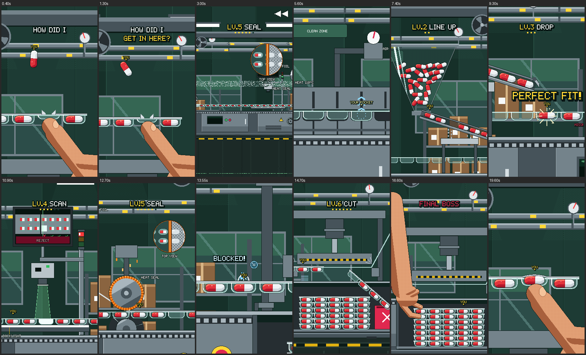

# How Pills Get Into Blister Packs

A 20-second looping, vertical "how it's made" short in 8-bit RPG pixel art, with a fun chiptune soundtrack and synced
arcade sound effects. It is built like a short-video hook: the payoff first, the question it raises, a rewind that
previews the whole line, six game levels, a final boss, and a loop that runs straight back into the first frame. There
is no narration: a hook question, a level banner per station, pop-up words and a few small labels.

a thumb pushes a capsule out of a blister card: POP! → the capsule hangs in mid-air: HOW DID I GET IN HERE? → the tape
rewinds the whole story along the machine → LV.1 POCKETS: the clear film is heated and air blows the pockets into
shape → LV.2 LINE UP: a hopper full of capsules, a vibrating lane, the hero (YOU) slides into line → LV.3 DROP: one
capsule per pocket, on the beat; one pocket goes by empty (MISS!); the hero lands in its own pocket (PERFECT FIT!) →
LV.4 SCAN: a line-scan camera over a backlight; the empty pocket glows, REJECT; the hero's card: PASS! → LV.5 SEAL: hot
foil rolled on, a diamond pattern, a water drop and an air bubble bounce off (BLOCKED!) → LV.6 CUT: the punch, the
rejected card blown into the bin, the hero's card on the stack → FINAL BOSS: a big hand takes the card, the thumb
presses... → POP!, and the film loops.



- **Format.** 1080×1920 (9:16 vertical), 30 fps, exactly 20.0 s (10 bars of 4/4 at 120 BPM), H.264 video with 48 kHz
  stereo AAC. The default export is **`out/blister-pack-animation.mp4`**, relative to this folder.
- **Look.** Every frame is drawn in code on a 270×480 canvas and scaled exactly 4× nearest-neighbour: chunky, crisp
  pixels, stepped 1-px outlines, flat colours and at most a checker or ordered dither. The machine is seen from the
  side like a side-scrolling game level, in a pharma factory drawn in parallax layers (a green panelled wall with lit
  windows, pipes with flow arrows, gauges and a clock; racks of cartons and a turning fan). Each colour has one job:
  - the hero's red-and-white capsule;
  - a white and stainless machine, aluminium greys for the foil, clear film with white glints;
  - orange only for heat, light blue only for air and water;
  - yellow game text, a UI green for PASS and a crimson for REJECT.
- **The hero.** One capsule, marked as the player by a yellow **YOU** tag (like a game's player indicator; no face).
  Its pocket gets a **YOUR POCKET** tag when it is blown, and the two tags meet when it lands.
- **Game feel.**
  - a level banner slides in for each station (LV.1 to LV.6, then FINAL BOSS), with a row of progress pips;
  - pop-up words on the beats (MISS!, PERFECT FIT!, PASS!, BLOCKED!, REJECT!);
  - small typed labels next to the parts (HEAT 110°C, AIR, BACKLIGHT, FOIL, HEAT SEAL, THUMB);
  - screen shakes and 8-bit impact stars on the pop, the hero's landing and the punches;
  - a live monitor: the cards scroll under the scan line and each pocket gets a tick or a cross;
  - a round top-view window that shows the foil's diamond pattern rolling out over the capsules.
- **Camera.** One continuous camera, no cuts:
  - close on the thumb, easing back as the capsule flies up and hangs there;
  - the rewind pulls far out, like a level map, and flies back along the whole line;
  - LV.1 pushes in on the mould; it rises to the hopper, drops to the gate, follows the web to the camera, the sealing
    roller and the punch, pushes in on the sealed pocket for the shield and pulls back out for the punch;
  - it follows the card up into the hand and pushes in to the thumb, which is where the film began.
  
  It scrolls in whole pixels, every move is eased, and long moves arc out a little so they stay readable.
- **Loop.** The last frame is the thumb pressing the dome as far as it goes; the first frame is the pop. The music's
  build-up ends on a silent 16th and resolves on the POP, and everything that rings past the end is folded back onto
  the start, so the sound loops too. `python render.py --loops 3` writes the loop three times back to back (60 s).

## Render it yourself

Working directory: **`belajar-python/blister-pack-animation`** (this folder). You need Python 3.9 or newer and git.
ffmpeg comes from the `imageio-ffmpeg` package in `requirements.txt`; a system ffmpeg on PATH is used if you have one.

Clone (skip if you already have the repo):

```bash
git clone -b ccr-90de552e-iir9tw https://github.com/Pudidil-dev/belajar-python.git
```

If you cloned it earlier, update it instead (run inside `belajar-python`):

```bash
git pull origin ccr-90de552e-iir9tw
```

Go to the project:

```bash
cd belajar-python/blister-pack-animation
```

Install the dependencies (numpy, Pillow, imageio-ffmpeg):

```bash
pip install -r requirements.txt
```

If pip refuses with an "externally-managed-environment" error, make a virtual environment first, then run the
`pip install` again:

```bash
python -m venv .venv
```

```bash
source .venv/bin/activate
```

(On Windows: `.venv\Scripts\activate`.)

Preview (540×960, fast encode, written to `out/blister-pack-animation-preview.mp4`):

```bash
python render.py --preview
```

Render the film (1080×1920, 30 fps, H.264 + stereo AAC):

```bash
python render.py
```

The film is written to **`out/blister-pack-animation.mp4`**. The music, effects and mix are written next to it as WAV
stems (`out/music.wav`, `out/sfx.wav`, `out/mix.wav`). On a 4-core machine the full render takes about 20 seconds.
With [uv](https://docs.astral.sh/uv/) instead of pip, no install step is needed:

```bash
uv run --no-project --with numpy --with pillow --with imageio-ffmpeg python render.py
```

On Windows, use `py render.py` if `python` is not on PATH.

**Options**

| Command | What it does |
|---|---|
| `python render.py --sheet 0:20:1` | one contact sheet of the whole film in `out/sheet.png` (start:end:step, seconds) |
| `python render.py --stills 0.3,9.3,14.8` | full-size PNG frames in `out/stills/` |
| `python render.py --from 8 --to 12` | only a slice of the film |
| `python render.py --fps 60` | 60 fps |
| `python render.py --scale 8` | 2160×3840 (4K vertical) |
| `python render.py --loops 3` | also `out/blister-pack-animation-loop3x.mp4`: the seamless loop played 3 times (any N) |
| `python render.py --audio-only` | only the soundtrack (music, effects, mix) |
| `python render.py --sprites` | export the sprites to `assets/sprites/` (see below) |
| `python render.py --no-audio` | the picture without sound |
| `python render.py --out PATH` | a different output file (or folder, for stills, sprites and audio) |
| `python render.py --jobs 2` | fewer CPU cores (the default uses all) |

### Render configuration

`render.json` holds the defaults; command-line flags override them.

| Key | Default | Meaning |
|---|---|---|
| `output` | `out/blister-pack-animation.mp4` | where `python render.py` writes the film |
| `fps` | `30` | frame rate |
| `scale` | `4` | pixel size: the 270×480 canvas × 4 = 1080×1920 |
| `crf`, `preset`, `tune` | `16`, `medium`, `animation` | x264 quality, speed and tuning |
| `audio_bitrate` | `256k` | AAC bitrate |
| `loudness_lufs` | `-14.0` | integrated loudness of the mix (true peak is kept below −1 dBTP) |
| `preview` | 2× scale, `veryfast`, crf 20 | the `--preview` settings and output path |
| `sprites` | `assets/sprites` | where `--sprites` writes the PNGs |

## The film, beat by beat

120 BPM: a bar is 2 s. Every sound effect is timed from `engine/timeline.py`, the same clock that drives the picture.

| Time | Picture | On screen | Sound |
|---|---|---|---|
| 0–2 | **The hook.** Close on a thumb under a blister card. The foil bursts (impact star, screen shake) and the capsule shoots out spinning, then hangs in mid-air as time nearly stops. | YOU · HOW DID I / GET IN HERE? | the POP on the downbeat with a crash, a record scratch as time freezes, a three-note question, a ticking clock, the rewind cue |
| 2–4 | **The rewind.** The camera pulls far out, like a level map, and flies back along the line while the whole story runs backward: the capsule drops back into its pocket, the card goes back onto the stack and into the web, the foil peels off, the capsules hop back up into the feeder, the pockets go flat. | the rewind icon | the whole mix played backward at tape speed, a tape whir |
| 4–6 | **LV.1 POCKETS.** The clear film softens between hot plates, the mould clamps down, and air blows the hero's card into shape, pocket by pocket. | LV.1 POCKETS · HEAT 110°C · AIR · YOUR POCKET | the quest theme starts; a clamp clunk; five air puffs that climb a C major chord; a chime for YOUR POCKET |
| 6–8 | **LV.2 LINE UP.** A clear hopper full of capsules sits over a vibrating lane that lines them up in single file. The hero slides out of the pile into line; there is an empty slot further ahead. | LV.2 LINE UP · YOU | the lane buzzes in the key; the queue clicks forward |
| 8–10 | **LV.3 DROP.** At the end of the lane, a gate lets one capsule drop into each passing pocket, on the beat. The empty slot reaches the gate and one pocket goes by empty. The hero drops into its own pocket. | LV.3 DROP · MISS! · YOUR POCKET · PERFECT FIT! | a music-box arpeggio, one note per capsule; a bonk for the empty pocket; the top note and a pick-up chime for the hero |
| 10–12 | **LV.4 SCAN.** The web runs under a line-scan camera, one pocket per 16th note, over a backlight. The empty pocket glows (the light shines straight through it); the monitor crosses it out, REJECT, and the stack light turns red. The hero's card gets five ticks: PASS. | LV.4 SCAN · BACKLIGHT · REJECT · PASS! | scanner beeps over a tense Dm–E bar, a buzzer, a PASS chime |
| 12–14 | **LV.5 SEAL.** Aluminium foil comes off its reel and a hot, ridged roller presses it onto the film. A round top-view window shows the diamond pattern rolling out over the capsules. Up close, a water drop and an air bubble bounce off the sealed foil. | LV.5 SEAL · FOIL · HEAT SEAL · TOP VIEW · BLOCKED! | a sizzle and crackle, two shield tinks |
| 14–16 | **LV.6 CUT.** The punch slams down: the card with the empty pocket is cut out and an air jet blasts it into the red bin. Then the hero's card is cut and drops onto the stack. | LV.6 CUT · REJECT! | the two punches are the band's stop-time hits; an air blast, a clang, a clack |
| 16–18 | **FINAL BOSS.** A big hand comes down, takes the hero's card off the stack and lifts it. | FINAL BOSS | a boss chord and a gong, a minor-key riff, whooshes |
| 18–20 | **The press.** A thumb comes up under the hero's pocket and presses: the dome dents and the foil bulges. The next frame is the first one: POP. | THUMB | a creaking strain and a snare roll that keeps speeding up, a silent last 16th, then the POP |

## The science (as drawn)

- **Forming.** The pockets are made on the machine from flat, clear PVC film. The film is softened between heated
  plates (one machine maker gives about 105–110 °C for standard 0.25 mm PVC) and blown into a mould by compressed air
  (4–8 bar), which shapes the cavities. The film shows this as LV.1, one pocket per beat.
- **Filling.** Capsules from a hopper are lined up and fed into the pockets. The film uses one vibrating lane with a
  gate that drops one capsule per pocket.
- **Inspection.** A camera checks every pocket before sealing. With a backlight under the clear film, an empty pocket
  shows up bright, because the light passes straight through it. A card with a missing (or broken, or wrong) tablet
  is rejected, and the film shows it blown off the line into a bin.
- **Sealing.** Aluminium lidding foil, coated on one side with a heat-seal lacquer, is pressed onto the film with
  heat and pressure. The sealing tool's pattern (here a diamond knurl) is pressed into the foil around the pockets.
- **Cutting.** A punch cuts the finished cards out of the web; the leftover web is wound up as scrap.
- **Push-through.** The foil is meant to break under thumb pressure: you push the dome and the capsule comes out
  through the foil.
- **Simplified on purpose.**
  - The machine is seen from the side, so only one row of pockets shows; the monitor's top view shows the card's two
    rows.
  - Sizes and distances are compressed: the capsules and pockets are drawn larger than real against the machine.
  - The web's motion is choreographed: it stops, starts and changes speed wherever the story needs it. Real machines
    run at a steady rhythm, either stepping (flat-plate) or continuously (rotary).
  - A real mould blows a whole card's pockets at once, and real feeders fill many pockets at once; here it happens
    one pocket per beat, so it can be seen and heard.
  - The empty pocket comes from a gap in the queue. Missed feeds happen for several reasons; the point is that the
    camera catches it.
  - The shield is a game picture of a real job: a blister keeps each dose sealed until it is used. The foil is a very
    good barrier; how well the clear plastic side keeps moisture out depends on the film, and moisture-sensitive drugs
    are packed in coated films or in aluminium on both sides. BLOCKED! is a simplification.
  - The heater label (110 °C) is the setting quoted above for one material; the sealing temperature depends on the
    materials, so the film shows heat there without a number.
  - In real life the capsule drops into your hand; in the film it shoots up, for fun. The rewind un-makes the pack,
    which cannot happen either.

Sources checked (through web-search summaries in this session; the pages themselves were not opened):
- Jornen: [Working principle of DPP series blister machines](https://www.jornen.com/?p=1350) (film feeding,
  heating, forming, filling, sealing, coding, punching)
- Jornen: [Pharmaceutical blister packaging principles and materials](https://www.jornen.com/?p=760) (heating plates;
  positive air pressure of 4–8 bar against a forming mould; lidding foil with a heat-seal coating)
- Jornen: [Thermoforming heating mechanism of the DPP260](https://www.jornen.com/?p=1358) (105–110 °C for standard
  0.25 mm PVC)
- Jornen: [Vision inspection tracking and automated rejection](https://www.jornen.com/?p=2361) (with a backlight, an
  empty pocket lets the light through and is flagged)
- PharmaNow: [Blister packaging in pharmaceuticals: a comprehensive guide](https://www.pharmanow.live/editors-choice/blister-packaging-in-pharma-a-complete-guide)
- US patent 12,545,465: [Inspection system for a blister machine](https://image-ppubs.uspto.gov/dirsearch-public/print/downloadPdf/12545465)
  (a blister pack with an empty pocket is rejected)
- Packaging Digest: [Doubling up on blister assurance](https://www.packagingdigest.com/packaging-design/doubling-up-on-blister-assurance)
  (a missing or broken tablet triggers ejection)

## How it is made

- **Picture** (`engine/`). Every frame is drawn in code on a 270×480 canvas and scaled exactly 4×; nothing is a
  bitmap that gets enlarged. The world is a 2D side view in millimetres seen by one camera, and every object is
  redrawn at the camera's own scale (from about 0.9 px/mm in the rewind's map view to 4.3 px/mm at the thumb).
- **One web, one clock.** The film web's position is a set of smooth keyframes in `engine/timeline.py`, chosen so the
  hero's pocket reaches each station on the beat (it lands under the gate at exactly 9.25 s). The stations' positions
  are derived from those keyframes, and every event is computed from them:
  - which pocket gets which capsule, and when it lands;
  - when each pocket passes the scan line (exactly one per 16th note);
  - which cards have been sealed, cut and stacked.
  
  Every roller turns with the web, so nothing slides: the support roller's notches stay under the pockets, and the
  reels unwind as the film moves.
- **The feeder** is a queue: one item per pocket, in the order the pockets pass the gate. One item is a gap (the
  empty pocket) and one is the hero. Each release tips the front capsule off the gate and the rest close up.
- **The capsule** is shaded from its surface normal, so it lights correctly at any angle as it tumbles. The blister
  card is one renderer (film, pockets blown to any depth, capsules, foil with its knurl). It is used for the moving
  web, the stack, the rejected card flying into the bin, and the card in the hand, with the dented dome, the bulging
  foil and the burst.
- **The rewind** shows the story at a time that runs backward, from the hook back through the loop point to LV.1. The
  camera flies the whole line in one smooth, zoomed-out move instead of replaying the story's own camera at speed.
- **Sound** (`engine/audio.py`). Everything is synthesized, with no samples.
  - **Chip voices:** band-limited pulse waves, an NES-style triangle bass, LFSR noise drums, echo and FM bells.
  - **Music:** 120 BPM in C major, 10 bars:
    - the POP and a crash on the downbeat, then a frozen three-note question;
    - a bouncy quest theme;
    - a tense Dm–E bar for the scan;
    - stop-time hits on the punches;
    - a minor-key boss riff;
    - a snare build-up that resolves on the POP.
  - **The machine plays along:**
    - the air puffs climb a chord;
    - the lane buzzes in the key;
    - the capsules land on a music-box arpeggio, one note per 8th;
    - the scanner beeps in 16ths.
  - **Effects stay on top.** Each effect was measured against the music at that moment, band by band, and the quiet
    ones were raised until they clear it. The music ducks for a moment under the POP, the hero's landing, the
    verdicts, the punches and the boss.
  - **The rewind** is the whole mix played backward along the picture's own rewind curve, muffled, with a tape whir.
  - **Loudness:** the mix is −14 LUFS with true peak below −1 dBTP.

## Assets

- **Sprites** (`assets/sprites/`). 18 PNGs exported from the drawing code, plus `_sheet.png`, a labelled overview:
  - 6 sprites with transparency: the capsule, a formed card, a sealed card, the hopper full of capsules, the heated
    sealing roller, and the thumb under the hero's card;
  - 12 full-frame tiles of key moments.
  
  The code is the source: to change a sprite, edit `engine/` and run `python render.py --sprites`.
- **Original audio** (`assets/audio/`). `music.wav`, `sfx.wav` and `mix.wav`: 48 kHz, 16-bit, stereo, exactly 20 s.
  To refresh them, run `python render.py --audio-only --out assets/audio`.

## Files

- `render.py`: the command line (film, preview, stills, contact sheets, loops, audio only, sprites).
- `render.json`: the render configuration.
- `requirements.txt`: numpy, Pillow, imageio-ffmpeg.
- `engine/`:
  - `timeline.py`: one clock for picture and sound (beats, events, the web's motion, the stations, the feeder queue,
    the hook's freeze, the rewind curve).
  - `palette.py`, `gfx.py`, `pixfont.py`: the palette, the pixel toolkit, the bitmap fonts.
  - `world.py`, `pix.py`: the millimetre world and 2D camera; shapes drawn only inside their own box, and the
    capsule.
  - `factory.py`: the factory's parallax layers and the floor.
  - `machine.py`: the machine (reels, heater, mould, inspection camera, monitor and stack light, sealing rollers,
    punch, bin, cabinet).
  - `web.py`: the film web and the cards (pockets, capsules, foil), the stack, the rejected card, the card in the hand.
  - `feeder.py`: the hopper and its pile, the vibrating lane, the queue, the gate, the falling capsules.
  - `hand.py`: the hand and the thumb.
  - `hud.py`: the hook question, level banners, tags, pop-up words, labels, the scan monitor and the seal's top view.
  - `fx.py`: impact stars, sparkles, air puffs, the shield, the punch and air-jet effects, the VHS rewind look.
  - `scenes.py`: the camera path, screen shake and frame assembly.
  - `sprites.py`: the sprite export.
  - `audio.py`: synthesizer, score, effects, the rewind, master.
- `assets/sprites/`, `assets/audio/`: the exported sprites and the original soundtrack.
- `镜头表.md`: the shot list (style lock, palette, 10 shots).
- `docs/交付说明.md`: delivery notes and the quality-gate results.
- `docs/storyboard.png`: one frame from each beat.
