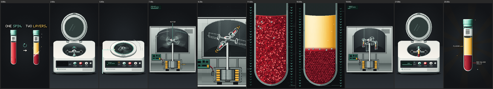

# How Blood Centrifuges Separate Blood

A 28-second vertical medical-science short in 16-bit pixel-art game style. A red blood tube goes into a benchtop
centrifuge and the machine starts to spin. A line of light slices the casing open, and you watch the inside as it runs:
the motor and its glowing copper windings, the drive shaft, and the swing-out rotor whose buckets fly out level as it
climbs to 3500 RPM. In bullet time the camera follows our tube and dives into it. The red cells sink and pack at the
bottom while clear gold plasma opens up above them. Back out, the rotor brakes, the buckets drop, and the casing closes.
The lid pops, and the tube comes out in two layers: plasma on top, red blood cells below.



- **Format.** 1080×1920 (9:16, for Shorts / Reels / TikTok), 30 fps (or 60), exactly 28.0 s. H.264 + AAC.
- **No narration, no subtitles.** The only text is the hook "ONE SPIN. TWO LAYERS." and four small labels (Rotor and
  Motor in the cutaway, Plasma and Red Blood Cells at the end). The machine also has its own display (RPM, End,
  START/STOP/OPEN).
- **Picture.** Every frame is drawn in code on a 270×480 pixel canvas and scaled exactly 4× with nearest-neighbour.
  - 3–9 shade ramps per material, Bayer dithering, 1-px outlines, sprite particles.
  - SNES-style tricks: colour-math glass, 16-step fades and flashes.
  - Zooms grow the pixel grid instead of blurring it.
  - Palette: the repo's `ink` set (charcoal, warm white, gold, teal) plus blood red.
- **Sound.** All synthesized in code, no samples. The music is a chiptune, and the effects are tied to the picture.
  - **Voices.** Band-limited pulse waves, the NES 4-bit triangle, LFSR noise drums, an SNES-style echo and FM bells.
  - **Score.** 120 BPM in C major on the "royal road" IV–V–iii–vi loop. The hook motif (A5 C6 A5 G5 A5 | B5 D6 B5 A5
    B5) comes back five times. The drops land when the casing flies open and when the camera enters the tube, and the
    music sinks under a lowpass during the bullet time.
  - **Machine.** The music tape-stops as the rotor brakes. The beeps and the lid play in silence, then a ♭VI–♭VII–I
    fanfare lands on the reveal.
  - **Effects.** Clink, lid thunk, power beeps, and a rising motor whine with a pulse per turn.
  - **Cutaway.** A laser cut, then the casing ka-chunks open. Then the motor's coil hum, a clatter as the buckets go
    level, a bullet-time whoom and the dive.
  - **Inside the tube.** A splash and bubbles, and soft pentatonic plinks as cells lock into the packed layer.
  - **Ending.** The buckets clink back down and the casing clunks shut. Then done-beeps, lid pssh, glass shing, reveal
    chime, label pops and a glint.
  - **Loudness.** The mix is −14 LUFS with true peak below −1 dBTP.

## Render it yourself

You need Python 3.9+ and git. ffmpeg comes from the `imageio-ffmpeg` package, so you don't have to install it
separately (a system ffmpeg on PATH is used if you have one).

```bash
git clone -b ccr-90de552e-iir9tw https://github.com/pudidil-dev/belajar-python.git
```

```bash
cd belajar-python/blood-centrifuge
```

```bash
pip install -r requirements.txt
```

```bash
python render.py
```

The film is written to `output/How_Blood_Centrifuges_Separate_Blood.mp4`. The soundtrack stems go next to it:
`music.wav`, `sfx.wav` and `mix.wav`. A 4-core laptop takes about one minute; the soundtrack takes about 10 s of that.

With [uv](https://docs.astral.sh/uv/) instead of pip, there's nothing to install into your Python:

```bash
uv run --no-project --with numpy --with pillow --with imageio-ffmpeg python render.py
```

On Windows, use `py render.py` if `python` is not on PATH.

**Options**

| Command | What it does |
|---|---|
| `python render.py --fps 60` | 60 fps (smoother spinning and zooms, twice the frames) |
| `python render.py --scale 8` | 2160×3840 (4K vertical); `--scale 2` gives 540×960 for a quick look |
| `python render.py --from 4 --to 8` | only a slice of the film |
| `python render.py --stills 0.8,11,22` | full-size PNG frames in `output/stills/` |
| `python render.py --sheet 0:28:1` | one contact sheet of the whole film in `output/sheet.png` |
| `python render.py --audio-only` | only the soundtrack (music, effects, mix) |
| `python render.py --no-audio` | silent video |
| `python render.py --jobs 2` | fewer CPU cores (the default uses all) |

## The film, shot by shot

120 BPM: a bar is 2 s, and every cut and hit sits on the 8th-note grid.

| Time | Picture | Sound |
|---|---|---|
| 0–2 | **Hook.** The red tube, "ONE SPIN."; its twin pops in already split gold over red, "TWO LAYERS.", with a little spin arrow between them. The twin poofs; the red tube slides to the centre. | Hook motif, text blips, sparkle chime, poof |
| 2–4 | The camera tilts down to the centrifuge. The tube flips and drops into the front bucket of the rotor. The round lid slams shut and the panel lights up. | Whoosh, glass clink, lid thunk and latch click, power beeps, START click |
| 4–6 | The rotor starts turning behind the lid window and the LCD climbs. A line of light runs around the casing and cuts it, then the camera pushes in. | Motor whine rising, snare roll and riser, laser cut and sparks |
| 6–8 | **Cutaway.** The front and the top of the casing fly apart. Inside, the motor's copper windings glow, the armature and the shaft turn, and the swing-out rotor climbs to 3500 RPM; its four buckets swing out level. Labels: Rotor, Motor. | Ka-chunk and split whooshes, the drop, coil hum, bucket clatter, label blips |
| 8–10 | Bullet time: the rotor slows to a crawl and gold arrows push toward the tube bottoms. The camera follows our tube, rolls with it and dives in. | Music sinks under a lowpass, deep whoom, then the dive whoosh |
| 10–14 | Inside the tube: an iris opens on red cells tumbling in the red liquid while speed streaks fly past. Arrows beside the tube show the force toward its bottom, and the cells start to sink. | Splash, sub drop, muffled motor, bubbles, the theme |
| 14–18 | The cells rain down and lock into a dark packed layer; clear gold plasma opens above them. A thin pale line of white cells settles on top, and a shine sweeps across. | Soft pitched plinks as cells land, "settled" chime |
| 18–20.5 | Back out to the cutaway: our tube is now gold over red in its bucket. The rotor brakes, the buckets drop back down, and the casing comes back together. | The motor winds down, the music tape-stops with it, buckets clink, casing clunk |
| 20.5–23.5 | Outside again: the LCD blinks End and the lid springs open. The tube rises out of its bucket, gold over red, and flies up as the machine sinks away. | Three done-beeps, latch clicks, air pssh, glass shing, whoosh |
| 23.5–28 | Reveal: a sparkle burst, then the labels Plasma and Red Blood Cells. The tube hops and a glint sweeps the glass while the camera eases back, then a 16-step fade. | Reveal chime and the fanfare, label pops, final C major chord |

**The science.** The tube holds anticoagulated whole blood (a lithium-heparin tube, teal cap). Spinning makes the
outward pull hundreds of times stronger than gravity, so the denser red blood cells sediment to the bottom of the tube
and pack there, about 45 % of the volume. White cells and platelets form the thin pale buffy coat on top of them, and
the lighter liquid, the yellow plasma (about 55 %), stays above.

## Files

- `render.py`: the command line (film, stills, contact sheets, audio only).
- `engine/`:
  - `timeline.py`: one timeline for picture and sound (event times, easing, rotor speed, bucket swing and angles).
  - `palette.py`, `gfx.py`, `pixfont.py`: the palette, the pixel drawing kit (masks, dithering, camera) and the bitmap fonts.
  - `tube.py`: the blood tube as a per-pixel shader, for any size, angle or separation state.
  - `machine.py`: the centrifuge, with projected lid, bowl, motion-blurred swing-out rotor, LCD and buttons.
  - `cutaway.py`: the machine cut open, with hatched section faces, half bowl, swing-out rotor with buckets and tubes,
    shaft, cut motor with windings and armature, control board, casing pieces, RPM readout, labels and force arrows.
  - `micro.py`: inside the tube, with 3D-lit biconcave red-cell sprites and the sedimentation model.
  - `fx.py`: sparkles, bursts, rays, speed arcs, labels and the iris.
  - `scenes.py`: what's on screen at each moment, and the camera (push, track, roll, iris).
  - `audio.py`: the synthesizer, score, sound effects and master (−14 LUFS).
- `镜头表.md`: the shot list (style lock, palette, 10 shots).
- `output/交付说明.md`: delivery notes and the quality gate results.
- `docs/storyboard.png`: one frame from each shot.
