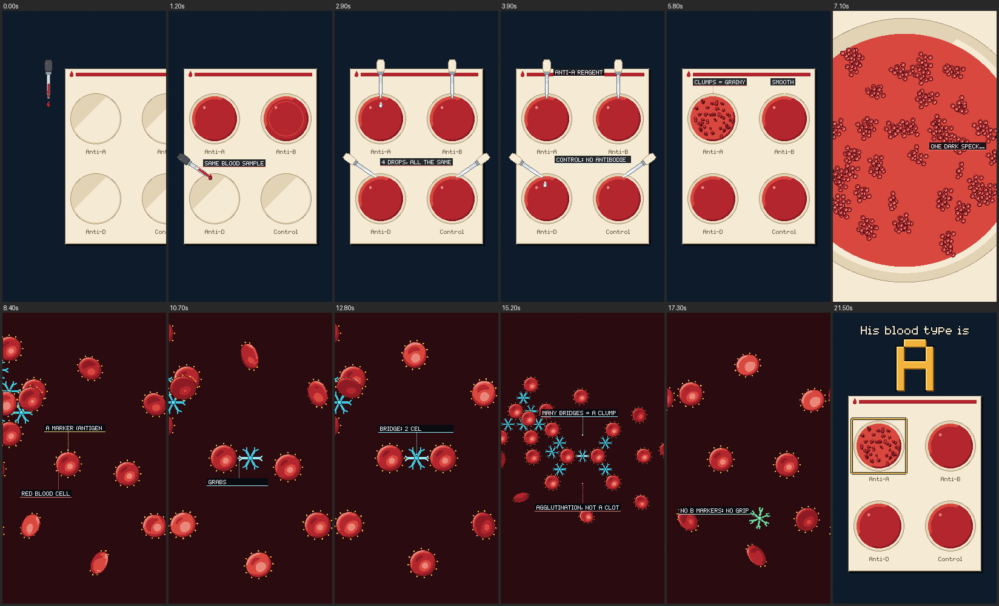

# How a Blood Typing Card Reads Your Blood

A 24-second looping vertical science short in 2D 8-bit RPG-lab pixel art, with an original 120 BPM chiptune and
synced sound effects.

Four drops of the same blood land on one test card and look identical. Then only the **Anti-A** spot turns grainy.
Inside that drop, one Anti-A antibody bridges two red blood cells, and many bridges make the clump you can see. In
**Anti-B** the same cells stay apart. Only after that does the card show **"His blood type is A"**.



Captions in Bahasa Indonesia (`--lang id`): [docs/storyboard_id.png](docs/storyboard_id.png)

## Ringkasan (Bahasa Indonesia)

Video 24 detik, vertikal, pixel art 8-bit gaya lab RPG, berulang (loop):

1. **0–3 dtk.** Kartu uji meluncur masuk. Empat tetes dari sampel darah yang sama jatuh tepat di ketukan ("plip" ×4),
   masing-masing dengan riak kecil. Keempatnya tampak sama.
2. **3–6 dtk.** Cairan uji Anti-A, Anti-B, Anti-D dan larutan kontrol diteteskan, lalu diaduk sebentar. Time-lapse
   bertahap: hanya Anti-A yang jadi berbutir (menggumpal); tiga lainnya tetap halus.
3. **6–9 dtk.** Kamera menyelam ke tetes Anti-A. Satu bintik gelap berubah menjadi sekelompok sel darah merah;
   tonjolan emas di tepi sel adalah penanda A.
4. **9–16 dtk.** Satu antibodi Anti-A (cyan) mengikat penanda A pada sel pertama ("tik"), lalu sel kedua ("tik"
   lebih tajam). Ini jembatan. Banyak jembatan membentuk gumpalan (aglutinasi, bukan pembekuan darah).
5. **16–19 dtk.** Di Anti-B, antibodi Anti-B (hijau) lewat tanpa menempel karena tidak ada penanda B. Sel tetap
   terpisah dan titiknya tetap halus.
6. **19–24 dtk.** Kartu utuh: Anti-A diberi bingkai emas, lalu muncul "His blood type is A" dengan huruf A besar dan
   "ding" dua nada. Kartu bergeser keluar dan video mulai lagi dari tetes pertama.

**Teks penjelasan:** label pendek yang menempel dan ikut bergerak bersama bendanya (tracking), bukan caption di atas
layar. Contohnya "SAMPEL DARAH SAMA" pada pipet, "ANTIBODI ANTI-A" pada antibodi yang melayang, dan "MENGGUMPAL" /
"HALUS" pada tiap titik. Default bahasa Inggris; `--lang id` untuk Bahasa Indonesia. `--clean` menghapus label,
sehingga hanya label kartu dan kalimat hasil yang tersisa (sesuai brief).

**Sel darah merah** digambar sebagai cakram bikonkaf: tepi tebal, tengah tipis dan pucat, dengan bentuk ketebalan
sel darah merah sungguhan. Sel yang bebas berputar pelan, jadi ada yang terlihat miring atau dari samping.

**Cara render:** lihat bagian berikut. Video akhir tidak dirender di sini; kamu render sendiri.

## Render it yourself (copy-paste)

Working directory: the `blood-typing-card-animation` folder of this repository (branch `claude/tes-45y4ej`).
Needs Python 3.9 or newer. ffmpeg comes from `pip` (imageio-ffmpeg); a system ffmpeg on PATH is used first if you
have one.

```bash
git clone -b claude/tes-45y4ej https://github.com/Pudidil-dev/belajar-python.git
cd belajar-python/blood-typing-card-animation
pip install -r requirements.txt
python render.py --preview
python render.py
```

- `python render.py --preview` makes a half-size check: `out/preview.mp4` (540×960, about 20 s).
- `python render.py` makes the film: `out/blood-typing-card.mp4`, relative to the project root, which is:

  `belajar-python/blood-typing-card-animation/out/blood-typing-card.mp4`

  It is a vertical 9:16 H.264 MP4, 1080×1920, 30 fps, exactly 24.000 s, with synchronized AAC 48 kHz stereo audio.

Already have the repository? Use these commands instead of the clone:

```bash
cd belajar-python
git fetch origin claude/tes-45y4ej
git checkout claude/tes-45y4ej
git pull origin claude/tes-45y4ej
cd blood-typing-card-animation
```

Other versions (each writes its own file):

```bash
python render.py --lang id      # labels and result line in Bahasa Indonesia -> out/blood-typing-card_ID.mp4
python render.py --clean        # no tracking labels: card labels + result line only -> out/blood-typing-card_clean.mp4
python render.py --assets       # sprite sheets -> assets/sprites/, audio stems -> assets/audio/
```

On Windows, write `py` instead of `python` if `python` is not found. On some Linux and macOS systems the commands are
`python3` and `pip3`.

More options:

```bash
python render.py --stills 0,5.8,12.6,21.5        # full-size PNG frames -> out/stills/
python render.py --sheet 0:24:1 --cols 6         # contact sheet -> out/sheet.png
python render.py --from 9 --to 16 --out out/slice.mp4   # just a slice
python render.py --audio-only                    # soundtrack only -> out/music.wav, out/sfx.wav, out/mix.wav
```

## Scene by scene (120 BPM, one bar = 2 s, 12 bars, looping)

| Time (s) | Scene | What you see | Sound |
|---|---|---|---|
| 0–3 | 1 Four blood drops | The card slides into the centre with a stepped stop while the first drop is already falling. Four red drops from the same sample land on the beat in Anti-A, Anti-B, Anti-D and Control, each with a small ripple that stays inside its circle. All four look the same. The sample dropper leaves as four reagent droppers enter. | plip, plip, plip, plip (0.5 / 1.0 / 1.5 / 2.0) |
| 3–6 | 2 The reagents go in | A clear drop lands in each spot (one-frame edge glint). The Control gets a matching solution without typing antibodies. A brief swirl in each circle, with no liquid crossing between them. A stepped time-lapse: tiny clusters appear only in Anti-A. Hold on the contrast, then a small push toward Anti-A. | lighter taps, swirl, four clock ticks |
| 6–9 | 3 Into the Anti-A drop | The camera accelerates into the drop; its curved edge sweeps past and the clusters turn into tiny cells. A stepped pixel cut turns one dark speck into a small group of red blood cells. The camera glides past it and stops on two separate cells with gold A markers. | one quick descending whoosh |
| 9–16 | 4 One antibody, two cells | A cyan, multi-armed Anti-A antibody drifts in. One tip binds an A marker on the first cell (gold pixel flash, 3 frames), then the second cell drifts close and another tip binds it (flash). Hold on the bridge. A slight pull back: more bridges form, and the group becomes a clump. No cell merges or bursts. | soft **tik** (10.5), sharper **tik** (12.5), quiet ticks; the music thins around the two tiks |
| 16–19 | 5 Compare Anti-B | Match cut at the same scale. A mint Anti-B antibody, whose square tips fit B markers, passes the same gold-tabbed cells without attaching. The cells stay apart. Pull back through the smooth red surface to the Anti-B circle and the whole card. | soft pass, rising whoosh |
| 19–24 | 6 His blood type is A | Hold to compare: Anti-A grainy, Anti-B, Anti-D and Control smooth. A blocky gold outline draws round Anti-A in four steps. The card shifts down, and "His blood type is A" appears with a big gold A that scales up once and settles on the chime. Hold, then the card slides out; on the next downbeat a new card slides in. | four outline blips, **two-note reward chime** (21.0) |

## Tracking explanations (default; `--clean` removes them)

There is no caption box at the top. Each explanation is a short label on a small dark plate, pinned to the thing it
explains by a dotted leader line. Its position is recomputed every frame through the camera on screen, so it follows
the object through slides, zooms and drifts. Labels flip sides near the frame edge and type in quickly. The accent
colour matches the subject:
- red: blood and cells;
- gold: A markers;
- cyan: Anti-A;
- mint: Anti-B;
- ivory: smooth spots.

| Time (s) | Label | Pinned to |
|---|---|---|
| 0.3–2.2 | SAME BLOOD SAMPLE | the sample dropper (it moves from spot to spot) |
| 2.2–3.0 | 4 DROPS, ALL THE SAME | the middle of the card |
| 3.0–4.5 | ANTI-A REAGENT · CONTROL: NO ANTIBODIES | the Anti-A and Control droppers |
| 5.2–6.2 | CLUMPS = GRAINY · SMOOTH | the Anti-A and Anti-B spots |
| 6.4–7.3 | ONE DARK SPECK... | the speck the camera dives into |
| 7.6–10.4 | RED BLOOD CELL · A MARKER (ANTIGEN) | the first cell and one of its gold markers |
| 9.1–10.5 | ANTI-A ANTIBODY | the antibody as it drifts in |
| 10.6–11.5 | GRABS AN A MARKER | the first contact point |
| 11.6–12.5 | 2ND CELL | the second cell as it drifts close |
| 12.6–13.5 | BRIDGE: 2 CELLS LINKED | the antibody between the two cells |
| 13.6–16.0 | MANY BRIDGES = A CLUMP · AGGLUTINATION, NOT A CLOT | the growing clump (through the pull back) |
| 16.2–17.7 | ANTI-B ANTIBODY → NO B MARKERS: NO GRIP | the Anti-B antibody as it passes |
| 18.0–19.0 | STAYS SMOOTH | the Anti-B spot (through the pull back) |
| 19.1–20.3 | CLUMPED · SMOOTH · SMOOTH · SMOOTH | the four spots |

Then **His blood type is A**.

## The science shown

- **The plate.** It is an illustrative liquid-reagent test plate: the reagents are added separately, so it is not a
  branded card with dry reagent.
- **Anti-A binds A antigens.** Anti-A binds to A antigens on red blood cells (the gold tabs). One antibody can hold
  two cells at once, which makes a bridge. Many bridges link many cells into a clump you can see: this is
  **agglutination, not clotting**. The cells keep their shape. They do not fuse or burst.
- **Binding needs contact.** The antibody binds only once it touches a marker. Nothing pulls it in like a magnet.
- **Anti-B.** Anti-B looks for B markers. These cells have only A markers, so it passes by and the spot stays smooth.
- **Anti-D and the result.** Anti-D does not clump in this example, so the person is RhD-negative. The headline
  intentionally shows only the ABO group: **A**, with no plus sign.
- **Red blood cells are biconcave discs.** They use the measured thickness profile of a red cell (Evans & Fung):
  a thick rim and a thin centre. Face-on, the rim is lit on the upper left, and the dent shows reversed shading: a
  shadow on its upper-left wall and a pale lower right. Free cells tumble slowly, so some are seen tilted (an oval
  with an off-centre dent) or edge-on (a rounded bar: from the side, the rim hides the thin middle). Cells in a
  bridge stay face-on so the bridge is easy to read. The A antigens are small surface markers, drawn as gold
  lollipops (a stalk and a knob) along the rim.
- **Positive vs negative.** All four drops use the same red. A positive spot differs only by texture (small,
  irregular clusters); a negative spot stays even and smooth.
- **Simplified on purpose.**
  - The reaction is time-compressed: the clusters appear in four time-lapse steps, not the instant the reagent
    lands.
  - The antibody is a simplified multi-armed icon, and only the two tips that make the bridge are highlighted.
  - Cells, markers and antibodies are not to scale.

## Format and style

- 270×480 working canvas, upscaled exactly 4× (nearest neighbour) to 1080×1920; 30 fps; 24.000 s; H.264 (yuv420p) +
  AAC 256 kb/s stereo.
- 2D 8-bit RPG lab:
  - chunky sprites with stepped 1-px outlines and flat pixel-cluster shading (no gradients, no glow);
  - the card is an inventory-style item: square corners, a stepped border, a tiny edge highlight;
  - a quiet navy bench.
- Separate artwork for the overhead card, the close-up drop (where the clusters become tiny cells) and the cellular
  view.
- The camera rests on the pixel grid (zoom 1, whole-pixel positions), so text and sprites stay crisp.
- Palette:
  - navy #0D1B2A;
  - ivory #F5EAD3;
  - reds #B3262E / #8E1B23 / #D9483F;
  - gold #F2B33D for the A markers and the final A;
  - cyan #3FC6DC for Anti-A;
  - mint #6BD59B for Anti-B.

## Sound

The music is an original 12-bar chiptune in C major at 120 BPM (chords C Am F G | C Am F G | Am F Dm G):
- a square-wave melody;
- a bouncy triangle bassline;
- light arcade drums.

The last G leads straight back into bar 1, so the loop restarts on the downbeat.

The arrangement leaves room for the story sounds:
- In bar 1 the bass plays off the beat, so the four plips land in the gaps.
- Inside the drop the music thins to bass, arpeggios and soft hats. It ducks again around the two binding tiks.
- The beat clears for the reward chime.

**Sound effects:**
- four distinct wet plips;
- lighter reagent taps with a tiny glint;
- the swirl;
- four time-lapse ticks;
- one quick descending whoosh into the drop;
- the soft tik and the sharper tik;
- quiet ticks while the clump forms;
- a soft "no match" boop in Anti-B;
- the rising whoosh back out;
- four outline blips;
- the A pop;
- the two-note reward chime;
- the card swap at the loop point.

All of it is synthesized from code on a circular bus, so the end flows into the start. It is mastered to −14 LUFS
with a −1 dBTP ceiling.

## Files

| File | What it is |
|---|---|
| `render.py` | Command line: film, preview, stills, contact sheet, slices, audio only, asset export. |
| `requirements.txt` | numpy, Pillow, imageio-ffmpeg. |
| `镜头表.md` | The shot list (huashu-art-motion workflow) with the style lock. |
| `docs/storyboard.png`, `docs/storyboard_id.png` | Key frames with English and Indonesian captions. |
| `assets/sprites/` | Exported sprites: card states, macro drop, cell views, result, and a sheet with the red cell, both antibodies, both droppers and both drops. |
| `engine/timeline.py` | The clock and choreography: events on the beat grid, card slide, droppers, time-lapse, cameras, cell and antibody positions, the exact bridge geometry. |
| `engine/card.py` | Overhead and macro artwork: bench, card, wells, labels, blood, clusters, swirl, ripples, droppers, outline. |
| `engine/cells.py` | Cellular artwork: biconcave red cells (any tilt) with A markers, Anti-A and Anti-B antibodies, contact flashes. |
| `engine/scene.py` | Which view is on screen, the stepped pixel cuts, the tracking labels and the result. |
| `engine/explain.py` | The tracking labels (English and Indonesian, anchors, placement), the result line with the big A. |
| `engine/audio.py`, `engine/synth.py` | Music and sound effects. |
| `engine/gfx.py`, `engine/view.py`, `engine/palette.py`, `engine/pixfont.py` | Pixel helpers, camera, palette, bitmap font. |

## Checks run on this project

- **Shot list lint** (`storyboard_lint.py`): green, 7 shots, 24 s.
- **Film gate** (`film_gate.py --no-template`) on a half-size preview: **pass**. Fast-motion frames 16.9%, no empty
  frames, no blue-purple.
- **Muted, phone-size check** (360×640 frames):
  - all four drops look the same at first;
  - only Anti-A turns grainy, and the other three stay smooth;
  - the gold A appears right above the outlined Anti-A spot, after the antibody scenes.
- **Determinism:** the same frame rendered twice is identical.
- **Audio** (measured, not listened to): 24.000 s, 48 kHz stereo, −14 LUFS, true peak about −1.4 dBTP.
  - The plips and the sharper tik peak about 20 dB above the music around them.
  - The soft tik is about 2 dB below the sharp one.
  - The reward chime peaks about 14 dB above the bed.
  - The loop seam has no gap.
- **Preview streams:** H.264 540×960 30 fps + AAC 48 kHz stereo, both 24.000 s.
- **Fresh clone:** the commands above were run from a fresh clone, rendering short full-size slices.
- The final 1080×1920 MP4 was **not** rendered here, as asked.
