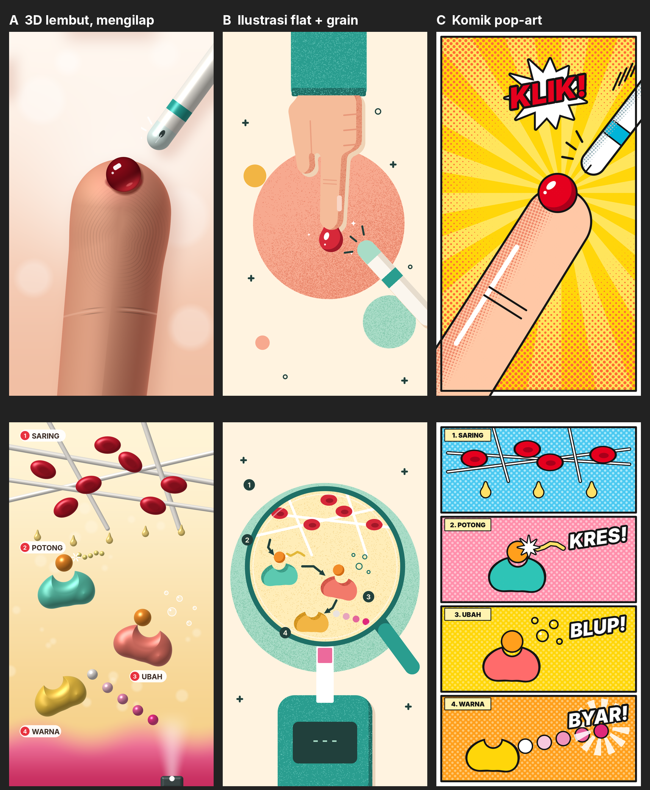

# How a Cholesterol Meter Works (in progress)

A vertical (1080×1920) short about a home cholesterol meter. The storyboard comes from the client: a fingertip is
pricked and a small drop of blood appears; only then does the cholesterol meter come in and the strip draws the drop
up; then the camera zooms into the strip to show how the meter measures cholesterol:

1. **Filter:** the strip's layers hold back the red blood cells; only the plasma flows on.
2. **Cut:** the first enzyme (cholesterol esterase) cuts the fatty-acid "tail" off cholesterol esters.
3. **Change:** the second enzyme (cholesterol oxidase) changes the cholesterol and releases hydrogen peroxide.
4. **Colour:** the third enzyme (peroxidase) uses the peroxide to turn a dye in the pad deeper in colour; the meter
   shines light on the pad and reads how deep the colour is.

## Status: picking a style

`style_tests/` holds three style directions, each drawn for the same two moments (the hook and the zoom), so the
client can choose before the film is made:

- **A** soft 3D, glossy macro;
- **B** flat illustration with grain;
- **C** pop-art comic.



Regenerate them (Python 3.9+, numpy, Pillow):

```bash
python style_tests/directions.py
```

The frames are drawn in code with `engine/canvas.py`: smooth, anti-aliased shapes from signed distances, soft 3D
shading, blur, grain, halftone dots and text (no pixel art this time).
