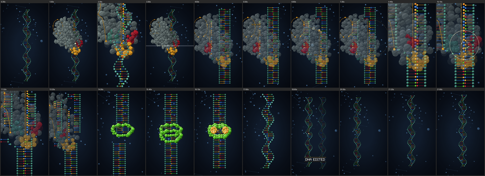

# How CRISPR-Cas9 Edits DNA

A 22-second looping, vertical short in 8-bit pixel art about how CRISPR-Cas9 finds one sequence in a genome, cuts
both strands of the DNA, and leaves the cell to repair the break. Drawn in the same 16-bit ink palette and with the
same effects as this repo's blood centrifuge film, inside a cell nucleus full of other DNA, chromatin and drifting
proteins. No narration and no subtitles; four tiny labels and nothing else.

**the hook: Cas9 cuts the DNA → rewind → it hunts along the helix for a PAM → the guide RNA pairs base by base and
locks on → the two cutting domains cut both strands → the cell's repair proteins grab the ends, trim them and seal
them → the DNA is two base pairs shorter → on to the next target: the last frame is the first frame.**



- **Format.** 1080×1920 (9:16 vertical), 30 fps, exactly 22.0 s (11 bars of 4/4 at 120 BPM; one beat is exactly 15
  frames), H.264 video with 48 kHz stereo AAC. **This project ships the editable film, not the export:** run
  `python render.py` to write `out/crispr-cas9-animation.mp4` yourself (about a minute on 4 cores).
- **Look.** Every frame is drawn in code on a 270×480 canvas and scaled exactly 4× nearest-neighbour. The repo's
  `ink` palette: a dark navy nucleus, teal DNA, a gold guide RNA, a blue-grey protein, blood-red and teal cutting
  domains. Short tone ramps shaded in flat bands with ordered (Bayer) dithering, 1-px dark outlines, hard-edged
  pixel particles (sparkles, bursts, ring waves). Everything is redrawn at the camera's own scale on every frame,
  so zooming in shows the beads, the base letters and the protein's surface instead of enlarging pixels.
- **Cas9 is a molecular surface**, the way a 3D model of the protein looks: 529 little residue spheres packed into
  the shape of its domains, depth-sorted and lit from the top left, so the silhouette is knobbly and full of
  grooves. The DNA and the guide RNA are drawn *between* the protein's back and front halves, so they really run
  through those grooves. Its domains are coloured: the PAM-reading domain gold, the two cutting domains red (HNH)
  and teal (RuvC). While the camera is inside the complex, the protein is drawn see-through (every other pixel) so
  you can watch the DNA and the RNA inside it.
- **The nucleus around it.** Three parallax layers that tile for ever, so the frame is never empty and a zoom feels
  like travelling through a crowded nucleus: chromatin loops far behind, other DNA molecules drifting past as
  little double helices, and a soup of nucleosome beads, free proteins and specks. Every drift is a whole number of
  laps per loop.
- **The DNA** is one molecule the whole film: 62 base pairs of real sequence that repeats along the strand, each
  base a coloured bead (A green, T red, G gold, C blue) hanging from a teal backbone. It winds as a double helix,
  straightens into a ladder for the search, opens into an R-loop where the guide RNA pairs, is cut, and winds back
  up two base pairs shorter.
- **Labels.** Four, each a dot on the thing, a thin elbow line and 5×7 pixel text typed on: CAS9, GUIDE RNA, PAM,
  REPAIR, plus the one small banner DNA EDITED. Nothing else is written anywhere.
- **Loop.** The camera flies on to the next target site, which is 62 base pairs along, where the sequence repeats:
  the last frame is the opening frame, pixel for pixel, and the soundtrack wraps round too.
  `python render.py --loops 3` writes the loop three times back to back (66 s).

## Render it yourself

Working directory: **`belajar-python/crispr-cas9-animation`** (this folder). You need Python 3.9 or newer and git.
ffmpeg comes from the `imageio-ffmpeg` package in `requirements.txt`; a system ffmpeg on PATH is used if you have one.

Clone (skip if you already have the repo):

```bash
git clone -b ccr-7e275fc1-l4xpr8 https://github.com/Pudidil-dev/belajar-python.git
```

If you cloned it earlier, update it instead (run inside `belajar-python`):

```bash
git pull origin ccr-7e275fc1-l4xpr8
```

Go to the project:

```bash
cd belajar-python/crispr-cas9-animation
```

Install the dependencies (numpy, Pillow, imageio-ffmpeg):

```bash
pip install -r requirements.txt
```

If pip refuses with an "externally-managed-environment" error, make a virtual environment first, then run the
`pip install` again:

```bash
python -m venv .venv
```

```bash
source .venv/bin/activate
```

(On Windows: `.venv\Scripts\activate`.)

Preview (540×960, fast encode, written to `out/crispr-cas9-animation-preview.mp4`):

```bash
python render.py --preview
```

Render the film (1080×1920, 30 fps, H.264 + stereo AAC):

```bash
python render.py
```

The film is written to **`out/crispr-cas9-animation.mp4`**. The music, effects and mix are written next to it as
WAV stems (`out/music.wav`, `out/sfx.wav`, `out/mix.wav`). On a 4-core machine the full render takes about a
minute. With [uv](https://docs.astral.sh/uv/) instead of pip, no install step is needed:

```bash
uv run --no-project --with numpy --with pillow --with imageio-ffmpeg python render.py
```

On Windows, use `py render.py` if `python` is not on PATH.

**Options**

| Command | What it does |
|---|---|
| `python render.py --sheet 0:22:1` | one contact sheet of the whole film in `out/sheet.png` (start:end:step, seconds) |
| `python render.py --stills 1.5,10,16` | full-size PNG frames in `out/stills/` |
| `python render.py --from 8 --to 13` | only a slice of the film |
| `python render.py --fps 60` | 60 fps |
| `python render.py --scale 8` | 2160×3840 (4K vertical) |
| `python render.py --loops 3` | also `out/crispr-cas9-animation-loop3x.mp4`: the seamless loop played 3 times (any N) |
| `python render.py --audio-only` | only the soundtrack (music, effects, mix) |
| `python render.py --no-audio` | the picture without sound |
| `python render.py --out PATH` | a different output file (or folder, for stills and audio) |
| `python render.py --jobs 2` | fewer CPU cores (the default uses all) |

### Render configuration

`render.json` holds the defaults; command-line flags override them.

| Key | Default | Meaning |
|---|---|---|
| `output` | `out/crispr-cas9-animation.mp4` | where `python render.py` writes the film |
| `fps` | `30` | frame rate |
| `scale` | `4` | pixel size: the 270×480 canvas × 4 = 1080×1920 |
| `crf`, `preset`, `tune` | `16`, `medium`, `animation` | x264 quality, speed and tuning |
| `audio_bitrate` | `256k` | AAC bitrate |
| `loudness_lufs` | `-14.0` | integrated loudness of the mix (true peak is kept below −1 dBTP) |
| `preview` | 2× scale, `veryfast`, crf 20 | the `--preview` settings and output path |

## The film, beat by beat

120 BPM: a bar is 2 s, a beat is exactly 15 frames. Every sound effect is timed from `engine/timeline.py`, the same
clock that drives the picture.

| Time | Picture | Sound |
|---|---|---|
| 0–3 | **The cut.** Inside the nucleus, a DNA double helix fills the frame. Cas9, carrying its gold guide RNA, swoops in from the left, clamps onto the helix on beat 3 and cuts both strands; the ends spring apart in a flash and the camera rushes into the break. | a whoosh, a CLICK on the beat, a SNIP with the kick, a rising rush |
| 3–3.6 | **Rewind.** The whole thing runs backwards: rows tear sideways, a bright band sweeps up, scan lines. | tape rewind |
| 3.6–5.5 | **The hunt.** The helix straightens into a ladder and Cas9 turns see-through so you can watch the guide RNA inside it. It slides along, stops at a PAM — but the sequence beside it does not match the guide, so a red cross flashes and it moves on. At the right PAM it stops again. | a dull TIK at the wrong site (the music leaves a hole for it), a bright TIK at the PAM |
| 5.5–8 | **The match.** The DNA opens: the non-target strand is peeled away and the 20 guide bases drop onto the target strand one by one, each flashing as it pairs, PAM-end first. Cas9 locks shut. | twenty blips climbing a pentatonic ladder, then a mechanical LOCK and a chord stab |
| 8–10 | **The scissors.** The camera moves in on the cutting domains. The teal RuvC closes on the near strand and the red HNH swings right across the DNA to the far one. | two servo sweeps, a snare roll building |
| 10–13 | **Both strands cut.** Three base pairs before the PAM, both strands are cut at once in a flash; in slow motion the two ends drift apart while the near half of the protein fades away so you can see it. | a SNIP on the bar line, then the music drops into a filtered hush |
| 13–16 | **The repair.** Cas9 lets go and drifts away. Two repair rings slide onto the ends and pull them together; two base pairs at the ends crumble away, and a gold ligase seals each strand. | a whoosh away, TIK, TIK, a crumble, then a SNAP |
| 16–18 | **Wound back up.** The rings leave and the DNA winds back into a double helix, two base pairs shorter. | a music box, an open hat |
| 18–20 | **Before and after.** The camera pulls out: a dim ghost of the original DNA stands beside the edited one, the two lost base pairs blinking red in the ghost, the new junction blinking gold in the real one. | a bell run, a blip under DNA EDITED |
| 20–22 | **Next target.** The camera flies along the molecule to the next matching site, where another Cas9 is already coming in: the last frame is the first frame. | a rising whoosh panning across, a tom fill into the top |

## The science (as drawn)

- **Cas9 is guided by RNA.** The protein carries a guide RNA whose 20-base spacer matches one strand of the target
  site. It does not read the DNA by itself.
- **A PAM first.** This Cas9 (the *Streptococcus pyogenes* one) can only cut next to a short PAM sequence,
  5'-NGG-3', on the non-target strand. It bumps along the DNA testing PAMs; at one it tries the neighbouring
  sequence against its guide. In the film the first PAM it finds is a real PAM (AGG) whose protospacer mismatches
  the guide at 19 of 20 positions, so it lets go and moves on; the second (CGG) is the right one.
- **The R-loop.** Where the guide matches, the DNA opens: the guide RNA pairs with the target strand, PAM-proximal
  base first, and the other strand is held aside in the protein. Pairing all the way along is what licenses the cut.
- **Two domains, two strands.** HNH cuts the strand paired with the guide RNA; RuvC cuts the other one. Both cut
  about three base pairs from the PAM, leaving a blunt double-strand break.
- **The cell repairs the break, not Cas9.** Non-homologous end joining pulls the ends back together and ligates
  them; the ends are often trimmed first, so a few base pairs are lost. That is the edit shown here: the sequence
  is disrupted by a small deletion. **Cas9 does not rewrite the DNA to a chosen sequence.** A precise change needs
  a repair template (homology-directed repair) or a different tool (base or prime editing), and the outcome is
  never guaranteed.
- **Simplified on purpose.**
  - The film shows one illustrative outcome: a 2-base-pair deletion. Real repair gives a mixture of small
    insertions and deletions, and sometimes a clean rejoin.
  - Everything is slowed down and made tidy: searching takes a real Cas9 minutes to hours, pairing and cutting are
    much faster than shown, and repair takes minutes to hours.
  - The protein's shape is a simplified molecular surface, not a structure from a PDB file; the repair machinery is
    one ring per end and one ligase per strand, standing in for a crowd of proteins.
  - The DNA is drawn with 20 base pairs' worth of guide and a sequence that repeats every 62 base pairs, so the
    film can loop onto an identical site; a real genome has one such site in billions.

## How it is made

- **Picture** (`engine/`). Every frame is drawn in code on a 270×480 canvas and scaled exactly 4×; nothing is a
  bitmap that gets enlarged.
- **The DNA** (`engine/dna.py`): a sequence model (target strand, non-target strand, PAM, decoy, deletion) and a
  shape that can be a helix or a ladder, open into an R-loop, break in two and lose base pairs. Drawn per pixel as
  depth-sorted beads at the camera's own scale.
- **Cas9** (`engine/cas9.py`): the residue-sphere surface described above, its domains, and the guide RNA, whose
  spacer bases drop from the protein onto the DNA one at a time.
- **The repair** (`engine/repair.py`): rings and a ligase built from the same little spheres, plus the crumbs that
  fly off the trimmed ends.
- **The nucleus** (`engine/bg.py`): the three tiled parallax layers.
- **Frames** (`engine/scenes.py`): the clock, the cameras, the rewind, the before-and-after, and the flight to the
  next site that lands on the first frame.
- **Sound** (`engine/audio.py`). Everything is synthesized, with no samples.
  - **Chip voices:** band-limited pulse waves, an NES-style triangle bass, LFSR noise drums, echo and FM bells (the
    synth core is shared with the repo's other pixel films).
  - **Music:** C minor, 120 BPM, 11 bars: a driving hook, a bouncy search, a build into the cut, a hush through the
    slow motion, a music box over the repair, and a turnaround back into the top.
  - **Effects stay on top.** Each effect was measured against the music at its moment, band by band, and set so it
    clears the music by at least 4 dB in one of its two strongest bands. The dull tick at the wrong PAM gets a hole
    in the melody instead of being made louder.
  - **Loudness:** the mix is −14 LUFS with true peak below −1 dBTP; it is limited wrapped round the loop.

## Assets

- **Original audio** (`assets/audio/`). `music.wav`, `sfx.wav` and `mix.wav`: 48 kHz, 16-bit, stereo, exactly 22 s.
  To refresh them, run `python render.py --audio-only --out assets/audio`.

## Files

- `render.py`: the command line (film, preview, stills, contact sheets, loops, audio only).
- `render.json`: the render configuration.
- `requirements.txt`: numpy, Pillow, imageio-ffmpeg.
- `engine/`:
  - `timeline.py`: the clock (120 BPM, 11 bars) and the time of every event.
  - `palette.py`, `gfx.py`, `raster.py`, `pixfont.py`: the palette, the pixel toolkit, vectorised drawing, the font.
  - `dna.py`: the sequence, the helix, the R-loop, the break, the deletion.
  - `cas9.py`: the protein's molecular surface, its domains and the guide RNA.
  - `repair.py`: the repair rings, the ligase, the crumbs.
  - `bg.py`: the nucleus: chromatin, other DNA, the soup.
  - `fx.py`: sparkles, bursts, ring waves, light rays, glows (shared with the blood centrifuge film).
  - `hud.py`: the four tiny labels and the one banner.
  - `scenes.py`: the cameras, the five scenes, the rewind, the loop, frame assembly.
  - `audio.py`: synthesizer, score, effects, master.
- `assets/audio/`: the original soundtrack.
- `镜头表.md`: the shot list (style lock, palette, 9 shots).
- `docs/交付说明.md`: delivery notes and the quality-gate results.
- `docs/storyboard.png`: one frame from each beat of the film.
