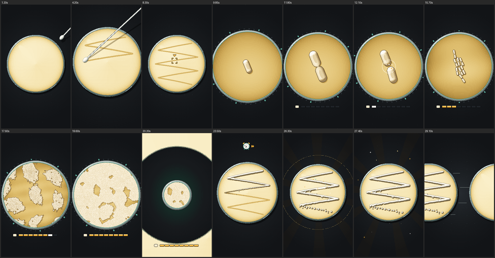

# How Bacteria Grow on a Culture Plate

A 30-second looping, vertical short in 16-bit RPG-style pixel art (the same look as the repo's blood centrifuge
film) about what happens after bacteria are streaked onto an agar culture plate, with a bouncy chiptune soundtrack
and small lab sound effects tied to every event on screen. Seen from straight above, on a dark lab bench, a white cotton swab streaks a zigzag across a fresh plate. A gold RPG target cursor
locks onto one point of the streak and the camera dives into it through a round lens. Down there, one rod-shaped
bacterium grows, pinches in the middle and splits in two (pop), then the two split, then four, faster and faster,
while more bacteria along the streak do the same, until their colonies merge into one white crowd. The lens closes,
the camera pulls back out to the plate, and in a time-lapse (a pixel alarm clock races and rings) white colonies
rise along the zigzag. A shine runs along the finished pattern, and the plate slides away as the next fresh plate
slides in: the last frame is the first frame. No narration, no subtitles, no text at all.

**a fresh plate → the swab streaks a zigzag → the cursor picks one point → dive in → one bacterium grows, pinches,
splits: 2, 4, 8 … 256 → the colonies merge → back out → time-lapse: white colonies grow along the zigzag → shine →
the next plate slides in → the loop starts again.**



- **Format.** 1080×1920 (9:16 vertical), 30 fps, exactly 30.0 s (15 bars of 4/4 at 120 BPM; one beat is exactly 15
  frames), H.264 video with 48 kHz stereo AAC. The default export is **`out/culture-plate-animation.mp4`**, relative
  to this folder.
- **Look.** A 16-bit (SNES-era) pixel-art game, in the repo's `ink` palette (charcoal, warm white, gold, teal,
  teal-grey glass) like the blood centrifuge film. Every frame is drawn in code on a 270×480 canvas and scaled
  exactly 4× nearest-neighbour: 5–9 tone ramps shaded with ordered (Bayer) dithering, 1-px dark outlines, one light
  from the top left, hard-edged sprite particles. The world is drawn again at the camera's own scale on every frame,
  so a zoom shows new detail (the agar's sheen, the fibres in the wet streak, the shading of each colony) instead of
  blowing up the wide shot's pixels.
  - a dark charcoal lab bench (black epoxy) with a soft pool of lamp light, a faint dot grid and drifting dust, so
    the pale plate glows on it;
  - a clear 90 mm Petri dish: teal-grey glass, rim-lit on both edges, a white glint at the top left, a shadow;
  - pale yellow agar in a dithered gradient: deep amber where it climbs the wall, a soft reflection of the lamp;
  - a white cotton swab: a fluffy, dithered oval tip on a white plastic stick shaded as a cylinder, with a shadow
    that grows as it lifts;
  - white-cream colonies, shaded as little domes with a glint, outlined and casting a shadow on the agar.
- **The streak.** Six strokes, one per dotted quarter note, each with its own soft swipe panned with the swab. The
  swab leaves a wet line behind it; a shine runs along the finished zigzag before the cursor picks its point.
- **Up close.** Seen through a round lens (a brushed-metal barrel with turning reticle ticks) while the bench goes
  dark round it. One rod-shaped bacterium, about 1 µm wide, lies on the agar. It grows to twice its length while a
  soft blob inside (its DNA) splits into two, pinches at the middle and splits with a pop, a white ring and a little
  shake; the two daughters spring apart. Each later round of splits comes faster (a speeding time-lapse), and the
  camera steps back after each one: 4, 8, 16 … until every colony has 256 cells. A gold bar under the lens lights
  one segment for each round of splits, like an RPG experience bar. The growth is a small physics
  simulation: rods grow, divide end to end and push each other apart, so each colony spreads into a disc of rods in
  little aligned patches, as real microcolonies do. Other bacteria the swab left along the streak grow into their own
  colonies around it, and they merge into one white crowd along the line of the streak.
- **The colonies.** Colonies rise along the zigzag in the order the swab laid it down: a solid white ridge where the
  swab started (it carried the most bacteria), thinning out over the fifth stroke, and single round colonies along
  the last one (a streak plate's isolated colonies). The colony the camera watched under the lens shows as a speck
  as soon as the lens closes.
- **The camera.** It leans in and follows the swab while it streaks, pulls back to show the whole zigzag, dives into
  the cursor's point, steps back after each round of splits, pulls out through the closing lens, leans in on the
  plate during the time-lapse and snaps back out for the reveal.
- **The game layer.** No text: a gold target cursor with a bobbing arrow, the lens with its reticle, the division
  bar, a pixel alarm clock with a fast-forward sign for the time-lapse, pops (a ring wave and a burst) on the first
  splits, and on the reveal turning gold light rays, a burst, a ring wave and twinkles (the same effects as the blood
  centrifuge film); speed lines when the plates slide.
- **Loop.** The new plate stops at 29.9 s exactly where the film starts, so the last frames and the first frame are
  the same picture; the soundtrack folds everything that rings past the end back onto the start.
  `python render.py --loops 3` writes the loop three times back to back (90 s).

## Render it yourself

Working directory: **`belajar-python/culture-plate-animation`** (this folder). You need Python 3.9 or newer and git.
ffmpeg comes from the `imageio-ffmpeg` package in `requirements.txt`; a system ffmpeg on PATH is used if you have one.

Clone (skip if you already have the repo):

```bash
git clone -b ccr-7e275fc1-l4xpr8 https://github.com/Pudidil-dev/belajar-python.git
```

If you cloned it earlier, update it instead (run inside `belajar-python`):

```bash
git pull origin ccr-7e275fc1-l4xpr8
```

Go to the project:

```bash
cd belajar-python/culture-plate-animation
```

Install the dependencies (numpy, Pillow, imageio-ffmpeg):

```bash
pip install -r requirements.txt
```

If pip refuses with an "externally-managed-environment" error, make a virtual environment first, then run the
`pip install` again:

```bash
python -m venv .venv
```

```bash
source .venv/bin/activate
```

(On Windows: `.venv\Scripts\activate`.)

Preview (540×960, fast encode, written to `out/culture-plate-animation-preview.mp4`):

```bash
python render.py --preview
```

Render the film (1080×1920, 30 fps, H.264 + stereo AAC):

```bash
python render.py
```

The film is written to **`out/culture-plate-animation.mp4`**. The music, effects and mix are written next to it as
WAV stems (`out/music.wav`, `out/sfx.wav`, `out/mix.wav`). On a 4-core machine the full render takes under a
minute; the very first run also builds the bacteria simulation (about 10 s) and keeps it in `build/`. With
[uv](https://docs.astral.sh/uv/) instead of pip, no install step is needed:

```bash
uv run --no-project --with numpy --with pillow --with imageio-ffmpeg python render.py
```

On Windows, use `py render.py` if `python` is not on PATH.

**Options**

| Command | What it does |
|---|---|
| `python render.py --sheet 0:30:1` | one contact sheet of the whole film in `out/sheet.png` (start:end:step, seconds) |
| `python render.py --stills 2,12.1,26.3` | full-size PNG frames in `out/stills/` |
| `python render.py --from 8 --to 12` | only a slice of the film |
| `python render.py --fps 60` | 60 fps |
| `python render.py --scale 8` | 2160×3840 (4K vertical) |
| `python render.py --loops 3` | also `out/culture-plate-animation-loop3x.mp4`: the seamless loop played 3 times (any N) |
| `python render.py --audio-only` | only the soundtrack (music, effects, mix) |
| `python render.py --no-audio` | the picture without sound |
| `python render.py --out PATH` | a different output file (or folder, for stills and audio) |
| `python render.py --jobs 2` | fewer CPU cores (the default uses all) |

### Render configuration

`render.json` holds the defaults; command-line flags override them.

| Key | Default | Meaning |
|---|---|---|
| `output` | `out/culture-plate-animation.mp4` | where `python render.py` writes the film |
| `fps` | `30` | frame rate |
| `scale` | `4` | pixel size: the 270×480 canvas × 4 = 1080×1920 |
| `crf`, `preset`, `tune` | `16`, `medium`, `animation` | x264 quality, speed and tuning |
| `audio_bitrate` | `256k` | AAC bitrate |
| `loudness_lufs` | `-14.0` | integrated loudness of the mix (true peak is kept below −1 dBTP) |
| `preview` | 2× scale, `veryfast`, crf 20 | the `--preview` settings and output path |

## The film, beat by beat

120 BPM: a bar is 2 s. Every sound effect is timed from `engine/timeline.py`, the same clock that drives the picture.

| Time | Picture | Sound |
|---|---|---|
| 0–2 | **A fresh plate.** It has just slid into place; a glint sweeps across the dish. The swab swoops in from the top right and touches down on the downbeat of bar 1. | a soft knock as the plate settles (the loop point), two glass pings, a whoosh, a tap on touchdown |
| 2–6.5 | **The streak.** Six strokes back and forth down the plate, one per dotted quarter, leaving a wet zigzag; the camera leans in and follows. Speed lines flick behind the tip. | a soft swipe per stroke, panned with the swab; theme A (I–vi–IV–V) |
| 6.5–8.5 | **Pick a point.** The swab lifts away and the camera pulls back to the whole zigzag; a shine runs along it. A gold cursor snaps onto one point of the streak and blinks. | a pip and a whoosh as it lifts, a run of little bells for the shine, two menu blips and a confirm |
| 8.5–10 | **Dive.** The camera dives into the point; a round lens bursts open on a bacterium lying on the agar and the bench goes dark round it. | the drums drop out; a rising whoosh, a snare swell, a shimmer as the lens opens |
| 10–13.5 | **One becomes two.** The bacterium grows longer, its DNA splits in two, it pinches at the middle and splits on the downbeat of bar 6 with a ring and a little shake; the daughters spring apart, grow and split again. | a music-box tune; a rubbery stretch into a big pop and a chime, then two smaller pops |
| 13.5–18 | **Two become many.** 4, 8, 16, 32 … each round faster; the gold bar fills one segment per round; the camera steps back after each one and finds more bacteria along the streak doing the same. | a pop for every split you can see, pitched to the chord; they turn into a fizz |
| 18–20 | **A crowd.** The colonies push into each other and merge into one white crowd along the streak. | the fizz swells; the arpeggio climbs; a snare roll |
| 20–22 | **Back out.** The lens shrinks back into the point (now a white speck) and the camera pulls out to the whole plate. | a falling whoosh and a bloop, a crash on the downbeat |
| 22–26 | **Time-lapse.** A pixel alarm clock races; white colonies rise along the zigzag from the first stroke to the last, a solid line at the start and single round colonies at the end; the camera leans in. The clock rings. | four on the floor and 16th hats; clock ticks; a pip for each step of the zigzag filling in, climbing the chord; the alarm |
| 26–28 | **The result.** The camera snaps back out; a shine runs along the white zigzag, gold rays turn behind the plate, a burst and a ring wave go off and sparkles twinkle. | a short fanfare, a run of bells along the shine, high twinkles |
| 28–30 | **Next plate.** The finished plate slides out to the left as the next fresh plate slides in and stops: the first frame. | a sliding whoosh; a tom fill back to the top |

## The science (as drawn)

- **Streaking.** The swab carries bacteria from a sample and spreads them across the agar surface. Along the streak
  the swab has fewer and fewer bacteria left to give, so where it started they are crowded and where it ended they
  are far apart. Each bacterium left on the surface is the start of a colony: crowded ones merge into a solid line,
  well-separated ones grow into single round colonies (that is what streaking is for: getting isolated colonies,
  each grown from one cell).
- **Binary fission.** A rod-shaped bacterium grows longer, copies its DNA, moves the two copies apart, builds a wall
  across its middle (the septum) and splits into two daughter cells, each with one copy. The daughters do the same.
  Many lab bacteria can do this every 20–30 minutes in good conditions, so one cell becomes millions overnight.
- **Colonies.** On the agar the daughters stay where they are born, so the population piles up into a mound you can
  see without a microscope: a colony. After a night in a 37 °C incubator (about 18–24 hours) colonies of many common
  bacteria are visible as white or cream dots.
- **Simplified on purpose.**
  - The divisions are a time-lapse that speeds up: the first takes 3 seconds on screen, the later ones half a second
    (in real life each takes about 20–30 minutes, with the cells soon out of step).
  - The close-up shows rods that are about 1 µm wide; the view under the lens is a fraction of a millimetre, so
    those 256-cell colonies are still far too small to see on the plate: real colonies hold millions of cells.
  - The colonies under the lens and along the zigzag grow in a few seconds; it takes about a day.
  - The colonies appear along the zigzag in the order it was drawn, to show that they follow the streak; on a real
    plate they all grow at the same time, the crowded start a little sooner.
  - There is no lid, no flame, no gloves, no incubator: just the plate, the swab and the bacteria.

## How it is made

- **Picture** (`engine/`). Every frame is drawn in code on a 270×480 canvas and scaled exactly 4×; nothing is a
  bitmap that gets enlarged.
- **The plate world** (`engine/plate.py`): the bench, the dish and the agar in millimetres, drawn per pixel at the
  camera's scale. The zigzag is a dense path (six slightly bowed strokes with rounded corners); a precomputed map
  holds, for every 0.08 mm of the plate, when the swab passed there and where in the streak it is, so the wet line
  appears exactly behind the tip. The colonies are about 850 soft bumps along the path that add up (metaballs), so
  close ones melt into a smooth ridge and far ones stay round; they are shaded as domes from the field's slope.
- **Up close** (`engine/micro.py`): three simulated colonies (rods that grow, split end to end and push each other
  apart, turning as they are pushed), replayed by about 50 founders along the streak, turned, mirrored and a little
  early or late. Cells are drawn per pixel as rounded rods with a pinching waist, shaded from the top left; far away
  the same rods fill in to white mounds. Every split is logged with its time and place for the pops and sparkles.
- **The game layer** (`engine/hud.py`, `engine/fx.py`): the cursor, the lens barrel and reticle, the division bar,
  the alarm clock; sparkles, bursts, ring waves, light rays and glows (shared with the blood centrifuge film).
- **Frames** (`engine/scenes.py`): which world is on screen, the cameras (the follow cam, the dive, the steps back,
  the pull out, the time-lapse lean), the lens and the dark iris that join the two worlds, the reveal, the slide to
  the next plate.
- **Sound** (`engine/audio.py`). Everything is synthesized, with no samples.
  - **Chip voices:** band-limited pulse waves, an NES-style triangle bass, LFSR noise drums, echo and FM bells (the
    synth core is shared with the repo's other pixel films).
  - **Music:** C major, 120 BPM, 15 bars: theme A over the streak, a drop for the dive, a music-box section up
    close where the pops are the percussion, a build, a release, a driving time-lapse, a fanfare, a turnaround.
  - **Effects stay on top.** Each effect was measured against the music at its moment, band by band, and set so it
    clears the music by at least 4 dB in one of its two strongest bands.
  - **Loudness:** the mix is −14 LUFS with true peak below −1 dBTP; it is limited wrapped round the loop.

## Assets

- **Original audio** (`assets/audio/`). `music.wav`, `sfx.wav` and `mix.wav`: 48 kHz, 16-bit, stereo, exactly 30 s.
  To refresh them, run `python render.py --audio-only --out assets/audio`.

## Files

- `render.py`: the command line (film, preview, stills, contact sheets, loops, audio only).
- `render.json`: the render configuration.
- `requirements.txt`: numpy, Pillow, imageio-ffmpeg.
- `engine/`:
  - `timeline.py`: the clock (120 BPM, 15 bars) and the time of every event.
  - `palette.py`, `gfx.py`, `raster.py`: the palette, the pixel toolkit, vectorised drawing of many small shapes.
  - `plate.py`: the bench, the dish, the agar, the zigzag path and its wet streak, the colonies, the swab.
  - `micro.py`: the bacteria simulation, the founders along the streak, the close-up camera, the agar and the cells.
  - `hud.py`: the cursor, the lens barrel and reticle, the division bar, the alarm clock, the sparkles.
  - `fx.py`: sparkles, twinkles, bursts, ring waves, light rays, glows (shared with the blood centrifuge film).
  - `scenes.py`: the cameras, the lens and iris transitions, the reveal, the slide to the next plate, frame
    assembly.
  - `audio.py`: synthesizer, score, effects, master.
- `assets/audio/`: the original soundtrack.
- `镜头表.md`: the shot list (style lock, palette, 11 shots).
- `docs/交付说明.md`: delivery notes and the quality-gate results.
- `docs/storyboard.png`: one frame from each shot.
