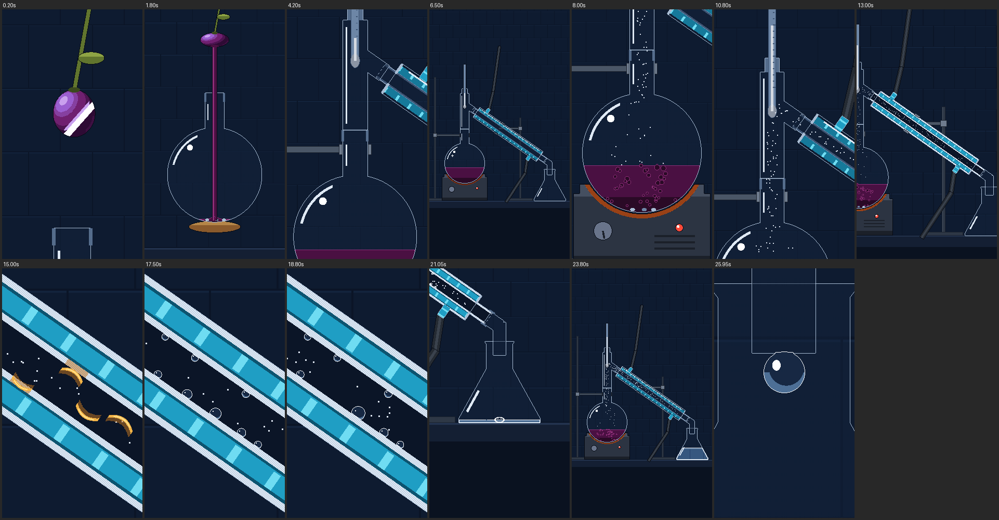

# What Happens When You Distill Grape Juice?

A 26-second looping, vertical science short in 8-bit RPG-lab pixel art, with an original chiptune soundtrack and arcade
sound effects. One grape is squeezed straight into a round-bottom flask. The juice is heated on an electric heating
mantle, and only its water leaves as vapour. A Liebig condenser cools that vapour back into clear drops, and the camera
follows one drop into the receiver. Then it pushes in on the next drop, which sits exactly where the grape was, and the
film loops.

grape → squish → flask → heating mantle → boil → vapour → condenser (cutaway) → heat crosses the glass → beads →
merge → one drop → receiver → both liquids together → the next drop = the grape.



- **Format.** 1080×1920 (9:16), 30 fps, exactly 26.0 s (13 bars of 4/4 at 120 BPM), H.264 video with 48 kHz stereo
  AAC. The default export is `./out/grape-juice-distillation.mp4`, relative to this folder.
- **One continuous camera.** The 14 story beats are timing marks on one moving camera, not cuts. There are only two
  cuts, and both are matched:
  - At 4.0 s, on the flask's neck. The neck keeps the same place, level and highlight, so the assembled apparatus
    simply appears around it.
  - At the loop. The last frame is a clear drop with the grape's size, outline and glint, so the video cuts to the
    grape on the downbeat. The last-frame drop is 80×80 px centred at (134.5, 199.5) on the 270×480 canvas; the
    first-frame grape is 80×88 px centred at (137.5, 200.5).

  The quality gate sees the whole film as a single shot. There is no morph, no fade and no freeze.
- **Seamless loop.** The music's last bar (a G7 turnaround) resolves into the first, and every echo and reverb tail
  wraps onto the start. `python render.py --loops 3` also writes the loop three times back to back (78 s).
- **No text on screen.** There is no title card, narration, subtitles, floating HUD or decorative particles. The
  science is in the pictures and in the notes below.

## Render it yourself

Working directory: **`belajar-python/grape-juice-distillation-animation`** (this folder). You need Python 3.9+ and git.
ffmpeg comes from the `imageio-ffmpeg` package; a system ffmpeg on PATH is used if you have one.

Clone (skip if you already have the repo):

```bash
git clone -b ccr-90de552e-iir9tw https://github.com/Pudidil-dev/belajar-python.git
```

If you already cloned it earlier, update it instead (run inside `belajar-python`):

```bash
git pull origin ccr-90de552e-iir9tw
```

Go to the project:

```bash
cd belajar-python/grape-juice-distillation-animation
```

Install the dependencies:

```bash
pip install -r requirements.txt
```

Preview (540×960, fast encode, written to `out/grape-juice-distillation-preview.mp4`):

```bash
python render.py --preview
```

Render the film (1080×1920, 30 fps):

```bash
python render.py
```

The film is written to **`out/grape-juice-distillation.mp4`**, which is
`belajar-python/grape-juice-distillation-animation/out/grape-juice-distillation.mp4`. The music, effects and mix are
written next to it as WAV stems (`out/music.wav`, `out/sfx.wav`, `out/mix.wav`).

A 4-core laptop takes under a minute for the full render and about 20 s for the preview. With
[uv](https://docs.astral.sh/uv/) instead of pip:

```bash
uv run --no-project --with numpy --with pillow --with imageio-ffmpeg python render.py
```

On Windows, use `py render.py` if `python` is not on PATH.

**Options**

| Command | What it does |
|---|---|
| `python render.py --sheet 0:26:1` | one contact sheet of the whole film in `out/sheet.png` (seconds) |
| `python render.py --stills 0.2,13,23.8` | full-size PNG frames in `out/stills/` |
| `python render.py --from 12 --to 20` | only a slice of the film |
| `python render.py --fps 60` | 60 fps |
| `python render.py --scale 8` | 2160×3840 (4K vertical) |
| `python render.py --loops 3` | also `out/grape-juice-distillation-loop3x.mp4`: the seamless loop played 3 times (any N) |
| `python render.py --audio-only` | only the soundtrack (music, effects, mix) |
| `python render.py --sprites` | export every sprite to `assets/sprites/` (see below) |
| `python render.py --jobs 2` | fewer CPU cores (the default uses all) |

### Render configuration

`render.json` holds the defaults; command-line flags override them.

| Key | Default | Meaning |
|---|---|---|
| `output` | `out/grape-juice-distillation.mp4` | where `python render.py` writes the film |
| `fps` | `30` | frame rate |
| `scale` | `4` | pixel size: the 270×480 canvas × 4 = 1080×1920 |
| `crf`, `preset`, `tune` | `16`, `medium`, `animation` | x264 quality, speed and tuning |
| `audio_bitrate` | `256k` | AAC bitrate |
| `loudness_lufs` | `-14.0` | integrated loudness of the mix (true peak is kept below −1 dBTP) |
| `preview` | 2× scale, `veryfast`, crf 20 | the `--preview` settings and output path |
| `sprites` | `assets/sprites` | where `--sprites` writes the PNGs |

## The film, beat by beat

120 BPM: a bar is 2 s. All sound effects are timed from `engine/timeline.py`, the same clock that drives the picture.

| Time | Beat | Picture | Sound |
|---|---|---|---|
| 0–3 | 01–03 | **The hook.** A purple grape, already swinging on its stem in close-up. A glint sweeps its skin, it squashes, and deep-purple juice falls straight through the open neck of the round-bottom flask. The pool lands with a ripple. Time compresses as the flask fills to about a third. | glint "ting", "squish", trickle, purple "plip", soft pour plips |
| 3–5 | 04 | The flask is carried onto the heating mantle. A match cut on its neck, at the same level and highlight, shows it fitted with the still head, the thermometer (bulb just below the side arm) and the sloping condenser. | a soft seat, a glass clink on the match |
| 5–7 | 05 | Zoom out to the whole route. Cyan cooling water is already circulating before the mantle's red light clicks on. Then a brief time jump: the lining glows, the thermometer climbs and the juice starts to bubble. | water burble, the mantle "click", fast clock ticks, a rising run |
| 7–9 | 06 | **Micro-shot A.** The bubbling surface and the lower neck. Pale vapour dots rise while the purple stays below. | rhythmic "blub-blub" on the beat, a soft hiss |
| 9–12 | 07 | Tilt up the neck with the vapour, past the thermometer bulb, and track right into the condenser's inner tube. The glass rim wipes into a cutaway. No purple, splash or smoke enters the condenser. | hiss rising with the camera, a bright glass slice |
| 12–14 | 08 | **Micro-shot B.** The whole condenser in cutaway. Water enters the lower port near the receiver, climbs the jacket and leaves the upper port near the flask. Vapour runs downhill in the inner tube. The glass wall always stays between them. | water panned right to left (uphill), hiss panned left to right (downhill) |
| 14–15.5 | 09 | Push in on one section of the inner wall. Amber pulses cross from the vapour through the glass wall and die out; the water stays cyan. | a soft, warm tone per pulse (no zap) |
| 15.5–18 | 10 | Clear, white-edged beads appear on the inner wall where the vapour has cooled. | one tiny pitched pip per bead |
| 18–20 | 11 | One bead slides into another and they merge. A pause, then the camera follows the bigger drop downhill and out. | the merge "tik", silence, a soft downhill glide |
| 20–22 | 12 | The drop leaves the outlet and lands in the receiver with a transparent, white-edged splash, echoing the opening landing. | a short fall, the bright clear "plip", sparkles |
| 22–24.5 | 13 | Zoom out to both flasks. In a time-lapse the purple level falls a little and the clear level rises; the purple flask is never emptied. Both liquids hold together in one frame for over a second. | fast clock ticks, a filling tone, the two-note RPG chime |
| 24.5–26 | 14 | Push in on the next drop hanging at the outlet until its outline and glint sit exactly where the grape's were. Cut to the grape on the downbeat. | a rising whoosh into the loop |

The flask is always on the left and the receiver on the right; the view and the flow are never reversed.

## The science (as drawn)

- **What boils off.** Heating the juice turns some of its water into vapour. The juice stays purple: the grape pigments
  (anthocyanins), sugars and acids do not evaporate, so they stay behind in the flask. The pool drops only a little.
- **How the condenser works.** The vapour runs down the inner glass tube. Cold water flows through the outer jacket and
  never touches the vapour; heat leaves through the inner glass wall into that water, the vapour cools and condenses
  into drops on the inside of the tube, and the drops run downhill to the receiver.
- **Counter-flow.** The water goes in at the lower port (near the receiver) and out at the upper port (near the flask).
  This keeps the jacket full of cold water along its whole length.
- **The product.** The clear liquid is called a **water-rich distillate**: mostly water, possibly with traces of the
  juice's volatile aroma compounds. The film never calls it pure water, drinking water or alcohol, and shows no
  fermentation.
- **Visual cues only.** The vapour dots and the amber heat pulses are cues; real vapour is invisible and heat has no
  colour. Time is compressed: the pour, the warm-up and the collection are sped up.
- **The apparatus.** An electric heating mantle (not a burner), a round-bottom flask with boiling chips, a still head
  with the thermometer bulb just below the side arm, a sloping Liebig condenser, a bent adapter and an Erlenmeyer
  receiver, held by retort stands and clamps. The brief mentioned a reference image of the apparatus, but none was
  received, so the setup follows the standard simple-distillation diagrams in the sources below.

Sources checked:
- Royal Society of Chemistry: [Simple distillation, practical videos for 14–16 students](https://edu.rsc.org/practical/simple-distillation-practical-videos-14-16-students/4012011.article)
  (coloured solution, water in at the lower end of the jacket and out at the higher end)
- Royal Society of Chemistry: [Recovering pure water from a solution using a water condenser](https://edu.rsc.org/resources/recovering-pure-water-from-a-solution-using-a-water-condenser/1767.article)
  (the coloured solute stays behind)
- LibreTexts, Nichols, *Organic Chemistry Lab Techniques*: [7.21 Simple Distillation](https://chem.libretexts.org/Bookshelves/Organic_Chemistry/Organic_Chemistry_Lab_Techniques_(Nichols)/07%3A_Technique_Summaries/7.21%3A_Simple_Distillation)
  (thermometer bulb position, condenser water direction, heating mantle)
- LibreTexts, Meredith College: [9.03 Simple Distillation Procedure](https://chem.libretexts.org/Courses/Meredith_College/Organic_I_Techniques/09:_Distillation/9.03:_Simple_Distillation_Procedure)
- American Chemical Society, Middle School Chemistry, [Chapter 2, Lesson 3](https://www.acs.org/middleschoolchemistry/lessonplans/chapter2/lesson3.html)
  (the coloured-water condensation demo). This session's network could not reach www.acs.org, so this page was not
  read. To check it from a cloud session, www.acs.org has to be allowed in the environment's network settings.

## How it is made

- **Picture** (`engine/`). Every frame is drawn in code on a 270×480 pixel canvas and scaled exactly 4×
  nearest-neighbour. Nothing is a bitmap that gets enlarged. The scene is a world measured in millimetres seen by one 2D
  camera, and every object is redrawn at the camera's own scale. So each zoom level has its own sprite with its own
  detail:
  - **wide** (about 1 px/mm): the whole apparatus, stands, hoses and both flasks;
  - **close-up** (2.2–4.7 px/mm): the grape's shading and glint, the thermometer's graduations, frosted glass joints,
    boiling chips and bubbles;
  - **cutaway** (10–13 px/mm): the hatched cut glass walls, solid cyan water, the dark inner bore with vapour, beads
    stuck to the wall like domes, and the hanging drop.
- **Look.** Bold silhouettes, stepped 1-px outlines, a limited flat palette and one checker dither for glass, with small
  animated glints on the glass. There are no gradients and no 3D camera.
  - Dark navy background.
  - Deep purple juice: a red-leaning grape purple, so it never reads as blue.
  - Violet only as highlights on the grape.
  - Cyan only for the cooling water.
  - White edges for the clear drops and the glass.
  - Amber only for the heat cue.
  - The clear liquid lets the wall tiles show through, so it reads as transparent.
- **Sound** (`engine/audio.py`). Everything is synthesized, with no samples:
  - **Chip voices:** band-limited pulse waves, an NES-style triangle bass, LFSR noise drums, echo and FM bells.
  - **Music:** 120 BPM in C major, 13 bars. The square-wave hook (E5 G5 C6 B5 G5 | A5 C6 E6 D6 C6) opens the loop and
    comes back for the payoff. A bouncy octave bass, a galloping boil section, and a light kit.
  - **Space for the key moments:** the melody rests and the music dips under the squeeze, the merge (with its pause)
    and the final drop. Against a −19 dB median, the music sits at −24 to −31 dB under the squeeze, −37 dB under the
    merge and about −40 dB under the final plip.
  - **Effects:** squish, purple plip, mantle click, blub-blub boil, soft heat tone, merge tik, bright clear plip and
    two-note chime, all on the picture's clock.
  - **Loudness:** the mix is −14 LUFS with true peak below −1 dBTP.

## Assets

- **Sprites** (`assets/sprites/`): 18 transparent PNGs exported from the drawing code, covering every object at the
  scales the film uses (wide, close-up and cutaway), plus `_sheet.png`, a labelled overview. The code is the source:
  to change a sprite, edit `engine/grape.py` or `engine/rig.py`, then run `python render.py --sprites`.
- **Original audio** (`assets/audio/`): `music.wav`, `sfx.wav` and `mix.wav` (48 kHz, 16-bit, stereo, exactly 26 s,
  loop-ready). `python render.py` regenerates the same stems into `out/` every time it renders the film; to refresh
  these copies, run `python render.py --audio-only --out assets/audio`.

## Files

- `render.py`: the command line (film, preview, stills, contact sheets, loops, audio only, sprites).
- `render.json`: the render configuration.
- `engine/`:
  - `timeline.py`: one clock for picture and sound (the 14 beats, events, easing, the loop's match point).
  - `palette.py`, `gfx.py`: the palette and the pixel toolkit (upscaling).
  - `world.py`: the millimetre world, the 2D camera and the pixel shape masks.
  - `grape.py`: the grape, its squash and the juice stream.
  - `rig.py`: the apparatus (mantle, flask, still head, thermometer, condenser with its cutaway, hoses, adapter,
    receiver, stands) and the vapour, heat pulses, beads and drops.
  - `scenes.py`: the camera path and frame assembly.
  - `sprites.py`: the sprite export.
  - `audio.py`: synthesizer, score, effects, master.
- `assets/sprites/`, `assets/audio/`: the exported sprites and the original soundtrack.
- `镜头表.md`: the shot list (style lock, palette, 12 shots).
- `docs/交付说明.md`: delivery notes and the quality-gate results.
- `docs/storyboard.png`: one frame from each beat.
