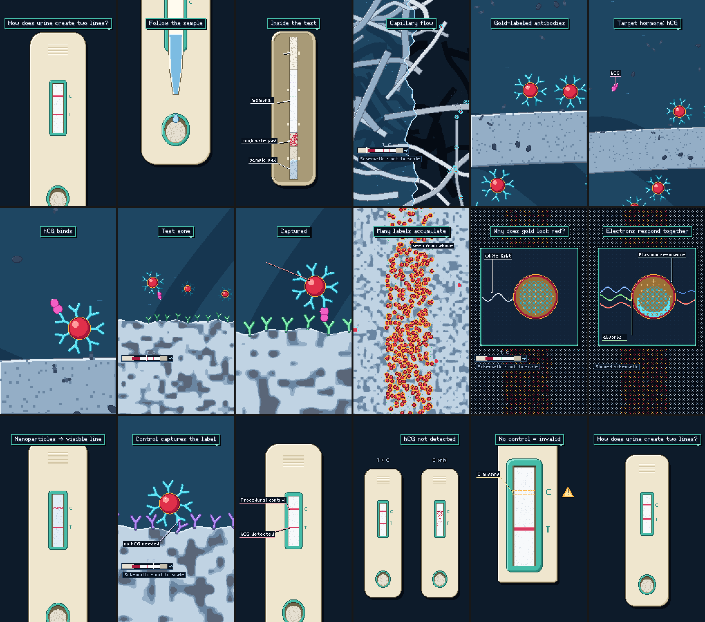
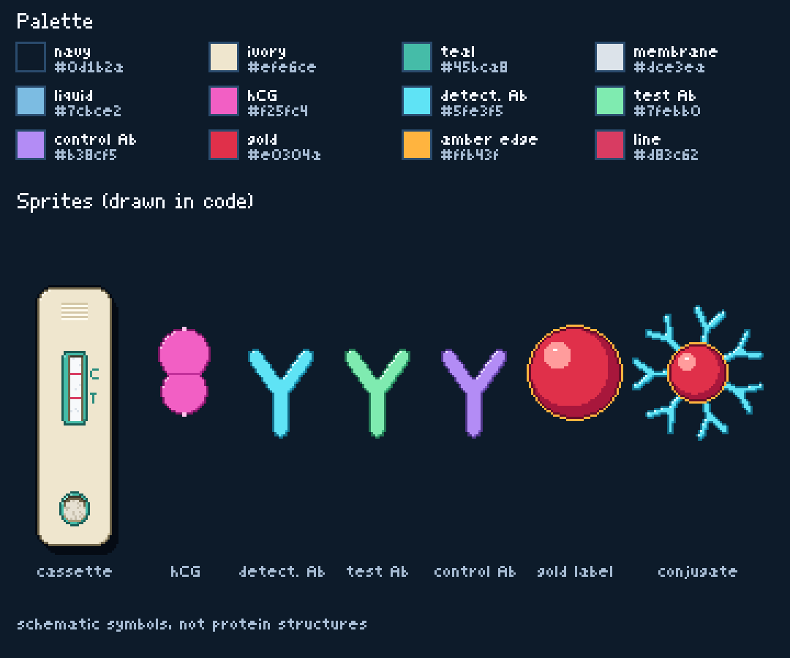

# How a Pregnancy Test Creates Two Lines — 16-bit pixel-art science animation (code project)

**From hCG molecules to gold nanoparticles.** A 72-second, 9:16, 60 fps, seamless-loop explainer in original 16-bit
pixel art: a finished test with two red lines asks "How does urine create two lines?"; a fresh cassette takes a drop;
the shell peels away to show the strip; the view dives into the sample pad and turns sideways; liquid creeps through
the fibres, dissolves the dried gold-antibody labels and carries one hCG molecule onto one label; the complex rides
the flow to the test zone, where a second antibody grabs hCG's other site — a sandwich; label after label piles up;
an inset opens one gold particle and shows its electrons sloshing together in the light's field, the green part of
the light taken out; the view pulls back until thousands of separate dots read as the red line; a lens shows the
control antibody catching a label without any hCG; then positive, negative ("hCG not detected") and invalid ("no
control") results — and the original cassette slides back into the opening frame.

Model shown (one representative architecture, not every product): a non-digital sandwich lateral-flow immunoassay,
mouse anti-hCG detection antibodies on colloidal gold, immobilised anti-hCG capture antibodies at T, immobilised
anti-mouse IgG at C. Original BGM: an addictive, bouncy pixel-game chiptune; SFX from the same chip, each on its
picture event.



| | |
|---|---|
| Video | 1080×1920, 60 fps, exactly 4,320 frames (72.000 s), H.264 High, yuv420p, BT.709. The art is drawn on a **180×320 pixel canvas** and scaled **exactly 6× nearest-neighbour**: every pixel is a crisp 6×6 block (and 4:2:0 chroma never straddles a pixel edge). Stepped sprite motion (15 Hz jitter steps), no interpolation, no anti-aliasing, no blur. |
| Audio | Original chiptune score, 120 BPM, 36 bars of 2 s = 72.000 s, D major, plus 107 SFX read from the picture's event table. AAC 256 kbit/s, 48 kHz stereo. Full mix −16.0 LUFS integrated, true peak −1.7 dBTP. |
| Loop | Frames 0…4319 are unique samples at t = f/60; the last frame is the moment just before frame 0. Frame 0 and the last frame show the same finished cassette, framing, line intensity, ground and question (they differ only by the caption cursor's regular blink); every sound that runs past 72 s wraps to 0:00. |
| Text | English. One dominant caption at a time (top, game-style dialog box, typed in), short annotations beside objects, "Schematic • not to scale" during magnification. No narration, no subtitles. |

## Render it yourself

Requirements: **Node ≥ 18**, **ffmpeg** with libx264, **Python 3** with **numpy** and **scipy** (mastering). No
browser and no GPU are needed — the frames are computed in Node.

```
cd hcg_test_pixel
node tools/export.js                      # everything: the picture once, then all four MP4 variants + three WAVs
```

That writes:

| File | Sound |
|---|---|
| `output/Pregnancy_Test_Two_Lines.mp4` | music + SFX |
| `output/Pregnancy_Test_Two_Lines_No_Music.mp4` | SFX only — no background music |
| `output/Pregnancy_Test_Two_Lines_No_SFX.mp4` | music only — no SFX |
| `output/Pregnancy_Test_Two_Lines_Silent.mp4` | no audio track (silent master) |
| `output/audio/Pregnancy_Test_Two_Lines_Full_Mix.wav`, `…_Music_Only.wav`, `…_SFX_Only.wav` | 24-bit / 48 kHz stems |

Only one variant, or a few:
```
node tools/export.js --mix full           # Pregnancy_Test_Two_Lines.mp4 (music + SFX)
node tools/export.js --mix nobgm          # _No_Music (SFX only)
node tools/export.js --mix nosfx          # _No_SFX (music only)
node tools/export.js --mix silent         # _Silent (no audio)
node tools/export.js --mix nobgm,silent   # several, comma-separated
node tools/export.js --audio-only         # only the three WAVs
node tools/export.js --video-only         # only the silent picture build/video.mp4
node tools/export.js --rerender           # render the picture again even if build/video.mp4 is current
```
The picture is rendered **once** (a few milliseconds per frame; the whole export, all variants included, took about
a minute on a 4-core machine) and kept as `build/video.mp4` with a fingerprint of the sources; another variant later only re-muxes it.
The three audio renders and the mastering take about 20 s. All audio versions share **one common gain**, so the
music-only and SFX-only versions are exactly as loud as they sit in the mix.

Preview without rendering: open **`index.html`** in a browser (self-contained player: click to play, ←/→ to seek,
M to mute; picture and sound loop seamlessly). After editing `src/`, rebuild it with `node tools/build.js`.
Stills / contact sheet: `node tools/stills.js build/sheet.png 2.2 26.8 46.9 --scale 3 --cols 3`.
Documentation images: `node tools/sheet.js` (writes `docs/sprite_sheet.png` and `docs/keyframes.png`).

Check the loop after rendering (three repetitions; watch both joins):
```
printf "file 'Pregnancy_Test_Two_Lines.mp4'\nfile 'Pregnancy_Test_Two_Lines.mp4'\nfile 'Pregnancy_Test_Two_Lines.mp4'\n" > output/loop3.txt
ffmpeg -f concat -safe 0 -i output/loop3.txt -c copy output/loop_check_3x.mp4
```

## Storyboard and editing timeline (18 scenes × 4 s = 2 bars each)

| s | scene | what happens on screen | text | camera | sound (on the frame of its event) |
|---|---|---|---|---|---|
| 0–4 | 01 two-line mystery | the finished cassette, two red lines; a glint runs across T, then C | **How does urine create two lines?** | slow push to the window | hook motif; two plinks on the glints |
| 4–8 | 02 a fresh test | match cut to an unused cassette (same framing, clean window); a dropper tip lets one pale-blue drop fall into the well; it soaks in | **Follow the sample** | pan down to the well | cut tick, drop, soft absorption |
| 8–12 | 03 reveal the strip | the top shell peels away bottom→top; sample pad, red conjugate pad, membrane (faint T/C markers), absorbent pad; the front creeps up | **Inside the test** + pad tags | pull back, track the front | reveal sweep, one click per layer |
| 12–16 | 04 capillary flow | the view dives into the sample pad **and turns 90° on screen** (flow arrow appears); liquid fills the gaps between fibres, the front advances right | **Capillary flow** · chip · mini-map | dive, then held | rising zoom + turn, granular flow texture, drips |
| 16–20 | 05 release the labels | the front reaches the conjugate pad; ruby gold particles with cyan antibodies, dried on a fibre (sugar crust), float free one by one; a lock-on bracket picks one | **Gold-labeled antibodies** | scale dive into the fibre | four release ticks, lock-on |
| 20–24 | 06 meet the target | a magenta two-lobed hCG drifts in with the liquid among grey non-target molecules | **Target hormone: hCG** + "hCG" tag | pull back, follow | the hCG two-note motif |
| 24–28 | 07 first binding | hCG jiggles, turns in three small steps, its detection site meets one antibody's arm tip; the three stay separate sprites | **hCG binds** | push in, hold | three nudges, soft binding click |
| 28–32 | 08 approach the test zone | the complex rides the flow onto the membrane; mint antibodies stand anchored on the floor; other labels pass behind | **Test zone** · mini-map | pull out, travel right, settle | whoosh, anticipation riser |
| 32–36 | 09 the sandwich | a mint antibody grabs hCG's second site: membrane → capture Ab → hCG → detection Ab → gold lights up link by link | **Captured** + four part tags | small push, hold | stronger capture click, five link blips |
| 36–40 | 10 many captures | the view steps back on the beat while more complexes land; the side view flips to the top view and red dots pile up in the band | **Many labels accumulate** · "seen from above" | stepped pull-back, flip | step bloops, rhythmic capture clicks, flip |
| 40–44 | 11 why gold looks red | one dot is locked; a framed inset opens on it; white light arrives as a wave | **Why does gold look red?** · "white light" · mini-map | into the inset | lock-on, window blips, bright optical tone (percussion out) |
| 44–48 | 12 electron-scale reveal | the cyan electron cloud sloshes up and down as one over the fixed amber ion core (− and + sides); the light splits into strands: green ends at the particle, red goes on | **Electrons respond together** · "Plasmon resonance" · "absorbs green" · "red goes on" · "Slowed schematic" | locked | an oscillating tone whose pitch and pan follow the cloud; prism blips |
| 48–52 | 13 the line becomes visible | the inset closes; the view pulls back and turns upright; thousands of separate dots shrink into the T line in the window (the C line is forming too) | **Nanoparticles → visible line** | pull back + turn | window close, falling sweep, resolving chord |
| 52–56 | 14 the control mechanism | a lens opens on the C zone: a spare label without hCG; a violet anti-mouse antibody grabs the cyan antibody itself | **Control captures the label** · "no hCG needed" | lens in, hold | lens, a distinct two-tone control click |
| 56–60 | 15 two zones, two jobs | the lens closes; both lines in the window | "hCG detected" (T) · "Procedural control" (C) | held | two related confirmation notes |
| 60–64 | 16 without detectable hCG | split screen: the positive cassette and a second strip where red dots pass T without stopping and stack at C | **hCG not detected** · "T + C" / "C only" | pull back, slide | slide, trickle, one control note |
| 64–68 | 17 the control matters | a separate result window: a T line, no C line, amber dashes where C should be, an amber warning sign | **No control = invalid** · "C missing" | static | slide, restrained caution tone |
| 68–72 | 18 loop return | the window is pushed out as the original finished cassette slides back into the exact opening position and stops; the question types again | **How does urine create two lines?** | slide in, rest | slide, landing thump; the hook returns |

The shot list the film was built from is `镜头表.md` (written and linted with the huashu-art-motion skill before any
code). All event times live in one table, `src/03_clock.js`; picture and sound both read it.

## Sprite and palette sheet



Every sprite is drawn by code, rasterised on the 180×320 grid at whatever zoom the camera has, so pixels stay square
and the same size in every shot. Shading is discrete 16-bit style (a light rim top-left, a shadow band bottom-right,
an outline in the darkest shade of the same colour); translucency (liquid, the electron cloud) and dissolves use an
ordered 4×4 dither — never a gradient.

| colour | means |
|---|---|
| deep navy | the ground |
| ivory + restrained teal | the cassette (no logo); T and C are marked beside the window |
| pale grey mesh | the porous membrane and pads (blue-grey once wet) |
| translucent pale blue | the liquid and its wetting front (illustrative colour coding) |
| magenta, two lobes | hCG, the target protein (two accessible sites marked as small pale bumps) |
| cyan Y | mouse anti-hCG detection antibody, on the gold |
| mint Y | test capture antibody, anchored on the membrane |
| violet Y | anti-mouse control antibody, anchored downstream |
| ruby disk + thin amber edge | the gold nanoparticle label (the amber edge is a teaching convention, not shine) |
| red / pink | the visible result lines |
| muted amber disk with "+" / translucent cyan | the particle's fixed positive ions / its conduction-electron cloud |

## Keyframes and motion (the brief's prompts, as code)

No image generator is used; the brief's keyframe prompts were followed as drawing specifications, and every motion
is deterministic (the same t always gives the same frame):

- **Device hook (shot A):** generic cassette, sample well near the lower end, result window in the middle, C
  downstream (above) of T, centred on navy — `src/10_device.js`.
- **Molecular capture (shot B):** side view; a mint antibody anchored in the membrane binds hCG's lower site with one
  arm tip; a cyan antibody binds hCG's upper site; that antibody stays on its ruby gold particle with six more
  antibodies around it; the chain is continuous, nothing clips or fuses — `src/12_mol.js`, `src/21_story.js`.
- **Electron response (shot C):** a framed inset, muted amber positive core, cyan electron density displaced as one
  region by the light's field; no orbits, no emission, no laser, no wire — `src/14_inset.js`.
- **Control capture (shot D):** a violet anchored antibody's arm tip meets the side of a cyan antibody on a label
  carrying no hCG (the contact is chosen by a small geometric search so nothing else touches) — `src/20_scenes.js`.
- **Molecular flow:** net flow to the right plus small random motion stepped at 15 Hz; anchored antibodies never move;
  no swimming, no attraction at a distance — binding happens only on contact after a small turn.
- **Line reveal:** each captured label is its own dot (1,500 in the band); the pull-back turns the view upright and
  the dots shrink until the band reads as the line — no single particle becomes the line.
- **Scale changes:** the two 90° turns are Mode-7-style affine blits of the native pixel buffer (the SNES trick);
  worlds meet through ordered-dither dissolves, a squash-and-expand flip (side view → top view) and a circular lens.

## Music and SFX

**Score** (D major, 120 BPM, two bars per scene): a question-like hook (F#–A–D–C#–A… ending on E over A) in bars
1–2 · an answer · the hook again for the reveal · flowing 16th-note arpeggios for capillary flow · a high sparkle
for the gold labels · the hCG two-note motif (A→D, a fourth up) in the lead · the bind · a build with rising arps
and a snare roll · a crash and a triumphant F#→A exactly on the capture click · dense driving 16ths while labels
accumulate · percussion out and a soft chip-chord pad for the optics (bars 21–24) · the full chorus when the line
appears and the control works · a calm comparison · a minor-coloured caution bar · the hook again, whose last E over
A falls back into bar 1. Two pulse channels, a 4-bit stepped triangle bass, LFSR noise drums, the 60 Hz
arpeggiated chip chord, a dotted-eighth ping-pong echo on the lead.

**SFX** (107 cues, all chip-made, all illustrative — molecules make no sound): drop, absorption, reveal sweep and
layer clicks, dive and 90° turn, granular capillary texture with drips, release ticks, lock-on, hCG motif, turning
nudges, binding click, riser, a stronger capture click, chain blips, step bloops, rhythmic capture clicks, flip,
window open/close, bright optical tone, the oscillating tone (its pitch and pan follow the drawn electron cloud),
prism split, falling sweep, resolving chord, lens, a distinct two-tone control click, two related confirmation notes
(T then C) and the same C note for the negative strip, a restrained caution tone, slides and a landing thump, soft
dialog-box blips. In the full mix the music dips slightly under the biggest hits.

## Science kept honest (the brief's checklist)

- One representative architecture; the film never says every test uses gold. No waiting time, threshold or volume.
- The gold labels are ruby before the test is used (red conjugate pad in the cutaway, dried labels on the fibre) and
  never change colour; the test zone only concentrates labels — nothing is made there.
- Liquid moves by capillary flow (no pump, no jet); the sample flows sample pad → conjugate pad → T → C → absorbent
  pad everywhere; T and C never swap; the sideways molecular view is entered by a visible 90° turn with a flow arrow
  and a strip mini-map.
- Binding by encounter, a small turn and contact; hCG, antibody and gold remain separate objects; capture uses two
  different sites on hCG; one captured molecule never makes a line — many labels do.
- The electron cloud moves collectively and stays inside the particle; colour comes from green being absorbed and
  scattered and the rest reaching the eye — no light is converted, nothing glows.
- The control antibody recognises the detection antibody, with no hCG bridge; the order in which lines appear is not
  implied (the C line is already forming while T is revealed).
- Negative = "hCG not detected" (an early sample can be below detection), never "not pregnant"; no control line =
  invalid, so counting lines is not enough. "Schematic • not to scale" and "Slowed schematic" are shown during
  magnification; time is compressed.

## QA (numbers, not a viewing test)

- **Shot list** — `storyboard_lint`: yellow only: the question is on screen in shot 1, which the brief requires
  ("use the question immediately") and the loop needs (it returns at the boundary).
- **Film gate** — `film_gate.py` on a 720×1280 / 30 fps proxy (`node tools/proxy.js`): **passed** — fast-motion frames
  13.6 % (worst 30-s window 8.2 %), no blank frames, blue-purple frames 0.0 %, 18 shots, 7.5 push-ins per minute
  (green). One yellow: fixed screen chrome 43 % of the time — the dialog-box caption (the brief's one dominant caption) and the long readable holds on the cassette in
  scenes 15–18; the mini-map and the scale chip appear only when the view magnifies or travels.
- **Motion** — `node tools/qa_motion.js`: no hard jumps; still stretches are the readable holds the brief asks for
  (sandwich, results, invalid window, the loop landing); 0 % blue-purple frames; rendering is deterministic.
- **Loop** — the last frame and frame 0 differ in 0.016 % of the pixels (the caption cursor's regular blink, which
  toggles every 0.25 s on a global clock); in the WAVs the sample step across the join (0.0004) is smaller than the
  median step (0.0027).
- **Sync** — `node tools/sync_qa.js`: 114 event times, 111 on the eighth-note grid (exact frames) and 3 sixteenths
  (drawn on the nearest frame, at most 8.33 ms off); all 107 SFX start exactly on their event; 54 percussive onsets
  measured on the SFX stem: median 0.38 ms, max 1.44 ms from their event.
- **Audio** — `node tools/audio_qa.js`: full mix −16.0 LUFS, true peak −1.65 dBTP (limiter 0.1 dB), music −16.7
  LUFS, SFX −22.1 LUFS; 85 of 107 cues are within 6 dB of the music or louder in their strongest octave band (the
  rest are deliberately soft dialog blips and nudges).

## Self-review against the skill's six failure modes

1. **Slide-deck feel** — no page frame or bullet list; one picture event per scene; camera moves vary (push, pan,
   dive, stepped pull-back, flip, lens, turn) and come back out after going in; the ending is an action on the main
   object (the cassette sliding back and stopping), not a closing card.
2. **Copying a demo** — composition, objects and the "strip as a side-scrolling level" idea are new for this subject.
3. **No concrete object** — every scene names a concrete object and what it does (shot list).
4. **Dead background / empty frame** — the subject fills the frame; the level background is liquid with flow streaks;
   no blank frames (film gate). The device ground is flat deep navy, as the brief asks (no filler particles).
5. **Real material drawn in code** — none was supplied; the cassette is generic and unbranded.
6. **AI look** — one style and one palette throughout, no blue-purple gradients or neon, no glow on the particle, no
   faces on molecules, no characters.

No separate reviewer agent was used. The assay chemistry follows standard descriptions of hCG sandwich lateral-flow
tests and gold-nanoparticle plasmon optics; specific values were not re-checked against online sources.

## Files

`镜头表.md` shot list · `index.html` self-contained preview player (built) · `src/` the film: `00_core.js` pixel
buffer, rasterisers, masks, camera, Mode-7 blit · `01_font.js` pixel fonts · `02_util.js` noise, splines, RNG ·
`03_clock.js` beat grid and the event table · `05_fx.js` small helpers · `10_device.js` cassette, strip, wetting
front, dropper · `11_level.js` the strip as a side-scrolling level (fibres, membrane floor, anchored antibodies,
liquid) · `12_mol.js` hCG, antibodies, gold, sparkle, lock-on · `13_top.js` the membrane from above, 1,500 labels ·
`14_inset.js` the nanoparticle inset · `20_scenes.js` cameras, turns, flip, lens, results, loop · `21_story.js` the
hero's journey and the captures · `24_overlay.js` dialog box, tags, chip, mini-map · `25_text.js` the text track ·
`30_audio.js` score and SFX · `40_player.js` browser player · `tools/` export, build, mastering, QA, sheets ·
`docs/` sprite and palette sheet, keyframe board.
