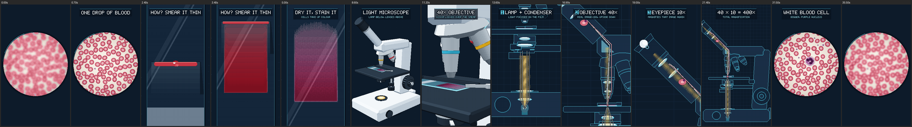

# What One Drop of Blood Looks Like Under a Microscope

A 36-second looping, vertical medical-science short in 16-bit pixel-art "lab game" style, with an original chiptune
soundtrack. It opens inside the microscope, where red blood cells snap into focus. Then it shows how that image was
made:

cells in the eyepiece → the drop → thin film → stained slide → microscope → an x-ray view of how the lenses make the
image → focus → moving the stage → the white blood cell → back to the opening cells.



- **Format.** 1080×1920 (9:16), 30 fps, exactly 36.0 s (18 bars at 120 BPM), H.264 video with 48 kHz stereo AAC.
  The default export is `./out/light-microscope.mp4`, relative to this folder.
- **Loop.** At the end the stage glides from the white cell back to the opening field and the focus softens, so the last
  frame flows straight into the first: no cut, no fade, no freeze (last vs first frame: 0.014/255). The music's last
  bar (a D7 turnaround) resolves into the first, with no click at the join. Platforms that replay the video (TikTok,
  Reels, Shorts) play it as an endless loop. `python render.py --loops 3` also writes the loop three times back to back
  (`out/light-microscope-loop3x.mp4`, 108 s) for players that don't loop.
- **Three moments worth replaying:** the cells snapping into focus (the hook), the glass swipe, and the plum-stained
  white cell sliding into view.
- **Captions.** Short context captions (8 words or fewer) sit at the top of the frame, in a 5×7 pixel font. The x-ray
  steps get numbered badges. The first half-second has no text, so the hook is the cells themselves, not a title.

## Render it yourself

Working directory: `belajar-python/light-microscope-animation` (this folder). You need Python 3.9+ and git; ffmpeg
comes from the `imageio-ffmpeg` package (a system ffmpeg on PATH is used if you have one).

Clone (skip if you already have the repo):

```bash
git clone -b ccr-90de552e-iir9tw https://github.com/Pudidil-dev/belajar-python.git
```

If you already cloned it earlier, update it instead (run inside `belajar-python`):

```bash
git pull origin ccr-90de552e-iir9tw
```

Go to the project:

```bash
cd belajar-python/light-microscope-animation
```

Install the dependencies:

```bash
pip install -r requirements.txt
```

Preview (540×960, fast encode, written to `out/light-microscope-preview.mp4`):

```bash
python render.py --preview
```

Render the film (1080×1920, 30 fps, written to `out/light-microscope.mp4` with the music, effects and mix as WAV stems
next to it):

```bash
python render.py
```

A 4-core laptop takes about 5 minutes for the full render and about 4 for the preview (the 3D microscope shots are ray
traced). With [uv](https://docs.astral.sh/uv/) instead of pip:

```bash
uv run --no-project --with numpy --with pillow --with imageio-ffmpeg python render.py
```

On Windows, use `py render.py` if `python` is not on PATH.

**Options**

| Command | What it does |
|---|---|
| `python render.py --sheet 0:36:1` | one contact sheet of the whole film in `out/sheet.png` (seconds) |
| `python render.py --stills 1,17,31` | full-size PNG frames in `out/stills/` |
| `python render.py --from 12 --to 22` | only a slice of the film |
| `python render.py --fps 60` | 60 fps |
| `python render.py --scale 8` | 2160×3840 (4K vertical) |
| `python render.py --loops 3` | also `out/light-microscope-loop3x.mp4`: the seamless loop played 3 times (any N) |
| `python render.py --audio-only` | only the soundtrack (music, effects, mix) |
| `python render.py --jobs 2` | fewer CPU cores (the default uses all) |

## The film, scene by scene

120 BPM: a bar is 2 s, and every event lands on the 8th-note grid.

| Time | Picture | Caption | Sound |
|---|---|---|---|
| 0–2 | **The hook: inside the microscope.** The round eyepiece view of a crowded field of pink red blood cells, soft at first, snaps into focus. The pale centres pop. Only the sharpness changes. | ONE DROP OF BLOOD | a crisp arcade "tik" on the beat |
| 2–4 | **How it was made: the glass swipe.** Macro: a red drop on a slide. The edge of a second slide comes back onto it, the blood runs sideways along the edge, and one smooth swipe draws it into a film that thins to a feathered far end. | HOW? SMEAR IT THIN | a glassy tink, the "shhk" swipe |
| 4–6 | **The prepared slide.** The same slide at the same angle. A dithered match dissolve brings in the dried, stained slide while the light's reflection crosses the glass: time has passed. | DRY IT, STAIN IT | a soft glassy swell |
| 6–9 | **Reveal the microscope.** The slide slides onto the stage, the spring clip closes, and the camera pulls back to the whole white microscope in three-quarter view. The lamp glows below, the condenser sits under the stage, the slide is on the stage and the objectives are above. | ONTO THE STAGE · LIGHT MICROSCOPE | glass on metal, a light metallic "tik" |
| 9–12 | **The objective clicks in.** Closer to the nosepiece: it turns until the blue-banded 40× objective sits right above the smear and locks. The camera drops toward the lamp. | 40× OBJECTIVE | a ratchet, one firm "click" |
| 12–15 | **X-ray, step 1.** A scan line turns the microscope see-through. Light from the filament is made parallel by the collector lens and focused by the condenser to a point on the thin film. | 1 LAMP + CONDENSER | x-ray buzz, a rising arcade whoosh with the light |
| 15–17.5 | **X-ray, step 2.** Three rays from one cell cross the objective and the prism and meet in the tube as a bigger, upside-down copy of the cell. Its plum spot has moved to the other side. | 2 OBJECTIVE 40× | ray zips, a pop as the image appears |
| 17.5–20 | **X-ray, step 3.** The rays leave that image and pass through the eyepiece, which works like a magnifying glass, to the eye. | 3 EYEPIECE 10× | ray zips, a ping at the eye |
| 20–22 | **The whole path.** The camera pulls back over the complete light path. | 40 × 10 = 400× | a three-note fanfare |
| 22–26 | **Find the focus.** The fine-focus knob turns slightly; match cut into the eyepiece. The fuzzy pink discs sharpen in place until their pale centres show. Only the sharpness changes, not the zoom. | FINE FOCUS · RED BLOOD CELLS | knob ticks; the music thins; a crisp high note at 24.5 |
| 26–30 | **Move across the sample.** A small turn of the stage control, then the whole field glides sideways together and a larger plum-stained cell enters from the edge. | MOVE THE STAGE | knob ticks, a soft glide |
| 30–33 | **The reveal.** The field stops on a white blood cell (a neutrophil: plum, lobed nucleus, pale granular cytoplasm) among the smaller pink red cells. | WHITE BLOOD CELL | a two-note chime |
| 33–36 | **The loop.** The stage glides on, the white cell leaves at the side, the opening field comes back and the focus softens into the very first frame. | ALL FROM ONE DROP | a soft glide, the focus sinking, the D7 turnaround |

**The science (as drawn).**
- **Preparation.** A wedge smear spreads the blood into a thin film. Its thin end is one cell thick, which is where you
  look. Drying and staining colour the red cells pink (eosin) and white-cell nuclei purple, so they show up in bright
  light.
- **Illumination.** The lamp's collector and the condenser under the stage focus a cone of light onto the specimen. The
  field and aperture diaphragms set how wide and how steep that light is.
- **The objective.** It forms a real, magnified, upside-down image inside the tube.
- **The eyepiece.** That image sits just inside the eyepiece's focal length, so the eyepiece works like a magnifying
  glass. It makes a further-enlarged virtual image that the eye sees.
- **Total magnification.** Objective × eyepiece: 40× × 10× = 400×.
- **Focus and stage.** Focusing changes only the sharpness; moving the stage moves the whole field; the cells stay put
  on the slide.

The ray diagram is a true paraxial thin-lens trace through the model's own lens positions. The magnification it shows
on screen is the diagram's (about 6×); the captions give the real 40× and 400×.

Sources checked for the optics:
- [OpenStax College Physics, "Microscopes"](https://phys.libretexts.org/Bookshelves/College_Physics/College_Physics_1e_(OpenStax)/26:_Vision_and_Optical_Instruments/26.04:_Microscopes)
- [University Physics, "Microscopes and Telescopes"](https://pressbooks.online.ucf.edu/osuniversityphysics3/chapter/microscopes-and-telescopes/)
- [ZEISS Campus, "Köhler illumination"](https://zeiss-campus.magnet.fsu.edu/articles/basics/kohler.html)
- [Leica, "Koehler Illumination: a brief history and a practical set-up"](https://www.leica-microsystems.com/science-lab/microscopy-basics/koehler-illumination-a-brief-history-and-a-practical-set-up-in-five-easy-steps/)

## How it is made

- **Picture.** Every frame is drawn in code on a 270×480 pixel canvas and scaled exactly 4× nearest-neighbour. Each
  zoom level has its own artwork:
  - **macro** (`engine/slide.py`): the glass slide, the drop, the spreader and the film;
  - **wide** (`engine/scope.py` + `engine/rt.py`): the microscope, ray traced in numpy from boxes, cylinders and cones,
    then shaded from palette ramps with Bayer dithering and 1-px outlines, like 16-bit pre-rendered sprites;
  - **x-ray** (`engine/xray.py`): the same model in orthographic side view, made see-through, with the ray diagram;
  - **microscopic** (`engine/field.py`): a stained smear of about 1,300 red cells, the neutrophil and platelets. The
    stain's optical density is blurred for focus and passed through Beer-Lambert light, then ordered-dithered.
- **Sound** (`engine/audio.py`). Everything is synthesized, with no samples:
  - **Chip voices:** band-limited pulse waves, a triangle bass, LFSR noise drums, echo and FM bells.
  - **Music:** 120 BPM in G major, 18 bars. The square-wave hook (D6 B5 D6 G6 F#6 | A5 D6 F#6 E6 D6) opens the loop
    and comes back after the focus.
  - **Effects:** timed from `engine/timeline.py`, so they play on the beat. The music ducks a touch under each main
    action and thins for the focus.
  - **Loudness:** the mix is −14 LUFS with true peak below −1 dBTP.

## Files

- `render.py`: the command line (film, preview, stills, contact sheets, audio only).
- `engine/`:
  - `timeline.py`: one timeline for picture and sound (scenes, events, easing, canvas places).
  - `palette.py`, `gfx.py`, `pixfont.py`: the palette, the pixel drawing kit, the bitmap font.
  - `slide.py`: macro glass slide, drop, spreader, fresh and stained films.
  - `rt.py`: the small vectorized ray tracer (solids, camera, outlines).
  - `scope.py`: the microscope model, its shading, its animated parts and the 3D camera.
  - `xray.py`: the x-ray side view and the thin-lens ray diagram.
  - `field.py`: the view through the eyepiece.
  - `captions.py`: the caption track.
  - `scenes.py`: which scene is on screen at each moment, and the transitions.
  - `audio.py`: synthesizer, score, effects, master.
- `镜头表.md`: the shot list (style lock, palette, 13 shots).
- `docs/交付说明.md`: delivery notes and the quality-gate results.
- `docs/storyboard.png`: frames from each scene.
