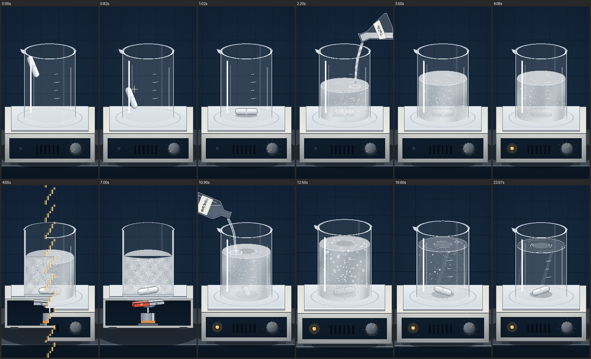

# How a Magnetic Stirrer Spins Without Touching

A 24-second vertical science short in 8-bit/16-bit pixel-art lab-game style, with an original 120 BPM chiptune and
arcade sound effects. It has no title card, no narration, no subtitles and no floating diagrams. The only letters are
printed on the props: CaCO₃ on the flask, VINEGAR on the bottle, and N / S on the magnet.

The **white stir bar** carries the whole story:
1. It lands in the empty beaker.
2. A cloudy calcium carbonate suspension hides it.
3. A magnet under the plate spins it without touching it.
4. Vinegar reacts with the suspended chalk.
5. The same bar comes back into view, still spinning, in the now-clear liquid.



## Ringkasan (Bahasa Indonesia)

Video 24 detik, vertikal, gaya game lab pixel 8/16-bit, tanpa narasi atau subtitle:

1. **0–4 dtk.** Batang pengaduk putih meluncur di dinding gelas kimia, berkilau, lalu mendarat ("tik"). Suspensi
   kapur (CaCO₃) yang keruh dituang dan menyembunyikan batang itu; yang tersisa hanya bayangan samar.
2. **4–10 dtk.**
   - Kenop diputar ("klik") dan lampu menyala.
   - Wipe piksel horizontal membuka potongan samping alat: motor memutar magnet di bawah pelat.
   - Batang di atasnya ikut berputar walau tidak tersentuh; ada pelat dan dasar kaca di antara keduanya.
   - Cairan berpusar tapi tetap keruh.
3. **10–15 dtk.** Cuka (VINEGAR) dituang sementara batang terus berputar. Gelembung CO₂ kecil muncul di sekitar
   partikel kapur, ikut berpusar, lalu naik ke permukaan ("fizz").
4. **15–24 dtk.** Time-lapse dengan zoom out pelan:
   - kekeruhan memudar dan gelembung makin jarang;
   - batang putih terlihat jelas lagi, disertai "ding" dua nada;
   - video berakhir pada gelas kimia utuh dengan cairan yang masih bergerak.

**Cara render:** lihat bagian berikut. Video akhir tidak dirender di sini; kamu render sendiri.

## Render it yourself (copy-paste)

Project location: the `magnetic-stirrer-animation` folder of this repository (branch `claude/tes-45y4ej`).
Needs Python 3.9 or newer. ffmpeg comes from `pip` (imageio-ffmpeg); a system ffmpeg on PATH is used first if you
have one.

```bash
git clone -b claude/tes-45y4ej https://github.com/Pudidil-dev/belajar-python.git
cd belajar-python/magnetic-stirrer-animation
pip install -r requirements.txt
python render.py --preview
python render.py
```

- `python render.py --preview` writes a quick half-size check to `out/preview.mp4` (540×960, about 20 s on 4 cores).
- `python render.py` writes the film to `out/magnetic-stirrer.mp4`, relative to the project root, which is:

  `belajar-python/magnetic-stirrer-animation/out/magnetic-stirrer.mp4`

  It is H.264 1080×1920, 30 fps, 24.000 s, with AAC 48 kHz stereo audio, and takes about a minute using all CPU
  cores.

Already have the repository? Use these commands instead of the clone:

```bash
cd belajar-python
git fetch origin claude/tes-45y4ej
git checkout claude/tes-45y4ej
git pull origin claude/tes-45y4ej
cd magnetic-stirrer-animation
```

On Windows, write `py` instead of `python` if `python` is not found. On some Linux and macOS systems the commands are
`python3` and `pip3`.

More options:

```bash
python render.py --stills 0,3.5,7,23.9          # full-size PNG frames -> out/stills/
python render.py --sheet 0:24:1 --cols 6        # contact sheet -> out/sheet.png
python render.py --from 4 --to 10 --out out/slice.mp4   # just a slice
python render.py --audio-only                   # soundtrack only -> out/music.wav, out/sfx.wav, out/mix.wav
python render.py --scale 8                      # 2160x3840 (4K vertical) instead of 1080x1920
python render.py --crf 18 --preset slow         # encoder settings (defaults: crf 16, preset medium)
```

## Scene by scene (120 BPM, one bar = 2 s, 12 bars)

| Time (s) | Scene | What happens | Sound |
|---|---|---|---|
| 0–1 | 1 The bar disappears | The empty beaker is centred on the stirrer. The white capsule stir bar is already sliding down the inside wall; a glint catches it (0.8) and it lands flat with a little bounce. | glassy slide, glint "ting", **tik** (1.0) |
| 1–4 | | A flask labelled CaCO₃ tips in from the top right and pours light-gray suspension. The level rises over the bar until only a faint silhouette is left; hold on the cloud. | flask whoosh, pour and gurgle |
| 4–5 | 2 The hidden magnet | The knob turns, the power light comes on. A horizontal pixel wipe opens a side cutaway of the stirrer; the beaker does not move. | **click**, power beep, wipe zip |
| 5–10 | | In the cutaway, a motor turns a magnet (N red, S gray) just under the plate. The bar sits still, snaps free (4.8), wobbles and locks onto the magnet (5.3), then spins right above it. The housing skin, the plate and the glass bottom stay visible between them: there is no shaft. The liquid swirls into a vortex but stays cloudy. | **whirr** with a 4 Hz magnet throb, snap, lock-on "clunk-bling" |
| 10–11.6 | 3 The reaction starts | The wipe closes. A bottle labelled VINEGAR pours clear vinegar while the bar keeps spinning (hidden again in the cloud). | wipe zip back, bottle whoosh, soft pour |
| 11.6–15 | | Gentle push in. Tiny CO₂ bubbles appear on the suspended chalk particles, ride the swirl, rise and pop at the surface. No heat, steam or foam. | "pop!" then **fizz** with tiny bubble pops (music ducks) |
| 15–21 | 4 Cloudy to clear | Time-lapse with a slow pull back. The cloudiness fades as the chalk is used up, bubbles become rarer, and the white bar comes back into view. | fizz fading with the bubble rate |
| 21–24 | | The bar is clearly visible through the clear liquid: an amber ring and sparkles on the **ding**. The film ends on the full beaker for the last second, with the liquid still moving. | **two-note chime** (21.0), cadence home |

## The science shown

- **Why the bar spins.** A motor inside the stirrer turns a permanent magnet just under the top plate. The stir bar
  is a small magnet sealed in white PTFE plastic, so it follows the rotating magnetic field. The field passes through
  the plate and the glass bottom, so nothing touches the bar.
- **Why it lags and locks.** The bar is pulled toward the magnet's direction and held back by the liquid. In the film
  it grips the glass for a moment, snaps free, wobbles once and then turns in step with the magnet. The physics is a
  small torque and drag model in `engine/timeline.py`.
- **Stirring is not dissolving.** Calcium carbonate does not dissolve in water. Stirring only mixes it, so the
  suspension stays cloudy however fast the bar spins.
- **The reaction clears the liquid.** Vinegar (acetic acid) reacts with the suspended calcium carbonate:

  CaCO₃ + 2 CH₃COOH → Ca(CH₃COO)₂ + H₂O + CO₂

  The carbon dioxide leaves as bubbles. Calcium acetate dissolves, so once enough vinegar has reacted with all the
  solid, the liquid is clear. The film shows this case.
- **What does not happen** (none of this is in the film):
  - the magnet does not filter anything;
  - particles do not stick to the bar;
  - the mixture does not separate into layers;
  - there is no heating, steam or overflowing foam.

### Simplified on purpose

- The bar is drawn turning at 2 turns per second, so it reads clearly at 30 fps. Real stirrers usually spin faster.
- 15–21 s is a time-lapse: the clearing takes much longer in real life. The bar keeps its drawn speed throughout.
- The cutaway shows the stir bar whole at the cut plane, so you can see it above the magnet.
- The cloudy suspension is shaded light gray for contrast. Particles and bubbles are drawn bigger than they are.

## Format and style

- 270×480 pixel canvas, scaled exactly 4× (nearest neighbour) to 1080×1920; 30 fps; 24.000 s; H.264 (yuv420p) + AAC
  256 kb/s stereo.
- 16-bit lab-game look with chunky 8-bit silhouettes, Bayer-dithered ramps, 1-px outlines, bright glass highlights
  and a dark navy tiled background.
- One beaker, one stir bar, one viewing direction (a slight top-down front view) for the whole film. The camera
  moves only twice: a gentle push in when the bubbles appear, and a slow pull back while the liquid clears.
- Palette (6 colours plus their shades):
  - navy #0D1B2A;
  - steel gray #8FA3B3;
  - off-white #EEF3F6;
  - cloudy gray #C9CFD4;
  - magnet red #E0533D;
  - amber #F2A93B.

## Sound

The music is an original chiptune in G major, 12 bars at 120 BPM (exactly 24 s):
- a short square-wave melody;
- a bouncy triangle bassline in octaves;
- light arcade drums;
- bubbly arpeggios during the time-lapse.

The music leaves room for the story sounds:
- a pocket in bar 1 for the tik;
- a drum fill into the knob click;
- ducking under the first fizz;
- a breakdown so the chime stands alone;
- a cadence home to G at the end.

The sound effects follow "tik → click → whirr → fizz → ding". The bubble pops use the same pop times as the picture.
Everything is synthesized from code, with no samples, and mastered to −14 LUFS with a −1 dBTP ceiling.

## Files

| File | What it is |
|---|---|
| `render.py` | Command line: film, preview, stills, contact sheet, slices, audio only. |
| `requirements.txt` | numpy, Pillow, imageio-ffmpeg. |
| `镜头表.md` | The shot list (huashu-art-motion workflow) with the style lock. |
| `docs/storyboard.png` | Key frames of the film. |
| `engine/timeline.py` | The clock: event times on the 120 BPM grid, the stirring physics (motor, magnet, bar, swirl), liquid level, cloudiness, particles and bubbles, camera. |
| `engine/draw.py` | The artwork: room, stirrer (outside and in section), beaker, liquid, stir bar, particles, bubbles, flask, bottle, streams, sparkles. |
| `engine/scene.py` | Outside view vs cutaway, the horizontal pixel wipes, the camera. |
| `engine/audio.py`, `engine/synth.py` | Music and sound effects. |
| `engine/gfx.py`, `engine/view.py`, `engine/palette.py`, `engine/pixfont.py` | Pixel helpers, 2D camera, palette, pixel font. |
| `out/` | Render output (videos, audio and stills are not committed). |

## Checks run on this project

- **Shot list lint** (`storyboard_lint.py`): green, 5 shots, 24 s.
- **Film gate** (`film_gate.py --no-template`) on a half-size preview: **pass**.
  - Fast-motion frames 7.8%; no empty frames; no blue-purple.
  - Yellow report: fixed frame about 73%. This is on purpose: the brief keeps the same beaker and viewing direction
    for the whole film.
- **Preview checks from the brief:**
  - The white bar is visible and moving from frame 0. It lands at 1.0 s, and the cloudy pour starts at 1.4 s.
  - The cutaway shows the motor, the magnet under the plate and the bar above it, with no connection between them.
  - The liquid stays cloudy until the vinegar: the cloudiness only starts to fall once the vinegar goes in
    (10.6 s).
  - The last frame shows the same bar clearly through the clear liquid.
- **Determinism:** the same frame rendered twice is identical.
- **Audio** (measured, not listened to): 24.000 s, 48 kHz stereo, −14 LUFS, true peak ≤ −1 dBTP.
  - The tik and the knob click peak about 19 dB above the music level around them.
  - The first fizz is the loudest part of the reaction.
  - The fizz fades with the bubble rate.
  - The chime peaks about 15 dB above the bed.
- **Preview streams:** H.264 540×960 30 fps + AAC 48 kHz stereo, both 24.000 s.
- **Fresh clone:** the commands above were run from a fresh clone, rendering a short full-size slice.
- The final 1080×1920 MP4 was **not** rendered here, as asked.
