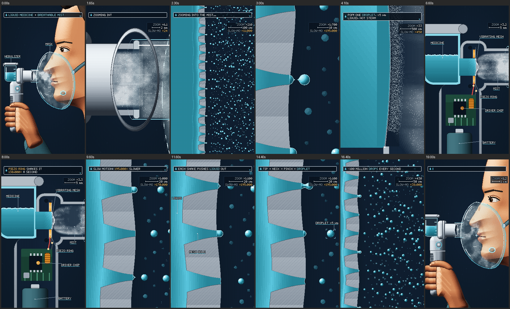

# How a Nebulizer Turns Liquid Into Mist

A 20-second looping, vertical medical-science short in 8-bit/16-bit pixel-art game style, with an original chiptune
and synced sound effects. One continuous camera move follows the medicine:
- from a patient breathing through a mask;
- into the nebulizer's vibrating mesh, where single droplets pinch off;
- and back out into the patient's breath.

On-screen game-style captions, part tags and a zoom/scale/slow-motion HUD explain each step. They are in English by
default and in Bahasa Indonesia with `--lang id`.



## Ringkasan (Bahasa Indonesia)

**Isi video (20 detik, berulang/loop tanpa sambungan terlihat):**

1. **0–3 dtk.** Pasien (tampak samping) sedang menghirup lewat masker transparan. Nebulizer genggam terpasang di
   masker, dan kabut mengalir masuk. Kamera lalu meluncur melawan arah kabut: masuk lewat konektor, menembus bibir
   *outlet*, lalu masuk ke potongan (*cutaway*) alat. Awan putih pecah menjadi tetesan piksel. Tepat di detik 3,0,
   satu tetes putus dari lubang *mesh*: bunyi "tik".
2. **3–15 dtk.** Kamera mundur untuk memperlihatkan seluruh mekanisme:
   - wadah obat cair, cincin piezo (oranye), *mesh* logam tipis, *outlet*;
   - chip penggerak dan baterai.

   Cincin piezo menggetarkan *mesh*. Kamera lalu mendekat ke tiga lubang yang meruncing. Di tiap lubang cairan
   membentuk ujung, lehernya menyempit, lalu putus menjadi tetesan, bergiliran tiap ketukan musik.
3. **15–20 dtk.** Kamera mengikuti satu tetes keluar: semprotan halus, lewat *outlet* dan konektor yang sama, sampai
   tetes itu terhirup pasien. Frame terakhir sama dengan frame pertama, jadi video bisa diputar berulang.

**Penjelasan di layar** (bisa dimatikan dengan `--clean`):

- **Kotak teks ala game RPG** di atas, satu kalimat pendek per langkah. Contoh: "OBAT CAIR → KABUT UNTUK DIHIRUP",
  "CINCIN PIEZO MENGGETARKANNYA, 130.000× PER DETIK", "UJUNG → LEHER → PUTUS → TETES".
- **Label nama bagian:** nebulizer, masker, obat cair, cincin piezo, *mesh* bergetar, kabut, chip penggerak, baterai,
  cairan, lubang *mesh*, tetesan.
- **HUD di kanan atas:** zoom (sampai ×1.700), garis skala (1 cm sampai 5 µm), dan faktor gerak lambat (sampai
  ×195.000).

**Cara render (salin-tempel):**

```bash
git clone -b claude/tes-45y4ej https://github.com/Pudidil-dev/belajar-python.git
cd belajar-python/nebulizer-animation
pip install -r requirements.txt
python render.py --preview --lang id    # cek cepat 540×960 -> output/preview.mp4
python render.py --lang id              # video final, teks Bahasa Indonesia
```

Tanpa `--lang id` teksnya bahasa Inggris. Dengan `--clean` video tanpa teks penjelasan (versi minimal).

Hasilnya ada di `belajar-python/nebulizer-animation/output/How_a_Nebulizer_Turns_Liquid_Into_Mist.mp4`. Video
1080×1920, 30 fps, tepat 20 detik, dengan audio stereo. Render final memakan sekitar 1–2 menit di laptop 4 core.

## Render it yourself (copy-paste)

You need Python 3.9+ and git. ffmpeg comes from the `imageio-ffmpeg` package, so you don't have to install it
separately (a system ffmpeg on PATH is used if you have one).

```bash
git clone -b claude/tes-45y4ej https://github.com/Pudidil-dev/belajar-python.git
```

The working directory is the `nebulizer-animation` folder inside the clone:

```bash
cd belajar-python/nebulizer-animation
```

Install:

```bash
pip install -r requirements.txt
```

Preview (optional, a half-size 540×960 check). It takes about 45 s and writes `output/preview.mp4`:

```bash
python render.py --preview
```

Render the final film. It takes about 1–2 minutes on a 4-core laptop:

```bash
python render.py
```

**Output:** `belajar-python/nebulizer-animation/output/How_a_Nebulizer_Turns_Liquid_Into_Mist.mp4`. It is
1080×1920, 30 fps, exactly 20.0 s, H.264 video with stereo AAC audio (48 kHz). The soundtrack stems are written next to
it: `music.wav`, `sfx.wav` and `mix.wav`.

With [uv](https://docs.astral.sh/uv/) instead of pip, there's nothing to install into your Python:

```bash
uv run --no-project --with numpy --with pillow --with imageio-ffmpeg python render.py
```

On Windows, use `py render.py` if `python` is not on PATH.

**Options**

| Command | What it does |
|---|---|
| `python render.py --preview` | quick half-size check → `output/preview.mp4` |
| `python render.py --lang id` | on-screen explanations in Bahasa Indonesia (the default is `en`) |
| `python render.py --clean` | the minimal cut: no captions, tags or HUD, only the tiny "VIBRATING MESH" tag |
| `python render.py --clean --no-label` | completely text-free |
| `python render.py --fps 60` | 60 fps (smoother zooms, twice the frames) |
| `python render.py --scale 8` | 2160×3840 (4K vertical) |
| `python render.py --from 8 --to 15` | only a slice of the film |
| `python render.py --stills 0,3,12` | full-size PNG frames in `output/stills/` |
| `python render.py --sheet 0:20:1` | one contact sheet of the whole film in `output/sheet.png` |
| `python render.py --audio-only` | only the soundtrack (music, effects, mix) |
| `python render.py --no-audio` | silent video |
| `python render.py --jobs 2` | fewer CPU cores (the default uses all) |

Options combine, for example `python render.py --preview --lang id`.

## What the film explains

### The device

A **nebulizer** turns a liquid medicine into a mist of tiny droplets that a patient breathes in through a mask or a
mouthpiece. It is used for asthma, COPD, cystic fibrosis and other lung conditions, often for children or older
patients who cannot coordinate an inhaler.

There are three common kinds:

| Type | How it makes the mist | Typical traits |
|---|---|---|
| Jet | compressed air from a compressor blows through the liquid (Venturi effect) | cheap and robust, but noisy, needs mains power |
| Ultrasonic | a piezo crystal shakes the liquid surface at 1–3 MHz and throws up a fountain of droplets | quiet, but can warm the medicine |
| **Vibrating mesh** (this film) | a piezo ring vibrates a thin metal mesh full of tiny holes; liquid is pumped through the holes | quiet, handheld, battery-powered, fine and even droplets, little medicine left over |

The film shows the **active vibrating-mesh** type, where the piezo moves the mesh itself.

### Step by step

1. **Medicine.** The liquid sits in the cup (reservoir) and touches the back of the mesh.
2. **Driver.** The battery and the driver chip make an alternating voltage, roughly 100–130 kHz.
3. **Piezo ring.** Piezoelectric ceramic changes shape when a voltage is applied. The ring, bonded around the mesh,
   expands and contracts ~130,000 times a second and makes the domed mesh vibrate.
4. **Mesh.** A metal plate about 50 µm thick with around a thousand holes. Each hole is a cone, wide on the liquid side
   and only a few micrometres wide at the exit.
5. **Pumping.** On every stroke the mesh pushes into the liquid. The tapered holes act like tiny nozzles and push liquid
   out of the exits.
6. **Pinch-off.** At each exit a tip grows, its neck narrows (surface tension takes over) and it breaks off as a
   droplet. Then the meniscus recoils and the next cycle starts.
7. **Mist.** Thousands of holes × ~130,000 cycles a second gives on the order of a hundred million droplets every
   second: a fine, cool aerosol of liquid, not steam and not smoke.
8. **Breathing.** The mist flows through the outlet and the mask, and the patient inhales it.

### Why droplet size matters

Droplets about **1–5 µm** across are small enough to follow the air past the throat into the airways and the deep
lung, where the medicine is needed. For scale, a human hair is about 70 µm thick. Much bigger droplets stick in the
mouth and throat, and much smaller ones are mostly breathed out again.

### What the film exaggerates (on purpose)

- **Time.** The vibration is far too fast to see, so the close-up plays in slow motion. One cycle lasts ~7.7 µs in
  reality and 1.5 s on screen (the HUD's "SLOW-MO ×195,000").
- **Stagger.** In a real mesh, neighbouring holes fire almost together. The film staggers them as a wave so that each
  pinch-off can be seen and heard on the beat.
- **Size.** The exit holes and droplets are drawn about twice their real size (~9–10 µm instead of 3–5 µm). The motion
  of the mesh and of the piezo ring is also enlarged.

*Educational animation, not medical instructions. Use a nebulizer as prescribed.*

## Shot by shot

120 BPM: a bar is 2 s, and every hit sits on the 8th-note grid. "On screen" lists the English captions (Indonesian
with `--lang id`).

| Time | Picture | On screen | Sound |
|---|---|---|---|
| 0–0.8 | **Hook.** The patient is mid-inhale through the transparent mask. Mist pours from the outlet through the connector toward the nose and mouth. | "LIQUID MEDICINE → BREATHABLE MIST"; tags NEBULIZER, MASK | Soft breath and a light "fsssh", the hook melody |
| 0.8–3.0 | **Reverse zoom** against the mist: the connector, then the outlet rim (the rim grows around the camera and opens into the cutaway), the plume, the mesh. The cloud resolves into pixel droplets. It lands on one tapered hole, where a tip grows and pinches off on 3.0 s. | "ZOOMING INTO THE MIST..."; HUD counts up the zoom (×1,700), scale (1 cm → 10 µm) and slow motion | A quick rising arcade whoosh, a "fwump" through the rim; the music stops 2.875–3.25 so that one crisp **tik** lands alone |
| 3–4.8 | The droplet zips away. The camera eases back to the whole mechanism. | "POP! ONE DROPLET, ≈5 µm / LIQUID, NOT STEAM" | A descending swoosh, then the groove |
| 4.8–8.5 | **Mechanism.** Amber drive pulses run up the wires, the piezo ring squeezes, the mesh buzzes. Liquid is on the left of the mesh and spray on the right. The housing stays still. | "A METAL MESH WITH ~1000 HOLES", then "PIEZO RING SHAKES IT / 130,000× A SECOND"; tags MEDICINE, VIBRATING MESH, MIST, PIEZO RING, DRIVER CHIP, BATTERY | A soft rhythmic buzz under the music; tag ticks |
| 8.5–10.3 | Push into three adjacent holes. The buzz slows into slow motion. | "SLOW MOTION: 195,000× SLOWER" | A rising whoosh; the buzz pitch falls with the slow motion |
| 10.3–15 | **Locked on three holes.** A wave runs down the mesh, and the holes take turns: tip, neck, pinch-off, recoil. One droplet per beat, and they build into a spray. | "EACH SHAKE PUSHES LIQUID OUT", then "TIP → NECK → PINCH → DROPLET"; tags LIQUID, MESH HOLE; a target bracket "DROPLET ≈5 µm" | A staggered pixel pop on every beat (D6 / B5 / G5), the payoff theme |
| 15–17 | The middle hole's droplet pinches off on 15.0, and the camera follows it downstream, pulling back over the full spray. | "~100 MILLION DROPS EVERY SECOND" | A bright pop with a sparkle, then a long descending whoosh |
| 17–20 | Back out through the same outlet rim and connector. The droplet is inhaled as the patient breathes in, landing on frame 0. | "SMALL ENOUGH TO REACH THE LUNGS", then the opening caption again (it spans the loop point) | The whoosh settles into the spray hiss, the breath, a tom fill back into bar 1 |

## Format and style

- **Format.** 1080×1920 (9:16 for Shorts, Reels and TikTok), 30 fps, exactly 20.0 s. Stereo audio in sync.
- **Loop.** The camera, the breath (4 s cycle, mid-inhale on 0 s), the mist, the music and the opening caption all
  repeat exactly every 20 s. The audio is rendered as a circle, so echo and reverb tails from the last bar flow into
  the first.
- **Picture.** Every frame is drawn in code on a 270×480 canvas and scaled exactly 4× with nearest-neighbour.
  - The world is modelled in millimetres and re-rasterized at every zoom level. The zoom runs from the patient's face
    at 2 px/mm to one mesh hole at 3400 px/mm. Pushing in reveals new detail (holes, menisci, droplet necks) instead
    of stretching a sprite.
  - 16-bit look: 6–10-tone ramps, Bayer dither anchored to the world, 1-px outlines, section hatching, SNES-style
    colour-math transparency for the mask, the mist and the dialog box.
  - Palette: the skill's `navy` set. The background is a flat navy (#0D1B2A, hue ≈211°). The device is light gray, the
    medicine and the mist are cyan, and the piezo and its drive glow are amber. Captions use the same accents.
- **Text.** One 5×7 bitmap font for captions, tags and the HUD. The caption box sits at the top, clear of the
  platform's bottom caption area, and every line stays on screen for at least ~0.7 s after it has finished typing.
- **Sound.** Everything is synthesized in code, with no samples and no audio files.
  - **Voices.** Band-limited square/pulse lead, NES-style triangle bass, LFSR noise drums, SNES-style echo, FM bells.
  - **Score.** 120 BPM in G major, ten bars of 4/4 = 20 s. The hook is G | D, the mechanism groove Em | C, the build
    Am→D, the payoff theme G | Em | C–D, and the half-time float Em–C | Am–D7 turns back into bar 1.
  - **Interface sounds.** Soft dialog blips while captions type, a two-note chime when a box opens, ticks for the tags.
    They are left out with `--clean`.
  - **Loudness.** The mix is −14 LUFS with true peak below −1 dBTP.

## Files

- `render.py`: the command line (film, preview, stills, contact sheets, audio only, `--lang`, `--clean`).
- `engine/`:
  - `timeline.py`:
    - the camera flight (zoom as ln z, centre as a function of zoom), so the way in and the way out pass the same rim;
    - the slow-motion clocks (`sigma`, `mu`);
    - the breath, the rim portal, and all event times for the soundtrack.
  - `explain.py`: the explanation layer (caption texts in English and Indonesian, timings, part tags, HUD).
  - `view.py`, `gfx.py`, `palette.py`, `pixfont.py`: the world camera (mm → canvas), signed-distance helpers, the
    pixel kit, ramps and the bitmap fonts (with µ, →, ×, ≈).
  - `person.py`: the patient (profile, eye, ear, hair, hand on the handle, sleeve) and the transparent mask with its
    port, seal, strap and side vent.
  - `device.py`: the nebulizer, outside and cut open with one shared geometry. That covers the reservoir cup, lid,
    head, mesh cap, outlet, handle, button and LEDs, plus the piezo ring, washer, mesh dome, O-rings, drive board,
    battery and wires.
  - `micro.py`: the mesh up close (tapered holes, the travelling wave, tip → neck → pinch-off, recoil) and the droplet
    population.
  - `mist.py`: the cloud. It is fractal noise carried by the flow, octaves appear with zoom, and it loops seamlessly.
  - `fx.py`: background motes, the hero droplet's glint, the clean cut's tag.
  - `scenes.py`: what is on screen when (exterior, cutaway, the rim portal between them).
  - `audio.py`, `synth.py`: the score, the sound effects, the interface sounds, the circular mix and the master.
- `镜头表.md`: the shot list (style lock, palette, eleven rows, the explanation-layer texts in both languages).
- `docs/storyboard.png` (English) and `docs/storyboard_id.png` (Indonesian): frames across the film.

## Checks run on this project

The final 1080×1920 film was not rendered here. The commands above produce it. These checks were run on test slices
and a half-size QA preview:

- **Pipeline.** A full-resolution slice encodes as H.264 1080×1920 at 30 fps, with stereo AAC at 48 kHz. Video and
  audio durations match.
- **Motion and content gate** (the skill's `film_gate.py` on the half-size preview): no red lights.
  - Fast-motion frames: 42%.
  - No near-empty frames.
  - Blue-purple background: 0%.
  - One yellow light, a "fixed frame" for 77% of the time. That is the caption box and the HUD plate at the top,
    which is how the explanation layer is meant to work: the box opens and closes with each step, and the picture
    underneath never stops moving. `--clean` renders the cut without them (that cut had no yellow lights).
- **Loop.** With the captions on, in both languages, the frame at 19.9999 s matches frame 0 (mean difference
  0.01/255). The audio wraps with no click at the seam.
- **Determinism.** The same instant rendered twice is pixel-identical.
- **Audio.** The mix is −14.0 LUFS with a true peak of −1.2 dBTP. The tik lands in a gap in the music, and the mesh
  buzz sits about 8 dB under the music.
- **Shot-list lint** (`storyboard_lint.py`): no red lights. The yellow lights (short rows, text in the first shot,
  numbers in captions) are explained at the end of `镜头表.md`.
