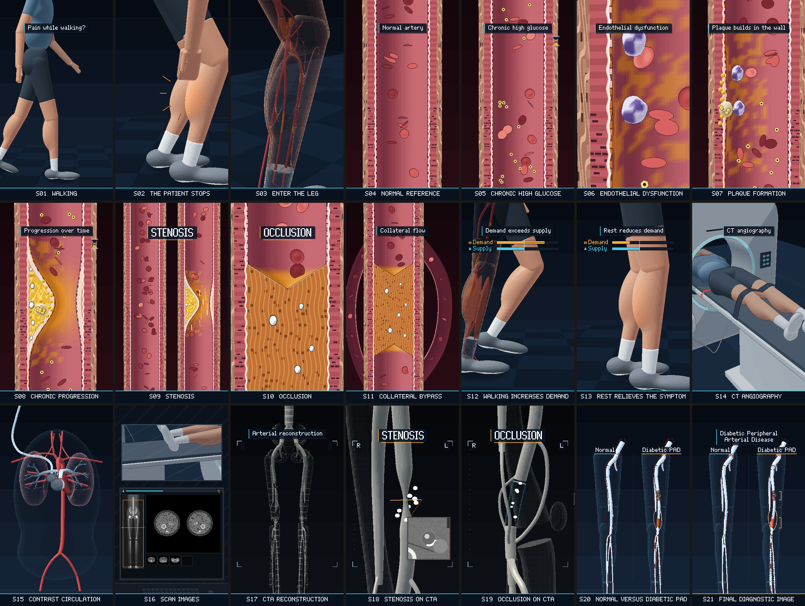

# How Diabetes Damages Leg Arteries — 3D pixel-art medical animation (code project)

**From walking pain to CT angiography.** A 63-second, 9:16, 60 fps medical animation in 3D pixel art, drawn in the
style of our earlier CTA film.
- **The symptom:** a man walks, slows, stops and holds his right calf. The view passes through the skin and muscle to the arteries and dives into the thigh artery.
- **The disease in the wall:** a normal artery; years of high glucose; a damaged lining; plaque building inside the wall; calcification and narrowing.
- **The consequences:** a stenosis (a narrow but open channel with a faster jet) and, farther down, an occlusion (no passage, the wall outline intact) bypassed by collateral side channels; walking raises the calf's demand above the limited supply, and rest lowers it again while the lesions stay.
- **The diagnosis:** CT angiography, with contrast traveling from the arm vein through the heart and lungs to the legs; the ivory 3D reconstruction; the stenosis and the occlusion on CTA. The film ends on a normal leg tree beside this patient's: **Diabetic Peripheral Arterial Disease**.

Not a loop: the film ends on the diagnosis. English placeholder labels, all in one editable file, and a clean version without text. No narration: the soundtrack is a quiet bed for an Azerbaijani voice-over to be added later. Music and SFX are delivered separately.



## Version 2 (revision)

Version 1 built every model from cubes (voxels) on a 540×960 grid. Small shapes — red cells, plaque, calcium, the
tibial arteries — were only a few cubes wide and broke up into steps and dither noise. Version 2 is rebuilt on the
renderer of the CTA film, as the client asked:

- **3D:** smooth shaded meshes on a 360×640 grid shown 3×, with dithered tone steps, rim light, small specular highlights and 1-px outlines.
- **2D pixel art, mixed in:** the artery close-ups pair a 3D lumen with glossy biconcave red cells and a flat pixel-art cut face of the wall:
  - the wall's layers;
  - the plaque with its cap, lipid core and calcium;
  - the organised occlusion.
- **Colour code:** red arteries.
- **CTA:** ivory volume-rendered views.
- **Reused from the CTA film:** the scanner room and the contrast route.

The story, the timing of all 21 scenes, the audio, the labels and the lesion map are unchanged, so the voice-over
timing sheet still applies.

Analysis of what was wrong and what changed, shape by shape: `docs/REVISION_ANALYSIS.md`. Before/after frames at the
same times: `docs/revision_before_after.png`. (The folder keeps its v1 name, `pad_voxel`, so existing links still work.)

| | |
|---|---|
| Video | 1080×1920, 60 fps, exactly 3,780 frames (63.000 s), H.264 High, yuv420p, BT.709. Drawn on a **360×640 pixel grid** and scaled **exactly 3× nearest-neighbour**. Smooth meshes lit per vertex in limited palette ramps with ordered-dither steps, rim light, specular highlights and 1-px outlines; glass skin and walls by screen-door dither. No anti-aliasing, blur or glow. |
| Structure | 21 scenes × 3.000 s, one bar of music each (80 BPM). Every picture event sits on the beat or the eighth-note grid, and every SFX starts on its picture event. |
| Audio | Original restrained cinematic-electronic score in D minor, plus 72 SFX read from the picture's event table. Full mix **−22.0 LUFS** integrated, true peak −5.7 dBTP: a bed that a voice-over at about −16 LUFS sits clearly above. Under 8 % of the energy is in the 1–4 kHz speech band. No constant heartbeat and no alarms. The last 0.5 s fades to silence. |
| Text | English placeholders from `src/04_labels_en.js` only: one caption at a time in a band at the top; two large key terms (STENOSIS / OCCLUSION); small labels (Demand / Supply, R / L, Normal / Diabetic PAD); the final title. The **clean** version renders without any text but keeps the graphics (bars, hourglass, CTA frame, axial inset, lesion brackets). |

## Render it yourself

Requirements: **Node ≥ 18**, **ffmpeg** with libx264 and AAC, and **Python 3** with **numpy** and **scipy** (for mastering). No browser and no GPU are needed: the frames are computed in Node.

```
cd pad_voxel
node tools/export.js            # everything: both text versions × four mixes, plus three WAV stems
```

That writes:

| File | Text | Sound |
|---|---|---|
| `output/Diabetic_PAD_CTA_Labeled.mp4` | English labels | music + SFX |
| `output/Diabetic_PAD_CTA_Labeled_No_Music.mp4` | English labels | SFX only — no background music |
| `output/Diabetic_PAD_CTA_Labeled_No_SFX.mp4` | English labels | music only — no SFX |
| `output/Diabetic_PAD_CTA_Labeled_Silent.mp4` | English labels | no audio track |
| `output/Diabetic_PAD_CTA_Clean.mp4` | none | music + SFX |
| `output/Diabetic_PAD_CTA_Clean_No_Music.mp4` | none | SFX only |
| `output/Diabetic_PAD_CTA_Clean_No_SFX.mp4` | none | music only |
| `output/Diabetic_PAD_CTA_Clean_Silent.mp4` | none | no audio track |
| `output/audio/Diabetic_PAD_CTA_Full_Mix.wav`, `…_Music_Only.wav`, `…_SFX_Only.wav` | — | 24-bit / 48 kHz stems |

Only some variants:
```
node tools/export.js --text labeled                 # only the four labeled MP4s
node tools/export.js --text clean                   # only the four clean MP4s (no text)
node tools/export.js --mix full                     # music + SFX only (both text versions)
node tools/export.js --mix nobgm                    # _No_Music (SFX only)
node tools/export.js --mix nosfx                    # _No_SFX (music only)
node tools/export.js --mix silent                   # _Silent (no audio)
node tools/export.js --text clean --mix full,silent # combine: comma-separated mixes
node tools/export.js --audio-only                   # only the three WAV stems
node tools/export.js --video-only                   # only the silent pictures build/video_labeled.mp4, build/video_clean.mp4
node tools/export.js --rerender                     # render the pictures again even if they are current
```
Each frame is drawn **once**: the clean frame first, then the text on top of a copy, so both versions come from the
same pixels. The pictures are kept in `build/` with a fingerprint of the sources, so another mix later only
re-muxes (seconds). In a sandbox test on 4 cores, both text versions with two mixes took 7 min 43 s (about 95 MB per
MP4; 8 min 45 s with another job running beside it); all eight MP4s take only a few seconds more (re-muxing). All audio versions share **one common gain** (`tools/master.py`), so
the music-only and SFX-only stems sit exactly as loud as they do in the full mix and sum back to it.

### Translating the labels (Azerbaijani)

All on-screen text lives in `src/04_labels_en.js`. The pixel font has the Azerbaijani letters ə ğ ı İ ö ü ş ç
(upper and lower case).
```
cp src/04_labels_en.js labels_az.js      # translate the strings in labels_az.js (keep the keys)
node tools/export.js --text labeled --labels labels_az.js   # → output/Diabetic_PAD_CTA_Labeled_az*.mp4
node tools/stills.js check_az.png 10 25 52 62 --labels labels_az.js   # quick look before rendering
```
Long words wrap onto a second line automatically. The two key terms switch to the caption font if the title font
lacks a letter. Bar labels step down a size if they are too wide.

### Preview and stills

- `index.html` is a self-contained player. Open it in a browser: Space plays or pauses, ←/→ seek, **T** toggles the labels (the clean version), M mutes. `node tools/build.js` rebuilds it.
- `node tools/stills.js out.png 10.5 25.5 62.9 --scale 3 [--clean]` makes a contact sheet of any frames.
- `node tools/refs.js` regenerates the reference images in `docs/`.

## Deliverables in this folder

| Brief item | Where |
|---|---|
| 1. 63-s animation | `node tools/export.js` → `output/Diabetic_PAD_CTA_Labeled.mp4` (and the other mixes) |
| 2. Clean version without text | `output/Diabetic_PAD_CTA_Clean*.mp4` (`--text clean`) |
| 3. Version with editable English labels | `output/Diabetic_PAD_CTA_Labeled*.mp4`; labels in `src/04_labels_en.js`, `--labels` for translations |
| 4. Music-only track | `output/audio/Diabetic_PAD_CTA_Music_Only.wav` (+ `_No_SFX.mp4` videos) |
| 5. SFX-only track | `output/audio/Diabetic_PAD_CTA_SFX_Only.wav` (+ `_No_Music.mp4` videos) |
| 6. Scene timing sheet for the Azerbaijani VO | `docs/timing_sheet.md`, `docs/timing_sheet.csv` |
| 7. Patient and anatomy references | `docs/patient_reference.png`, `docs/anatomy_reference.png` |
| 8. Lesion continuity map | `docs/lesion_map.png`, `docs/LESION_MAP.md` |
| 9. Storyboard and scene prompts | `docs/storyboard.png`, `docs/STORYBOARD.md`, shot list `镜头表.md` |
| 10. Final normal-vs-diabetic-PAD still | `docs/final_still_labeled.png`, `docs/final_still_clean.png` (1080×1920) |
| Revision | `docs/REVISION_ANALYSIS.md`, `docs/revision_before_after.png` |

## Medical accuracy kept in every scene

- **Chronic PAD only:** no embolus, acute ischaemia, ulcer, gangrene, amputation, balloon, stent or bypass surgery.
- **One patient, one map:** the same patient (neck-down, face never shown) and the same right leg throughout, with one fixed lesion map (`docs/LESION_MAP.md`). The SFA stenosis (L1), the popliteal occlusion (L2), the genicular collaterals and the below-knee disease (L3) sit at the same places in every view, and the below-knee branching is correct.
- **Glucose:** stays dissolved in the blood and never forms a plug.
- **Plaque:** stays inside the wall, under the lining.
- **Calcium:** opaque white, and distinct from contrast (on CTA it is the brightest white, with a dark outline).
- **Stenosis:** keeps a continuous channel, with a faster jet through it.
- **Occlusion:** has no passage and keeps its wall outline.
- **Collaterals:** bypass the occlusion; they never reopen it.
- **Rest:** lowers demand; the lesions stay as they are.
- **CTA:** only diagnoses. The white-blue contrast colour is a teaching overlay.
- **No numbers anywhere.**
- **Drawing convention:** calibres are exaggerated so the arteries stay legible on a phone (2.3× in the leg, 3.9× in the whole-tree and CTA views, 4.6× in the final comparison).

## QA (numbers, not a substitute for watching it)

- **Shot list:** `镜头表.md` passes the skill's `storyboard_lint` (green): 21 shots, 63 s, no text-led shots.
- **Film gate** (the skill's `film_gate.py`, run on a sandbox test export `Diabetic_PAD_CTA_Labeled.mp4` at 1080×1920 / 60 fps — the MP4 itself is not in the repository): all three gates green.
  - Fast-motion frames 26.4 % (red below 3.5 %).
  - No empty frames; 0 % blue-purple frames.
  - Worst 30-s window (31–61 s): 20.2 %.
  - 16 shots (14 cuts, 1 crossfade), average 3.9 s.
  - Push-ins 2.9 per minute, green (v1 had a yellow notice at 8.6).
- **Export check** (the same sandbox test): every MP4 is 1080×1920, yuv420p, BT.709, 60 fps, exactly 3,780 frames, 63.000 s; the mixes carry AAC 48 kHz stereo and the _Silent versions have no audio track.
- **Motion and colour** (`tools/qa_motion.js`, every frame at 30 fps):
  - no frame is more than 30 % blue-purple;
  - hard jumps only at the planned cuts (24, 27, 33 and 39 s);
  - the dive into the artery (8.25–9.2 s) blends red into red: the background darkens and warms to the artery world's maroon before the crossfade, so it never passes through a muddy purple;
  - holds: two short ones (0.8 s at 37.9 s, 1.0 s at 52.3 s) and the final diagnostic image (from 57.9 s), where both trees only turn slowly while the lesion marks and the title come in on the beat.
- **Sync** (`tools/sync_qa.js`):
  - all 87 event times on the 80-BPM eighth-note grid, drawn within 8.3 ms (half a frame);
  - all 72 SFX start exactly on a picture event;
  - measured onsets of the percussive cues: median 0.9 ms, max 3.6 ms after their event.
- **Audio** (`tools/master.py`; the score and SFX are unchanged from v1):
  - full mix −22.00 LUFS, true peak −5.7 dBTP, no limiting needed;
  - music stem −23.9 LUFS, SFX stem −24.8 LUFS.
- **Player:** `tools/smoke.js` (headless Chromium) plays and seeks `index.html` with no errors.

## Self-review against the six failure modes (huashu-art-motion)

1. **Slide-deck feel:**
   - no page frame and no bullet points;
   - one picture event per scene;
   - the camera grammar changes with the story: lateral tracking, slow and fast pushes, holds, pull-backs, cuts, and soft crossfades at changes of world;
   - every push is answered by a pull-back or a lateral move;
   - the film ends on an action (both trees turning while the lesions light up), not a centred quote card.
2. **Copying a demo:** nothing from the skill's demos, sample specs or style samples is used. The renderer, the CT room, the contrast route and the red-cell model come from our own earlier CTA film; every other model (patient, leg, artery cut face, arterial tree, lesions) is built in code for this film.
3. **No concrete object:** every scene is a concrete thing doing something: the man walking, the calf, the wall, cells, plaque, the scanner, the contrast, the two trees.
4. **Dead or empty background:**
   - the subject fills most of the frame;
   - the backdrop changes with each world (floor, the vessel interior, the CT room, the black CTA viewer, glass bodies behind the trees);
   - the film gate finds no empty frames.
5. **Real material drawn in code:** not applicable. No footage or photographs were provided, and the client asked for the style of the CTA film.
6. **AI-looking result:**
   - one style (the CTA film's 3D pixel art) and one palette for the whole film;
   - 0 % blue-purple frames;
   - no code-drawn faces: the patient is always neck-down, his head inside the gantry on the CT table;
   - molecules and cells have no faces.

Not done: an independent review by a second agent (the skill recommends one). This project was built and checked by a
single agent only; watch it once at normal speed before publishing.

## How it is built

`src/` is one engine shared by the player, the export and the reference images:

- **Core and timing:**
  - `00_core.js`: the 360×640 pixel buffer, palette, 2-D primitives.
  - `01_font.js`: pixel fonts, including Azerbaijani letters.
  - `02_util.js`: helpers and the film's colour code.
  - `03_clock.js`: 80 BPM, the event table `EV` used by the picture and the sound alike.
  - `04_labels_en.js`: the editable labels.
- **The 3D pixel renderer (the CTA film's engine):**
  - `07_r3d.js`: perspective, z-buffer, per-vertex lighting, palette ramps with Bayer dither, glass, fog, procedural cut faces, 1-px outlines.
  - `08_geo.js`: tubes, ellipsoids, rings, boxes, quads.
  - `09_sdf.js`: signed-distance shapes turned into smooth meshes.
  - `17_cam.js`: camera paths and the sky gradient.
- **Models:**
  - `10_patient.js`: smooth body parts on a skeleton, a gait with heel strikes on the beat, stance-foot locking, the calf-holding pose with two-bone IK.
  - `11_leg.js`: the right leg's layers: glass skin, muscles that glow where they hurt, arteries with the lesions.
  - `12_micro.js`: the artery cut lengthwise:
    - in 3D: the lining, red cells on streamlines (faster in the narrowing) pulsing at 80 per minute, white cells, the foam cell, collaterals;
    - in 2D pixel art on the cut face: the wall's layers, plaque, calcium, the occlusion.
  - `13_tree.js`: the arterial tree, the lesion map, the CTA look, the bones and the glass body.
  - `14_ct.js`: the CT room.
  - `15_circ.js`: the contrast's route through the heart and lungs.
  - `16_axial.js`: the axial CTA slice.
- **Film and output:**
  - `20_scenes.js`: the 21 scenes, cameras and crossfades.
  - `24_ui.js`: graphics kept in the clean version.
  - `25_text.js`: the text layer.
  - `30_audio.js`: the synthesised score and SFX.
  - `40_player.js`: the browser player.

`tools/` holds the export, mastering, QA scripts and the reference-image generator (`refs.js` + `refs_draw.js`).
