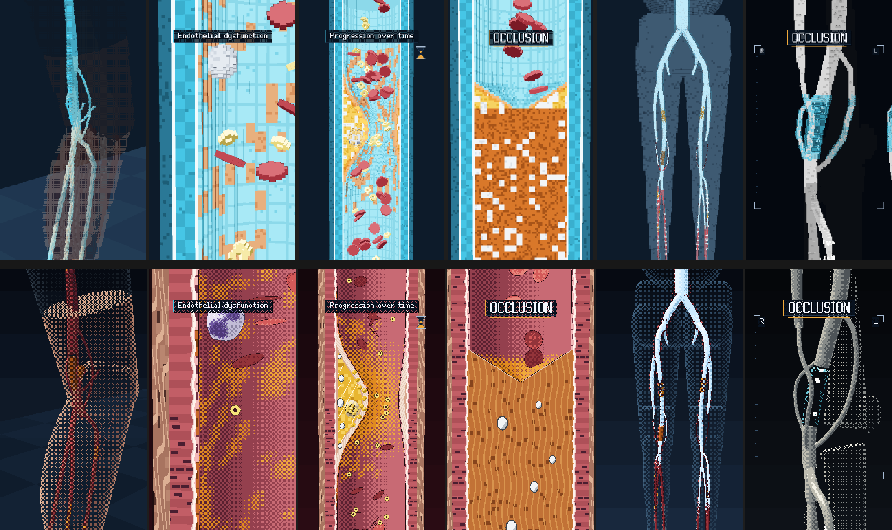
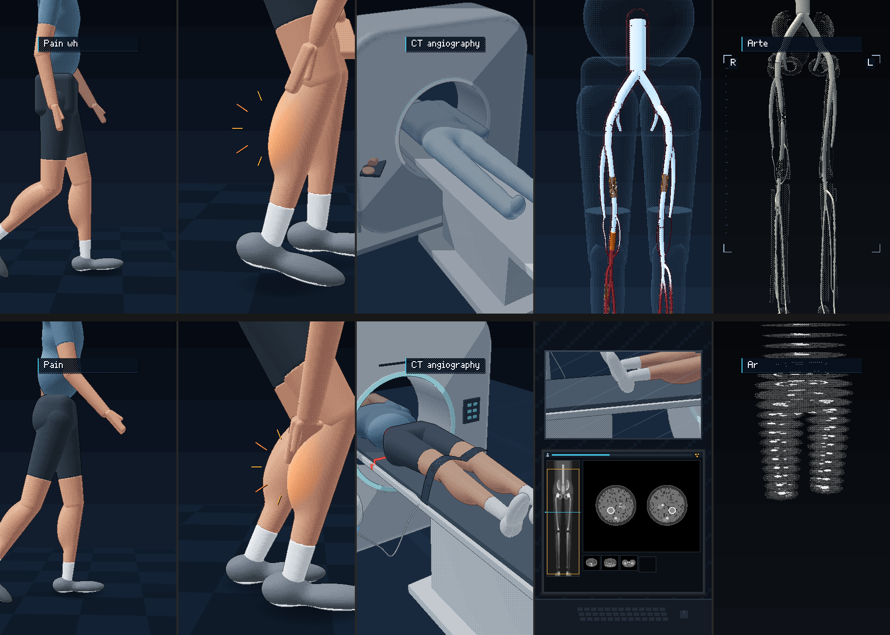

# Analisa revisi bentuk video — v1 (voxel) → v2 (gaya film CTA)

Atas: v1. Bawah: v2. Keduanya pada detik yang sama: 7.7, 16.2, 23.0, 29.2, 46.4 dan 56.0 s
(masuk ke kaki, disfungsi endotel, progresi plak, oklusi, pengisian kontras, oklusi pada CTA).

## Kesimpulan

v1 tampak jelek karena semua model dibangun dari kubus voxel. Bentuk kecil seperti sel darah, plak, kalsium dan
pembuluh tibial hanya beberapa kubus lebarnya. Pada ukuran sekecil itu kubus tidak bisa membentuk lengkungan, dan
dither transparansi mengubahnya menjadi noise.

v2 dibangun ulang dengan mesin render film CTA, sesuai harapan klien ("closer to the style of your original CT
animation"):

- model 3D halus dengan shading bertingkat (ramp + dither), rim light, kilap kecil dan outline 1 piksel;
- dalam close-up arteri, bidang potong dindingnya digambar sebagai pixel art 2D, piksel demi piksel.

Ini campuran 2D pixel + 3D yang diminta. Bagian 3D-nya bukan lagi kubus voxel, karena justru kubus itulah sumber
ketidakjelasan dan film CTA juga tidak memakai kubus.

## Masalah per bentuk dan perbaikannya

| Bentuk | Masalah di v1 | Penyebab | Perbaikan di v2 |
|---|---|---|---|
| Sel darah merah | Kepingan bergerigi seperti kue, tidak terbaca sebagai cakram | Cakram dari sedikit kubus: sisi lengkungnya menjadi tangga | Cakram bikonkaf 3D halus seperti di film CTA: merah tua, cekung di tengah, kilap kecil, outline gelap |
| Dinding arteri (permukaan dalam) | Pola kotak-kotak cyan, seperti ubin kamar mandi | Wajah kubus terlihat sebagai grid; warna cyan | Lapisan dalam merah-pink yang diterangi lembut, dengan kabut plasma ke arah belakang |
| Lapisan dinding (penampang) | Hanya beberapa garis tipis | Satu kubus terlalu kasar untuk 4 lapisan | Pixel art 2D di bidang potong: endotel dengan inti, lamina elastika interna putih bergelombang, media merah bergaris, adventisia cokelat berserat |
| Warna arteri | Cyan, bertabrakan dengan konvensi (arteri = merah) dan mirip warna kontras | Pilihan palet v1 | Kode warna baru: arteri merah, vena biru baja, kontras putih-biru, plak kuning-oranye, kalsium putih, oklusi oranye-cokelat |
| Plak dan kalsium | Bintik oranye dan putih acak, tanpa struktur | Noise per kubus | Tudung fibrosa krem di atas inti lipid kuning, celah kolesterol, sel busa, nodul kalsium putih bulat dengan outline |
| Oklusi | Kotak oranye dengan bintik putih acak | Isi kubus acak | Sumbat fibrosa oranye-cokelat berserat dengan nodul kalsium; saluran mengerucut berbentuk V lalu berhenti; lapisan dinding tetap terlihat di kedua sisi |
| Pohon arteri (kaki dan tubuh) | Pipa tipis yang putus-putus | Diameter hanya beberapa kubus, lalu dipecah oleh dither | Tabung halus (3,9× kaliber asli; 4,6× di perbandingan akhir): dinding kaca merah, kolom lumen yang berubah dari darah ke kontras, selongsong plak kuning |
| Kaki tembus pandang | Kulit dan otot menjadi kabut titik-titik | Dither pada kubus | Kaca dengan dither paling rapat di siluet: bentuk kaki tetap terbaca, otot dan arteri jelas di dalamnya |
| CTA | Tulang ber-dither menjadi noise abu-abu, pembuluh kasar | Kubus + transparansi | Volume rendering gading-putih halus seperti film CTA; tulang samar di belakang; kalsium putih paling terang dengan outline gelap |
| Pasien | Badan dari balok kaku | Model voxel | Tubuh halus (iso-surface) dengan rim light dan bayangan kontak; gerak jalan dan pegang betis tetap sama |
| Ruang CT dan sirkulasi | Versi voxel sederhana | — | Aset film CTA: gantry, meja, pasien di bawah selimut, kanula, injector, jalur kontras lewat jantung dan paru |

## Kenapa 360×640 ×3, bukan 540×960 ×2

Film CTA digambar pada grid 360×640 lalu diperbesar tepat 3× (nearest-neighbour) ke 1080×1920. Pikselnya lebih
besar dan tegas: itu ciri khas gaya yang diminta klien. Bentuknya tetap halus karena cahaya dihitung per titik model
dan transisi warnanya memakai dither teratur, bukan kubus.

## Yang tidak berubah

- Cerita, 21 adegan × 3 detik dan semua waktu kejadian (`EV`). Timing sheet untuk voice-over Azerbaijan tetap berlaku.
- Musik dan SFX (80 BPM, −22 LUFS, 72 SFX tepat pada kejadian gambar).
- Semua label, file label yang bisa diedit, dan versi clean tanpa teks.
- Peta lesi (L1 stenosis SFA, L2 oklusi popliteal, kolateral, L3 di bawah lutut) dan aturan medis
  (glukosa tidak menyumbat, plak di dalam dinding, kalsium ≠ kontras, CTA hanya mendiagnosis).

## Summary for the client (English)

Version 2 is rebuilt on the renderer of the CTA film:

- smooth shaded 3D models with dithered tone steps, rim light, small highlights and 1-px outlines;
- the artery close-ups pair a 3D lumen (glossy biconcave red cells) with a 2D pixel-art cut face of the wall:
  - endothelium, the internal elastic lamina, media and adventitia;
  - the plaque with its cap, lipid core and calcium;
  - the organised occlusion;
- a red-artery colour code, ivory volume-rendered CTA views, and the CTA film's scanner room and contrast route.

The story, the 3-second scene timing, the audio, the labels and the lesion map are unchanged, so the voice-over
timing sheet still applies.

---

# Revisi 2 — gerak lebih natural, adegan CT lebih realistis

Atas: v2. Bawah: v3. Detik yang sama: 1.0 (berjalan), 5.6 (memegang betis), 40.4 (meja CT), 46.2 (pemindaian),
48.6 (rekonstruksi).

Umpan balik klien: gerakan terasa robotik; adegan CT perlu memperlihatkan pasien berbaring di meja yang perlahan masuk
ke scanner, lalu gambar hasil scan muncul di layar, lalu rekonstruksi 3D pembuluh darah, dengan gerak dan detail yang
lebih mirip aslinya. Gaya pixel art tetap.

## Kenapa gerak v2 terasa robotik (hasil pengukuran)

| Sumber | Yang terjadi di v2 | Perbaikan di v3 |
|---|---|---|
| Langkah kaki | Pinggul dihitung dari titik tengah telapak: di setiap langkah badan sempat terlempar mundur (sampai 3,5 m/s) lalu melompat maju. Percepatan pinggul terukur sampai 474 m/s² (orang berjalan sungguhan sekitar 3–10 m/s²) | Jalan direncanakan dari pijakan: tiap tumit punya waktu dan tempat mendarat. Telapak menggelinding tumit → datar → jari tanpa tergeser (0,0 mm). Kaki ayun melengkung mulus. Pinggul paling tinggi tepat di atas kaki tumpuan dan paling rendah saat dua kaki menapak; lintasannya dihaluskan dengan batas percepatan ±0,6 g. Hasil: maksimum 12 m/s², tidak pernah mundur |
| Tubuh atas | Pinggul hanya naik-turun; bahu, kepala dan siku kaku; lengan berayun persis seirama kaki | Pinggul bergoyang ke kaki tumpuan, berputar dan sedikit miring. Bahu berputar berlawanan arah dengan pinggul. Lengan berayun sedikit terlambat (follow-through) dengan siku menekuk saat maju. Pinggul dibulatkan |
| Berhenti dan memegang betis | Satu pengatur untuk semuanya; sudut punggung dicari per 2° sehingga melompat-lompat; tangan meluncur lurus | Langkah penutup yang pendek, lalu aksi bertumpuk: lutut menekuk, punggung membungkuk (dihitung kontinu), tangan meraih betis dengan lintasan melengkung lalu mengusapnya. Napas berat. Telapak tetap menapak |
| Diam | Tubuh membeku seperti patung | Napas (lebih cepat saat nyeri), berat badan bergeser pelan dari kaki ke kaki |
| Kamera | Berhenti di setiap titik kunci (stop-and-go); kamera menempel pada pinggul yang tersentak | Kamera melaju mulus melewati titik kunci; kamera jalan mengikuti rata-rata gerak pinggul seperti operator kamera; shot diam diberi ayunan sangat pelan |
| Adegan mikro | Plak, kolateral dan endotel tumbuh dalam 4–16 tahap; glukosa bergerak dengan kecepatan konstan; sel darah putih meluncur lalu berhenti mendadak | Pertumbuhan kontinu; glukosa dan sel ikut denyut aliran yang sama; sel darah putih berguling, melambat, sedikit memipih saat menempel; lipid masuk dengan lintasan melengkung; butir lemak sel busa tumbuh satu per satu |
| Teks dan grafis | Panel dan teks muncul dalam 4–6 tahap patah-patah | Panel meluncur dengan easing, huruf muncul satu per satu (tetap tajam per piksel) |

## Adegan CT, seperti CT angiografi tungkai sungguhan

- **14 — di meja CT:**
  - pasien terlentang, kepala masuk lebih dulu (kepala dan lengan sudah di dalam lorong, wajah tidak pernah terlihat);
  - kedua lengan di atas kepala, sepatu dilepas (kaus kaki), tali pita di atas lutut;
  - meja meluncur pelan ke gantry, garis laser merah melintas di tubuh;
  - gantry lengkap dengan cincin lampu, panel tombol, celah laser dan lampu sinar-X;
  - selang dari injektor dua-tabung menggantung ke kanula di siku kanan, lalu kontras putih-biru mengalir di selang.
- **15 — rute kontras:** jalur vena kini dimulai dari siku kanan yang terangkat.
- **16 — gambar hasil scan di layar** (sudut ruang kontrol):
  - lewat jendela tampak meja membawa pasien menembus gantry dengan kecepatan tetap (scan heliks), lampu sinar-X menyala;
  - di monitor: topogram dengan kotak rentang scan dan garis posisi yang turun dari perut ke kaki, irisan aksial terbaru, dan thumbnail irisan sebelumnya (muncul bersama denting musik);
  - irisan dihitung dari anatomi dan peta lesi yang sama:
    - aorta di depan tulang belakang;
    - arteri paha kanan menyempit eksentrik dengan kalsium;
    - arteri popliteal tanpa kontras (hanya dindingnya), dikelilingi kolateral kecil;
    - tiga arteri betis di bawahnya.
- **17 — rekonstruksi 3D:** irisan menjadi lempeng tipis yang menumpuk dari perut ke kaki membentuk volume. Jaringan lunak menipis hilang, tulang dan arteri berkontras tersisa, lalu menjadi rekonstruksi CTA 3D berwarna gading yang berputar.

Perbaikan anatomi yang ikut ditemukan: di irisan aksial, batang femur sebelumnya berimpit dengan arteri femoralis.
Femur kini berada di lateral (sesuai sudut adduksinya), arteri femoralis di medial-depan, dan pembuluh iliaka lewat di
depan sendi panggul. Tidak ada pembuluh yang menembus tulang di level mana pun.

Yang tidak berubah: cerita, 21 adegan × 3 detik, waktu semua kejadian, musik dan SFX, label, peta lesi.

## Summary for the client (English) — revision 2

- **Motion:**
  - the walk is now planned from footfalls: the feet roll heel to toe without sliding, the swinging foot moves on a smooth arc, and the hips rise, sway and turn naturally;
  - the shoulders counter-rotate and the arms follow through with bent elbows;
  - stopping and reaching for the calf are overlapping actions with breathing;
  - cameras glide through their keys without stop-and-go;
  - disease growth, cell flow and UI reveals are continuous instead of stepped.
- **CT sequence, as a real leg CT angiogram is done:**
  - the patient lies head first with raised arms and glides slowly into the gantry under the positioning laser while the injector starts;
  - in the control room the console shows the topogram, the moving scan line and each new axial image, all computed from the same anatomy and lesion map: the narrowed calcified thigh artery, the popliteal without contrast, the collaterals;
  - the slices then stack into a volume, the soft tissue falls away, and the 3D reconstruction of the arteries remains.
- **Unchanged:** the timing, the audio and the labels.
