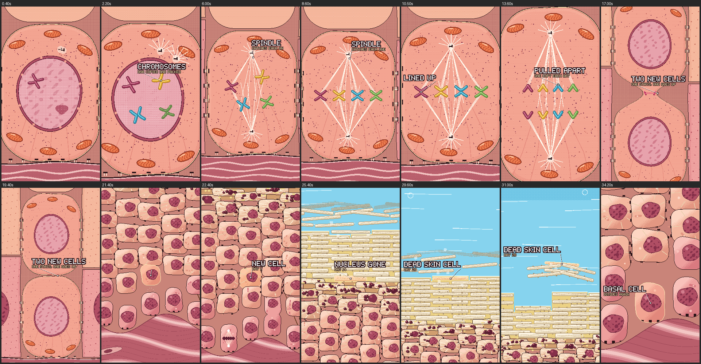

# The Life Cycle of a Skin Cell

A 35-second looping, vertical short in 8-bit pixel art about how your skin replaces itself, with a calm, catchy
chiptune soundtrack and sound effects tied to every event on screen. It follows one skin cell's life from the
client's scenario (born at the bottom, pushed up, dies, flakes off), reordered so that the cell division runs from the
very first frame. The film opens inside a basal cell that is already dividing and follows the division step by step
for 20 seconds, until it is two cells, one above the other. The camera comes back out as the top one, the cell we
follow, pops up. A fast-forward carries it up through the layers to the top, where it is a dead, flat tile, and it
lifts off in a flake into the water. The camera dives back down to the cell that stayed at the bottom, which is
about to divide again, and goes into it: the last frame runs straight into the first. No game elements and no
narration: clean captions in English name the things on screen.

inside a basal cell, already dividing: **the copied DNA packs into chromosomes → the spindle catches them → they line
up → each splits and one copy goes each way → the cell pinches into two cells, one above the other** → back out: the
top cell pops up (NEW CELL, DAY 1) → fast-forward up the layers: spines and keratin, granules, the nucleus goes
(DAY 14), a flat dead tile → it lifts off in a flake (DEAD SKIN CELL, DAY 28) → the camera dives back to the cell
that stayed (BASAL CELL, DIVIDES AGAIN) and into it → the loop starts again.



- **Format.** 1080×1920 (9:16 vertical), 30 fps, exactly 35.0 s (14 bars of 4/4 at 96 BPM), H.264 video with 48 kHz
  stereo AAC. The default export is **`out/skin-cell-animation.mp4`**, relative to this folder.
- **Look.** Every frame is drawn in code on a 270×480 canvas and scaled exactly 4× nearest-neighbour: crisp pixels,
  stepped 1-px outlines, a limited palette, at most a checker or ordered dither. A slice of skin seen from the side,
  like a textbook diagram come alive:
  - clear light-blue water on top, flowing to the right with streaks and bubbles;
  - the dead layer: thin cream tiles laid like bricks, woven with keratin, with pale lipid "mortar" between them;
  - the living layers: peach cells that turn rosier toward the bottom, each one different, with a wobbling membrane,
    a bevelled edge, organelles, a nucleus with clumped chromatin and a nucleolus, keratin filaments running out to
    the desmosomes ("spines") that bridge the gaps to its neighbours, and, higher up, dark keratohyalin granules and
    pale lipid sacs;
  - the basal cells on a wavy junction, anchored by small dark dots, with melanocytes reaching up between them;
  - the dermis below: soft rose with collagen bundles, fibroblasts and one capillary loop with red cells moving
    round it.
- **The cell we follow** has no face and no tag: it is just a little warmer than its neighbours, with a light rim,
  and the camera keeps it in view.
- **Inside the dividing cell** (0–20 s). The film opens inside it; the camera got there at the end of the loop,
  diving into the basal cell and through its membrane in a short white flash. Inside, the cell fills the frame. It sits on the basement membrane, with the dermis below,
  held down by hemidesmosomes. Its neighbours are just beyond the membrane on both sides, held on by desmosomes, and
  the cell born before it is above. It has a big nucleus with clumped chromatin, free ribosomes and orange
  mitochondria. The four chromosomes each have their own colour (maroon, gold, teal, green), and both copies of a
  chromosome share it. The spindle is drawn in cream, with a pair of centrioles at each pole, and a pink ring pinches
  the cell in two. The camera follows the division and pulls back as the cell stretches, then comes back out of the
  two new cells as the top one pops up. It breathes with the music: a slow drift, a small zoom pulse on every beat
  and a bigger one on each step, and the cytoplasm's specks stream slowly.
- **The fast-forward** (21–30 s). The tissue is a conveyor that pushes the new cell up on every 8th note, 12 cell
  heights in under 9 seconds; the camera rides up with it while it changes, and the tiles above it peel away.
- **Motion.** Each push of the conveyor sends a jelly-like squash-and-stretch up through the cells, divisions pop
  below, and the cell we follow rises in time with the music. Membranes wobble gently all the time.
- **Captions.** White pixel text with a thin line to the object it names, typed on and gone a couple of seconds
  later; never more than one at a time, and always clear of a phone app's buttons and caption area.
- **Loop.** The camera crosses into the basal cell 0.3 s before the end, so the last frames are the first moments
  inside it and the first frame carries straight on. Every idle motion (water, bubbles, wobble, the capillary)
  repeats exactly once per loop, and the soundtrack wraps round too. `python render.py --loops 3`
  writes the loop three times back to back (105 s).

## Render it yourself

Working directory: **`belajar-python/skin-cell-animation`** (this folder). You need Python 3.9 or newer and git.
ffmpeg comes from the `imageio-ffmpeg` package in `requirements.txt`; a system ffmpeg on PATH is used if you have one.

Clone (skip if you already have the repo):

```bash
git clone -b ccr-90de552e-iir9tw https://github.com/Pudidil-dev/belajar-python.git
```

If you cloned it earlier, update it instead (run inside `belajar-python`):

```bash
git pull origin ccr-90de552e-iir9tw
```

Go to the project:

```bash
cd belajar-python/skin-cell-animation
```

Install the dependencies (numpy, Pillow, imageio-ffmpeg):

```bash
pip install -r requirements.txt
```

If pip refuses with an "externally-managed-environment" error, make a virtual environment first, then run the
`pip install` again:

```bash
python -m venv .venv
```

```bash
source .venv/bin/activate
```

(On Windows: `.venv\Scripts\activate`.)

Preview (540×960, fast encode, written to `out/skin-cell-animation-preview.mp4`):

```bash
python render.py --preview
```

Render the film (1080×1920, 30 fps, H.264 + stereo AAC):

```bash
python render.py
```

The film is written to **`out/skin-cell-animation.mp4`**. The music, effects and mix are written next to it as WAV
stems (`out/music.wav`, `out/sfx.wav`, `out/mix.wav`). On a 4-core machine the full render takes about 2 minutes.
With [uv](https://docs.astral.sh/uv/) instead of pip, no install step is needed:

```bash
uv run --no-project --with numpy --with pillow --with imageio-ffmpeg python render.py
```

On Windows, use `py render.py` if `python` is not on PATH.

**Options**

| Command | What it does |
|---|---|
| `python render.py --sheet 0:35:1` | one contact sheet of the whole film in `out/sheet.png` (start:end:step, seconds) |
| `python render.py --stills 0.6,6.3,16.2` | full-size PNG frames in `out/stills/` |
| `python render.py --from 5 --to 9` | only a slice of the film |
| `python render.py --fps 60` | 60 fps |
| `python render.py --scale 8` | 2160×3840 (4K vertical) |
| `python render.py --loops 3` | also `out/skin-cell-animation-loop3x.mp4`: the seamless loop played 3 times (any N) |
| `python render.py --audio-only` | only the soundtrack (music, effects, mix) |
| `python render.py --no-audio` | the picture without sound |
| `python render.py --out PATH` | a different output file (or folder, for stills and audio) |
| `python render.py --jobs 2` | fewer CPU cores (the default uses all) |

### Render configuration

`render.json` holds the defaults; command-line flags override them.

| Key | Default | Meaning |
|---|---|---|
| `output` | `out/skin-cell-animation.mp4` | where `python render.py` writes the film |
| `fps` | `30` | frame rate |
| `scale` | `4` | pixel size: the 270×480 canvas × 4 = 1080×1920 |
| `crf`, `preset`, `tune` | `16`, `medium`, `animation` | x264 quality, speed and tuning |
| `audio_bitrate` | `256k` | AAC bitrate |
| `loudness_lufs` | `-14.0` | integrated loudness of the mix (true peak is kept below −1 dBTP) |
| `preview` | 2× scale, `veryfast`, crf 20 | the `--preview` settings and output path |

## The film, beat by beat

96 BPM: a bar is 2.5 s. Every sound effect is timed from `engine/timeline.py`, the same clock that drives the picture.

| Time | Picture | Captions | Sound |
|---|---|---|---|
| 0–4.0 | **Already dividing.** Inside a basal cell, the copied DNA packs into four X-shaped chromosomes, each its own colour, one per beat; the two centrosomes move to the top and the bottom. | CHROMOSOMES · DNA COPIED AND PACKED | a music-box bell over Bb; a quick twist as each chromosome appears (they rise up the chord: the tune of bar 0); two tones parting |
| 4.0–8.0 | **Caught.** The nuclear envelope breaks up on the downbeat; on every 8th note a spindle fibre catches a chromosome, from the top or the bottom. | SPINDLE · CATCHES EACH ONE | a crackle as the envelope breaks; a pluck for each fibre that catches (top pole an octave above the bottom): the tune of bar 2 |
| 8.0–12.5 | **Lined up.** The chromosomes gather and line up across the middle. | LINED UP | a soft chord on the downbeat of bar 4 as they line up |
| 12.5–15.0 | **Pulled apart.** On the downbeat each X splits; one copy is pulled up, the other down, and the cell stretches. | PULLED APART · ONE COPY EACH WAY | a snap, then two tones moving apart |
| 15.0–20.0 | **Two cells.** A nucleus forms round each set of copies and a ring pinches the cell into two cells, one above the other; the bottom one's anchors glint. | TWO NEW CELLS · ONE STAYS, ONE GOES UP | two bloops on the downbeat of bar 6 (top, then bottom); a rubbery creak as the ring tightens; a plip as they come apart; a tom run |
| 20.0–21.25 | **Out.** Back out through the membrane to the slice; on beat 3 the top cell, ours, pops up into the layer above. | NEW CELL · DAY 1 | a falling bloop and rush, a rubbery stretch that snaps into a juicy pop on beat 3 |
| 21.25–30.0 | **Fast-forward.** Pushed up on every 8th note, it grows spines and keratin, then dark granules, loses its nucleus and flattens into a dead tile; the tiles above it peel away into the water. | NUCLEUS GONE · DAY 14 | a driving beat; a soft pop on every push, a rising tick for every cell height (a scale), a crackle, a falling bloop as the nucleus goes, a squish, tinks and flicks at the top |
| 30.0–32.2 | **Flake.** At the top, it lifts off with its neighbours in a flake on the downbeat and drifts away; the camera follows. | DEAD SKIN CELL · DAY 28 | the water's hush swells into a whoosh and a crackle, the flake fluttering off to the right, the hook phrase |
| 32.2–35.0 | **Again.** The camera dives back down to the cell that stayed in the basal layer and zooms into it, through its membrane. | BASAL CELL · DIVIDES AGAIN | a falling bloop and bubbles, the music muffled; a rising rush and a bloop through the membrane, into the first frame |

## The science (as drawn)

- **Layers.** Thin skin, seen in section: the basal layer on the wavy junction with the dermis, the spinous layer,
  the granular layer and the stratum corneum (the stratum lucidum is only in thick skin, on palms and soles, so it
  is left out).
- **Birth: the basal cell divides (mitosis).** As drawn, in order:
  - Before the division the cell has copied its DNA. Each chromosome now packs up tight and becomes two identical
    copies (sister chromatids) joined in the middle: the X shape.
  - The two centrosomes become the poles of the spindle. The nuclear envelope breaks up and spindle fibres from both
    poles attach to each chromosome (at its kinetochore), one from each side.
  - The chromosomes line up across the middle (the metaphase plate).
  - The copies separate at the centromere and are pulled to opposite poles.
  - A nucleus forms around each set, and the chromosomes unpack.
  - A ring of actin and myosin at the old middle line pinches the cell in two.
- **One stays, one goes up.** Basal cells are anchored to the basement membrane by hemidesmosomes (integrin α6β4
  holding on to laminin-332). When the spindle stands upright, perpendicular to the basement membrane, the bottom
  cell keeps that anchorage and stays a dividing basal cell. The top one is pushed out of the basal layer and starts
  to become a skin cell; Lechler and Fuchs found most divisions in developing mouse skin to be upright like this.
  Basal cells also divide side by side, making two basal cells, and later work suggests each cell can choose either
  way at each division; the film shows the upright kind because that is how the cell we follow is born.
- **The climb.** The cell does not swim up: it is pushed up by the cells born below it. On the way it builds keratin
  filaments anchored at desmosomes (the "spines"), then keratohyalin granules; its nucleus and organelles break
  down, lipids are released between the cells, and it becomes a flat, dead corneocyte full of keratin.
- **Shedding.** Enzymes (kallikreins) break the corneodesmosomes that hold the dead cells together, and the
  outermost cells are shed. Washing and friction help loosen them.
- **Time.** From division to shedding takes about four weeks in a young adult (about 28 days; longer with age, and
  estimates vary with the method); the captions' DAY 1, DAY 14 and DAY 28 follow that.
- **Simplified on purpose.**
  - Cells are drawn in tidy columns that move like a conveyor, in one push per beat; real cells are not that
    orderly.
  - The division is played slowly (about 20 seconds) and the four weeks of the climb fast (under 9 seconds).
  - The dividing cell has four chromosomes; a human cell has 46. The colours are only there to follow each one.
  - The copying of the DNA happens before the division and is not shown; the caption only says it has happened.
  - The two new cells are drawn as big as the cell they came from (the tissue model needs that); real daughter
    cells start smaller and grow.
  - Normally dead cells are shed one by one, too small to see; the flake in the film is a small clump, drawn large.
  - Proportions are not to scale, and the melanocytes, fibroblasts and the capillary are reduced to a few.

Sources checked during this session (through web-search summaries; the pages themselves were not opened):
- BioNumbers: [time for keratinocytes to reach the skin surface](https://bionumbers.hms.harvard.edu/bionumber.aspx?id=111965)
  and [turnover time of the epidermis](https://bionumbers.hms.harvard.edu/bionumber.aspx?id=109215)
- [Keratinocyte Biology and Stratum Corneum Formation](https://jddonline.com/articles/dermatology/S1545961616P1047X)
  (about 28 days from the basal layer to shedding)
- Lechler and Fuchs, [Nature 2005](https://www.nature.com/articles/nature03922) (upright, asymmetric divisions in
  the basal layer: one cell stays, one is pushed out), and a
  [2020 bioRxiv preprint](https://www.biorxiv.org/content/10.1101/2020.07.24.219493v1.full.pdf) (the pattern is not
  universal)
- [The biology and regulation of corneodesmosomes](https://pubmed.ncbi.nlm.nih.gov/25407522/) (kallikreins break
  the corneodesmosomes before shedding)
- [Multiscale modelling of desquamation](https://arxiv.org/pdf/2107.08575) and
  [PMC4452581](https://pmc.ncbi.nlm.nih.gov/articles/PMC4452581) (cells shed one by one; visible clumps)
- The division:
  - OpenStax *Biology 2e*, [10.2 The Cell Cycle](https://openstax.org/books/biology-2e/pages/10-2-the-cell-cycle)
    (prophase to telophase, the spindle and kinetochores, the metaphase plate, sister chromatids separating, the
    actin ring of cytokinesis)
  - [Setting the spindle's compass](https://rupress.org/jcb/article/191/5/895/36151/Setting-the-spindle-s-compass)
    (J Cell Biol 2010: an upright spindle gives one basal and one suprabasal cell, a flat one two basal cells) and a
    [news release on the Lechler lab's later work](https://www.eurekalert.org/news-releases/616584) (most basal cells
    can divide either way)
  - [A review of the hemidesmosome](https://link.springer.com/doi/10.1007/s00441-014-2061-z) (Cell and Tissue
    Research: integrin α6β4 and laminin-332 anchor basal cells to the basement membrane)

## How it is made

- **Picture** (`engine/`). Every frame is drawn in code on a 270×480 canvas and scaled exactly 4×; nothing is a
  bitmap that gets enlarged. The world is a side view in micrometre-like units seen by one camera, redrawn at the
  camera's own scale (3.9 to 5.3 canvas px per unit).
- **One conveyor, one clock** (`engine/timeline.py`). The epidermis is columns of cells; a cell's look depends only
  on its height p (0 at birth, 12 at shedding). Each column holds the same cells at the same heights, only out of
  step with its neighbours (that is what lays the dead cells like bricks), so after the conveyor has moved exactly 12
  cells the slice looks the same as before it moved. The film runs on one clock: the conveyor creeps through the
  division (P = SPLIT × the division's progress), then pushes on every 8th note until it has moved 12 cells, then
  holds while the flake lifts and the camera dives back, and from there it is drawn as 0 again. The division's
  progress is one number that drives both the inside view and the tissue's own drawing of the division, so the
  zoom in and the zoom out match.
- **Cells** (`engine/tissue.py`). Every cell is drawn from its height: shape and size, colour ramp, organelles,
  keratin filaments to its desmosomes, granules, nucleus (resting, condensing, breaking up, gone), lipid, the dead
  tile's woven keratin and its bonds. Details are fixed in the cell's own frame, so they move with it; its membrane
  wobbles and each push sends a squash-and-stretch up the tissue.
- **Inside the dividing cell** (`engine/inside.py`). Its own drawing in design pixels (26 per tissue unit, the
  scale the zoom reaches), driven by the same division progress as the tissue's own drawing of it. It starts 0.31 s
  before the loop point, so the first frame is already inside. The camera pushes onto the chromosomes, pulls back to
  see both poles, leans in on the line-up, stays close while the copies are pulled apart and pulls back as the cell
  pinches in two; on top of that it drifts slowly and pulses on the beats (the captions use the camera without the
  pulses, so the text stays still). Every event with a sound is on the beat grid: the chromosomes appear on the
  beats of bar 0, the spindle catches one on every 8th of bar 2, and the line-up, the split and the new nuclei land
  on downbeats. Its grain (the ordered dither) is fixed to the cell, not to the screen, and kept soft in the large
  flat areas, so it moves with the picture.
- **Captions** (`engine/scenes.py`): a dot on the object, a thin line, the text typed on.
- **Sound** (`engine/audio.py`). Everything is synthesized, with no samples.
  - **Chip voices:** band-limited pulse waves, an NES-style triangle bass, LFSR noise drums, echo and FM bells.
  - **Music:** 96 BPM, 14 bars. Bars 0–7 are inside the dividing cell (Bb–Gm–F–C–Dm–Bb–F–C): a soft music-box
    bell over a pad, a light pulse and a music-box arpeggio. The chromosomes' own notes are the tune of bar 0 and
    the spindle's plucks the tune of bar 2; the bell holds on the line-up, steps down as the copies part and climbs
    as the cell pinches in two, and a tom run leads out. Bar 8 comes out of the cell with a stretch that pops on
    beat 3. Bars 9–11 drive the fast-forward (I–vi/IV–V, 16th hats, a climbing arpeggio). Bar 12 is the hook
    phrase as the flake lifts off, and bar 13 falls away for the dive. The music is muffled while the camera is
    inside the skin (deepest on the dive and on the way into and out of the cell, a little on the climb), opens up
    inside the cell, and opens fully at the surface.
  - **Effects stay on top.** Each effect was measured against the music at that moment, band by band, and the quiet
    ones were raised until they clear it.
  - **Loudness:** the mix is −14 LUFS with true peak below −1 dBTP.

## Assets

- **Original audio** (`assets/audio/`). `music.wav`, `sfx.wav` and `mix.wav`: 48 kHz, 16-bit, stereo, exactly 35 s.
  To refresh them, run `python render.py --audio-only --out assets/audio`.

## Files

- `render.py`: the command line (film, preview, stills, contact sheets, loops, audio only).
- `render.json`: the render configuration.
- `requirements.txt`: numpy, Pillow, imageio-ffmpeg.
- `engine/`:
  - `timeline.py`: the clock, the conveyor, where the layers are, the flake, the jelly bounce.
  - `palette.py`, `gfx.py`, `pixfont.py`, `world.py`: the palette, the pixel toolkit, the bitmap font, the camera.
  - `tissue.py`: the water, the dermis and capillary, the melanocytes, the basal cells and their divisions, every
    cell and dead tile.
  - `scenes.py`: the camera path (and the zoom into the basal cell and back), the shedding tiles, the flake, the
    captions and frame assembly.
  - `inside.py`: the dividing basal cell from inside: nucleus, chromosomes, spindle, the ring, the two new cells,
    its surroundings, its camera and captions.
  - `audio.py`: synthesizer, score, effects, master.
- `assets/audio/`: the original soundtrack.
- `镜头表.md`: the shot list (style lock, palette, 9 beats).
- `docs/交付说明.md`: delivery notes and the quality-gate results.
- `docs/storyboard.png`: one frame from each beat.
