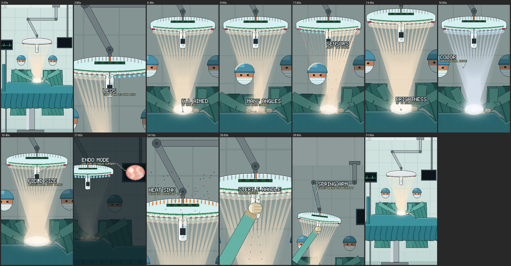

# Surgical Light, Fully Functional

A 32.5-second looping, vertical short in 8-bit pixel art about how a surgical light works, with a bright, catchy
chiptune soundtrack and sound effects tied to every event on screen. It follows the client's brief: the hook shows the
operation for one second from the side, then the camera zooms into the lamp and goes straight into how it works, one
function per bar of music, in an x-ray (cutaway) view of the lamp head. The camera pulls back out to the operating room
at the end, and the last frame runs straight into the first. No game elements and no narration: clean captions in
English name the things on screen.

the operation from the side (1 s) → zoom into the lamp → **LEDs, each with its own lens → all aimed at one spot →
a head in the way: no hard shadow → sensors shift the power → brightness → colour temperature → field size → endo
mode → the heat sink → the sterile handle and its camera → the spring arm** → back out to the operating room → the
loop starts again.



- **Format.** 1080×1920 (9:16 vertical), 30 fps, exactly 32.5 s (13 bars of 4/4 at 96 BPM), H.264 video with 48 kHz
  stereo AAC. The default export is **`out/surgical-light-animation.mp4`**, relative to this folder.
- **Look.** Every frame is drawn in code on a 270×480 canvas and scaled exactly 4× nearest-neighbour: crisp pixels,
  stepped 1-px outlines, a limited palette, at most a checker or ordered dither.
  - **The room:** an operating room seen from the side. The table runs left to right with the patient under teal-blue
    drapes, and the prepped skin shows through a window in the drape. Two surgeons in teal gowns, caps and masks (only
    their eyes show) work at the field. A vital-signs monitor's green trace beats with the music, and a monitor hangs
    on a ceiling boom.
  - **The lamp:** a white dome on a suspension: ceiling mount, central axis, extension arm, spring arm and yoke. In
    x-ray you see the LED modules, each with its own lens, on a curved circuit board; the driver board, the heat-sink
    fins, the sensors at the rim, and a camera in the sterile handle.
- **The light's effects.** The light is drawn as light, in every shot:
  - every LED sends a ray, and the rays build a glowing cone that gets brighter where they cross;
  - they meet in a bright pool on the field that lights the gloves, the skin and the drape;
  - a head in the way cuts off only the rays it is in front of and catches the light on its cap, so the field stays
    lit, with no hard shadow;
  - the light turns warmer or cooler, the pool grows and shrinks, the whole room dims in endo mode, and warm specks
    rise off the heat sink.
  - While the film explains the light, the room is a little darker so the light stands out; it is bright again in
    the operating-room shots at the start and the end.
- **Captions.** White pixel text with a thin line to the object it names, typed on and gone a couple of seconds
  later; never more than one at a time, and always clear of a phone app's buttons and caption area.
- **Loop.** The film starts and ends on the same shot of the operating room; the surgeons' hands, the heart monitor's
  trace and every idle motion repeat exactly once per loop, the soundtrack wraps round, and the heart monitor beeps
  across the loop point. `python render.py --loops 3` writes the loop three times back to back (97.5 s).

## Render it yourself

Working directory: **`belajar-python/surgical-light-animation`** (this folder). You need Python 3.9 or newer and git.
ffmpeg comes from the `imageio-ffmpeg` package in `requirements.txt`; a system ffmpeg on PATH is used if you have one.

Clone (skip if you already have the repo):

```bash
git clone -b ccr-90de552e-iir9tw https://github.com/Pudidil-dev/belajar-python.git
```

If you cloned it earlier, update it instead (run inside `belajar-python`):

```bash
git pull origin ccr-90de552e-iir9tw
```

Go to the project:

```bash
cd belajar-python/surgical-light-animation
```

Install the dependencies (numpy, Pillow, imageio-ffmpeg):

```bash
pip install -r requirements.txt
```

If pip refuses with an "externally-managed-environment" error, make a virtual environment first, then run the
`pip install` again:

```bash
python -m venv .venv
```

```bash
source .venv/bin/activate
```

(On Windows: `.venv\Scripts\activate`.)

Preview (540×960, fast encode, written to `out/surgical-light-animation-preview.mp4`):

```bash
python render.py --preview
```

Render the film (1080×1920, 30 fps, H.264 + stereo AAC):

```bash
python render.py
```

The film is written to **`out/surgical-light-animation.mp4`**. The music, effects and mix are written next to it as
WAV stems (`out/music.wav`, `out/sfx.wav`, `out/mix.wav`). On a 4-core machine the full render takes about 2 minutes.
With [uv](https://docs.astral.sh/uv/) instead of pip, no install step is needed:

```bash
uv run --no-project --with numpy --with pillow --with imageio-ffmpeg python render.py
```

On Windows, use `py render.py` if `python` is not on PATH.

**Options**

| Command | What it does |
|---|---|
| `python render.py --sheet 0:32.5:1` | one contact sheet of the whole film in `out/sheet.png` (start:end:step, seconds) |
| `python render.py --stills 0.5,9.0,21.5` | full-size PNG frames in `out/stills/` |
| `python render.py --from 5 --to 9` | only a slice of the film |
| `python render.py --fps 60` | 60 fps |
| `python render.py --scale 8` | 2160×3840 (4K vertical) |
| `python render.py --loops 3` | also `out/surgical-light-animation-loop3x.mp4`: the seamless loop played 3 times (any N) |
| `python render.py --audio-only` | only the soundtrack (music, effects, mix) |
| `python render.py --no-audio` | the picture without sound |
| `python render.py --out PATH` | a different output file (or folder, for stills and audio) |
| `python render.py --jobs 2` | fewer CPU cores (the default uses all) |

### Render configuration

`render.json` holds the defaults; command-line flags override them.

| Key | Default | Meaning |
|---|---|---|
| `output` | `out/surgical-light-animation.mp4` | where `python render.py` writes the film |
| `fps` | `30` | frame rate |
| `scale` | `4` | pixel size: the 270×480 canvas × 4 = 1080×1920 |
| `crf`, `preset`, `tune` | `16`, `medium`, `animation` | x264 quality, speed and tuning |
| `audio_bitrate` | `256k` | AAC bitrate |
| `loudness_lufs` | `-14.0` | integrated loudness of the mix (true peak is kept below −1 dBTP) |
| `preview` | 2× scale, `veryfast`, crf 20 | the `--preview` settings and output path |

## The film, beat by beat

96 BPM: a bar is 2.5 s. Every sound effect is timed from `engine/timeline.py`, the same clock that drives the picture.

| Time | Picture | Caption | Sound |
|---|---|---|---|
| 0–2.5 | **The operation**, from the side, under the light for one second; then the camera rises and pushes into the lamp. | | the heart monitor's beep on every beat over a soft pad; a rising rush; a glassy shimmer as the shell turns see-through |
| 2.5–5.0 | **LEDs.** In x-ray, the LEDs light up one after another, left to right, each with its own lens. | LEDS · EACH WITH ITS OWN LENS | a rising blip for each LED, one per 16th: the bar's tune |
| 5.0–7.5 | **One spot.** A ray leaves every lens; all of them meet in one bright pool of light on the field. | ALL AIMED · AT ONE SPOT | a bright chord as the camera settles on the beams |
| 7.5–10.0 | **No hard shadow.** A surgeon leans in under the lamp; the head cuts off the rays it is in front of, and the rest still light the field. | MANY ANGLES · NO HARD SHADOW | a soft rush; a tick for every ray the head cuts off |
| 10.0–12.5 | **Sensors.** Red scanning rays find the head; the blocked LEDs dim and the others brighten, and the pool is as bright as before. | SENSORS · SHIFT THE POWER | scanning pips, a two-tone beep when they find the head, a rising whirr as the power shifts |
| 12.5–15.0 | **Brightness** steps up on every beat, to full. | BRIGHTNESS · UP TO 160,000 LUX | a switch click and a rising note per step: the bar's tune |
| 15.0–17.5 | **Colour temperature:** the white light changes from warm to cool on every beat. | COLOR · WARM TO COOL WHITE | a click and a brighter bell per step |
| 17.5–20.0 | **Field size:** the lenses slide closer to the LEDs and the pool of light grows. | FIELD SIZE · LENSES MOVE, SPOT GROWS | the lens panel's servo whirr, a soft bloom |
| 20.0–22.5 | **Endo mode:** the lamp and the room go dim; the monitor shows the keyhole camera's picture. | ENDO MODE · DIM FOR KEYHOLE SURGERY | a power-down glide, a ping as the monitor lights; the music goes dim and muffled |
| 22.5–25.0 | **Heat sink:** heat from the LEDs flows up into the fins and rises away, while only light goes down. | HEAT SINK · LED HEAT LEAVES UP TOP | a soft rising rush and a few crackles |
| 25.0–27.5 | **Sterile handle:** a gloved hand grips the handle; inside it a camera films the field. | STERILE HANDLE · CAMERA INSIDE | a grip click, the camera's two beeps |
| 27.5–30.0 | **Spring arm:** the surgeon pulls the lamp to a new place; the spring inside the arm takes the weight and it stays there; then it goes back. | SPRING ARM · STAYS WHERE YOU LEAVE IT | ratchet clicks, a spring, a soft thunk as it holds; a tom run |
| 30.0–32.5 | **Back to the room:** the camera pulls back out to the operation under the light. | | a falling rush; the heart monitor beeps again, into the loop |

## The science (as drawn)

- **Many sources, one spot.** A surgical light has dozens of LEDs, often grouped in modules or zones, each with its own
  lens or reflector aimed at the same spot. The beams overlap there into one light field. One evaluated light has 72
  LEDs (six zones of 9 plus a central ring of 18); a patent describes 108 LEDs in 54 reflectors.
- **No hard shadow.** Because the light comes from many angles at once, a head or a hand only blocks the beams it is in
  front of. The field keeps the light of all the others: it gets a little darker, but no hard shadow falls on it. The
  IEC standard for surgical lights tests this ("shadow dilution") with a mask that stands in for the surgeon's head.
- **Sensors.** Some lights have sensors that detect a head in the beam and shift power from the blocked zones to the
  others, so the light on the field stays the same.
- **Brightness.** The standard's upper limit for the light at the centre of the field is 160,000 lux, measured 1 m from
  the lamp; lights offer several brightness steps.
- **Colour.** The standard allows white light from 3,000 K (warm) to 6,700 K (cool). It asks for a colour rendering
  index above 85, so tissue colours look true. Many lights let the team adjust the colour temperature within part of
  that range.
- **Field size.** The size of the light field can be changed by moving a panel of lenses closer to or further from the
  LEDs (closer spreads the light wider). Other designs tilt the outer emitters or switch between LED groups. One
  product's field goes from 17 to 25 cm.
- **Endo mode.** A dim setting for keyhole (endoscopic) surgery, when the team watches the camera's picture on a
  monitor.
- **Heat.** LEDs put far less infrared into the beam than halogen lamps did, which means less heat and less drying of
  exposed tissue. They still make heat, though, and the housing and its heat sink carry it away. Light from several
  overlapping lamps can still heat tissue, which is why the standard limits it.
- **Sterile handle and camera.** The centre handle lets the surgeon move the light without breaking sterility: it is
  detachable and sterilisable, or covered with a sterile cover. A camera can sit inside it.
- **Spring arm.** Springs in the arm balance the weight of the head, so it stays where it is left.
- **Simplified on purpose.**
  - The cross-section shows one row of 15 LED modules; real heads have dozens, in rings or zones.
  - The beams are drawn as visible rays. In a real operating room the light is invisible in the air; you only see
    where it lands.
  - The sensors and the camera are features of some lights, not all.
  - Sizes and distances are close to real ones (a head about 70 cm across, about 1 m above the field) but not exact.

Sources checked during this session (through web-search summaries; the pages themselves were not opened):
- [Maquet/Getinge flyer on the IEC standard](https://www.getinge.com/dam/hospital/documents/english/maquet-surgical-lights-iec-standard-flyer-en-global.pdf)
  (colour temperature range, colour rendering, the 160,000 lux limit, depth of illumination, shadow dilution)
- [Surgical lighting](https://www.wikipedia.com/wiki/Surgical_lamp) (definitions of the light-field measures)
- ECRI evaluations of the
  [Trumpf iLED 7](https://www.ecri.org/search-results/member-preview/hdjournal/pages/eval-trumpf-medical-iled-7/)
  (72 LEDs in zones, shifting power around obstructions, brightness steps, endo mode, a camera in the handle) and the
  [Amico iCE-30m](https://www.ecri.org/search-results/member-preview/hdjournal/pages/evaluation-amico-ice-30m-led-surgical-light/);
  [Hillrom](https://www.hillrom.com/en/products/iled-7-surgical-light) and
  [Baxter](https://support.baxter.com/en/products/iled-7-surgical-light/) pages on the iLED 7
- Patents:
  - [obstacle sensing](https://image-ppubs.uspto.gov/dirsearch-public/print/downloadPdf/10568181)
  - [a multi-source shadowless lamp](https://image-ppubs.uspto.gov/dirsearch-public/print/downloadPdf/7980738)
  - [spot size adjustment with a moving lens panel](https://image-ppubs.uspto.gov/dirsearch-public/print/downloadPdf/12601463)
  - [a counterbalanced arm](https://image-ppubs.uspto.gov/dirsearch-public/print/downloadPdf/5025359)
  - [a quick-release sterile handle](https://image-ppubs.uspto.gov/dirsearch-public/print/downloadPdf/4878156)
- [Mindray HyLED Q](https://www.mindray.com/en/products/surgical-lights/hyled-q-series) (a 17–25 cm light field)
- Heat:
  - [Aspen Surgical on halogen and LED lights](https://www.aspensurgical.com/Resources/Documents/Articles/the-difference-between-halogen-and-led-lights-in-surgical-rooms)
  - [AORN, "Cool surgical lights"](https://www.aorn.org/outpatient-surgery/article/2007-August-cool-surgical-lights)
  - [a Dräger white paper on surgical lighting](https://www.draeger.com/Content/Documents/Products/surgical-lighting-wp-dmc-116694-en-us.pdf)

## How it is made

- **Picture** (`engine/`). Every frame is drawn in code on a 270×480 canvas and scaled exactly 4×; nothing is a bitmap
  that gets enlarged. The world is a side view in centimetres (the floor at 0, the ceiling at 300), seen by one camera
  that is redrawn at its own scale (1.6 to 5 canvas px per cm), so zooming in shows new detail instead of bigger
  pixels.
- **One clock** (`engine/timeline.py`). Everything the light does is a function of time: which LEDs are on, the
  brightness, the colour temperature, the field size, the lean of the surgeon's head, the sensors' power shift, endo
  mode, the heat, the hand on the handle and the arm's swing. Every event with a sound lands on the 16th-note grid.
- **The room** (`engine/room.py`): walls, ceiling, the monitors, the table and the drapes, the surgeons (body, head,
  arms, gloved hands working at the field).
- **The lamp and its light** (`engine/lamp.py`). The arm's joints, the head's outside and its x-ray (it dissolves from
  one to the other with the ordered dither). Each LED's beam is a ray from its lens to the field centre, as wide as the
  light field when it gets there. Where a head is in the way the ray stops at it. The rays add up into the glow in the
  air, and the pool on the field is as bright as the rays that reach it.
- **Camera and captions** (`engine/scenes.py`): the camera path (a monotone cubic through keyframes, in log scale for
  the zoom), the captions (a dot on the object, a thin line, the text typed on) and frame assembly.
- **Sound** (`engine/audio.py`). Everything is synthesized, with no samples.
  - **Chip voices:** band-limited pulse waves, an NES-style triangle bass, LFSR noise drums, echo and FM bells.
  - **Music:** 96 BPM in A minor / C major, 13 bars: vi–IV–I–V three times, one chord per function, and a last bar
    that turns to E to lead back to the top. The LEDs' own notes are the tune of the LED bar, and the brightness
    steps are the tune of the brightness bar.
  - **Effects stay on top.** Each effect was measured against the music at that moment, band by band, and the quiet
    ones were raised until they clear it.
  - **Loudness:** the mix is −14 LUFS with true peak below −1 dBTP.

## Assets

- **Original audio** (`assets/audio/`). `music.wav`, `sfx.wav` and `mix.wav`: 48 kHz, 16-bit, stereo, exactly 32.5 s.
  To refresh them, run `python render.py --audio-only --out assets/audio`.

## Files

- `render.py`: the command line (film, preview, stills, contact sheets, loops, audio only).
- `render.json`: the render configuration.
- `requirements.txt`: numpy, Pillow, imageio-ffmpeg.
- `engine/`:
  - `timeline.py`: the clock and the light's state at every moment.
  - `palette.py`, `gfx.py`, `pixfont.py`, `world.py`: the palette (and the light's colour at each colour
    temperature), the pixel toolkit, the bitmap font, the camera.
  - `room.py`: the operating room, the table and drapes, the surgeons, the monitors.
  - `lamp.py`: the suspension, the lamp head outside and in x-ray, the light (rays, glow, pool), the sensors, the heat,
    the camera, the hand.
  - `scenes.py`: the camera path, the captions and frame assembly.
  - `audio.py`: synthesizer, score, effects, master.
- `assets/audio/`: the original soundtrack.
- `镜头表.md`: the shot list (style lock, palette, 13 beats).
- `docs/交付说明.md`: delivery notes and the quality-gate results.
- `docs/storyboard.png`: one frame from each beat.
