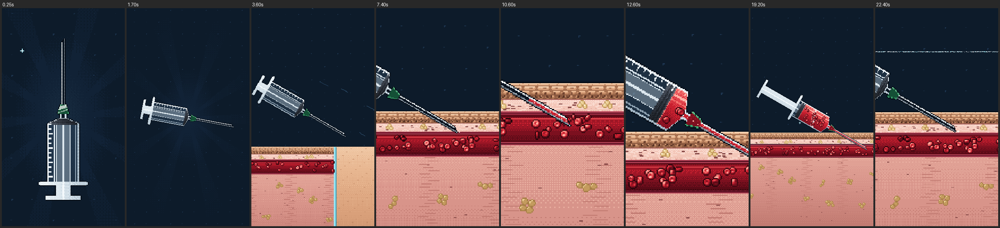

# How a Syringe Draws Blood

A 24-second looping, vertical medical-science short in 16-bit pixel-art game style. One clear syringe, one arm, all in
side view, on a dark navy background.

1. The empty syringe stands upright in the middle of the screen. A glint runs up it and sparkles pop around it. Then
   it swings down to the needle angle and shoots toward the arm with the camera alongside.
2. A scan line reveals a side cutaway of the arm: a thick skin layer built from rows of individual cells, soft tissue
   with little fat cells, and a big vein full of red cells.
3. The fine needle slides through the layers until its opening sits inside the vein, while the camera follows slowly
   and pushes in.
4. The plunger pulls back, the pressure in the syringe drops, and the cells swirl into the needle, ride up it and pour
   into the wide barrel.
5. The camera pulls back to the whole syringe, now full.
6. Then the tape rewinds the whole thing at about 5× and lands on the upright opening shot, so the video loops
   seamlessly.



- **Format.** 1080×1920 (9:16, for Shorts / Reels / TikTok), 30 fps (or 60), exactly 24.0 s, H.264 + AAC.
- **No title card, narration, subtitles or text.** The three moments that carry the story are the syringe starting
  empty, the needle opening reaching the vein, and the same syringe ending full.
- **Loop.** The rewind lands one frame before the opening glint, on the same upright close-up, so playback resumes with
  no freeze, no duplicate frame and no jump. The last and first frames differ by about 0.43/255, against 0.5–1.3
  between ordinary neighbouring frames. The music runs forward the whole time and its last bar turns around into the
  first.
- **Picture.** Every frame is drawn in code on a 270×480 pixel canvas and scaled exactly 4× with nearest-neighbour.
  - Bold silhouettes, 1-px outlines, 3–8 tone shading with Bayer dithering, the 3D-lit red cell sprites from the
    centrifuge film.
  - The syringe is a per-pixel "shader" in its own axis coordinates, so it can stand upright, swing and fly at any
    angle. It has a wide barrel (40 px across, about 2.5× the blood of the first version) and a fine needle drawn in
    section, so the blood shows travelling up its channel.
  - The skin is drawn cell by cell:
    - a thin layer of flat dead cells on top;
    - flattened cells with granules;
    - polygonal cells with round nuclei;
    - a row of column-shaped cells on the basement membrane.
  - Below the skin: soft tissue with collagen, small nuclei and lobules of round fat cells. Then a thick-walled vein,
    shaded as a round tube, with red cells flowing through it.
  - The camera shows off the upright syringe close up, tracks it, pushes in slowly during the insertion, zooms in on
    the opening and pulls back, all on the big pixels.
  - Palette: the repo's `navy` set (flat dark navy, cyan accent) plus blood red and skin.
- **Sound.** All synthesized in code, no samples.
  - **Music.** A light chiptune loop: 120 BPM, F major, the I–V–vi–IV progression, with the hook
    (C6 A5 C6 F6 E6 | E6 C6 E6 G6 F6 E6) coming back five times.
  - **Effects.**
    - The opening: a glint sweep, sparkle pings on the chord, a "ting" when the needle tip flashes, a soft wind-up,
      a rising "dwip" as it swings, and a two-beep lock-on.
    - The flight and the needle: an arcade "shup", a tracking whoosh, and three rising pips as the tip enters the
      skin, the tissue and the vein.
    - The blood draw: a soft plunger slide, a quiet flow with little plinks as cells pass, and a two-note chime.
  - **Rewind.** An arcade rewind cue, then a crunchy cassette rewind made of the film's own effects played backward.
    The music keeps moving forward, ducked under it, and is back up exactly as the loop restarts.
  - **Loudness.** The mix is −14 LUFS with true peak below −1 dBTP.

## Render it yourself

You need Python 3.9+ and git. ffmpeg comes from the `imageio-ffmpeg` package (a system ffmpeg on PATH is used if you
have one).

```bash
git clone -b ccr-90de552e-iir9tw https://github.com/pudidil-dev/belajar-python.git
```

```bash
cd belajar-python/syringe-blood-draw
```

```bash
pip install -r requirements.txt
```

```bash
python render.py
```

The film is written to `output/How_a_Syringe_Draws_Blood.mp4`. The soundtrack stems go next to it: `music.wav`,
`sfx.wav` and `mix.wav`. A 4-core laptop takes under a minute.

If you already cloned it, update instead of cloning again:

```bash
cd belajar-python && git pull origin ccr-90de552e-iir9tw
```

With [uv](https://docs.astral.sh/uv/) instead of pip:

```bash
uv run --no-project --with numpy --with pillow --with imageio-ffmpeg python render.py
```

On Windows, use `py render.py` if `python` is not on PATH.

**Options**

| Command | What it does |
|---|---|
| `python render.py --fps 60` | 60 fps (smoother tracking and rewind) |
| `python render.py --scale 8` | 2160×3840 (4K vertical); `--scale 2` gives 540×960 for a quick look |
| `python render.py --from 9 --to 15` | only a slice of the film |
| `python render.py --stills 0.25,8,19.25` | full-size PNG frames in `output/stills/` |
| `python render.py --sheet 0:24:1` | one contact sheet of the whole film in `output/sheet.png` |
| `python render.py --audio-only` | only the soundtrack (music, effects, mix) |
| `python render.py --jobs 2` | fewer CPU cores (the default uses all) |

## The film, beat by beat

120 BPM: a bar is 2 s, and every beat lands on the 8th-note grid.

| Time | Picture | Sound |
|---|---|---|
| 0–2 | **Empty syringe showcase.** The clear, empty syringe stands upright in the centre, close up: needle up, plunger fully in, slowly bobbing in front of soft light rays. A glint runs up it from the thumb press to the needle, sparkles pop around it and the needle tip flashes. It winds up, then swings down to the 30° needle angle with a little overshoot while the camera pulls back. | Glint, sparkle pings on the chord, a tip "ting", a soft wind-up, a rising "dwip", a two-beep lock-on |
| 2–5 | **Launch and side cutaway.** On the bar line it shoots toward the arm with the camera alongside, and the arm rises into frame. A scan line wipes across the arm and reveals the layers: skin made of rows of individual cells, soft tissue with little fat cells, and a thick vein of flowing red cells. The camera slows and moves in on the insertion site. | Arcade "shup", tracking whoosh, scan sweep; the music calms down |
| 5–9 | **Skin to vein.** The fine needle, its tip marked by a small glint, slides through the skin cells and the tissue and stops with its opening inside the vein. The camera follows slowly and pushes in. No blood outside the vein and no impact. | Three rising pips (skin, tissue, vein), a gentle two-note confirm |
| 9–15 | **Follow the blood.** A slight zoom on the opening. The plunger pulls back and the cells swirl into the needle, ride up its channel and pour into the wide barrel. The camera follows them, then starts pulling out as the barrel fills. | Plunger slide, quiet flow with plinks, the groove returns |
| 15–20 | **Full syringe payoff.** The whole syringe, centred, with the arm at the bottom. The red column grows in the wide barrel as the plunger draws back, then stops full and still. A glint and a two-note chime. | Cadence on F, two-note arcade chime |
| 20–24 | **Retro rewind loop.** Everything runs backward at about 5×: the barrel empties, the blood flows back down the needle, the camera retreats from the vein, the arm slides away, and the syringe swings back upright. Two brief pixel scanlines cross the screen, and the rewind eases into the upright opening close-up. | Arcade rewind cue, crunchy cassette rewind; the music keeps going forward underneath and comes back up for the loop |

**The science.** Pulling the plunger back enlarges the space in the barrel and lowers the pressure inside it. The blood
in the vein is at a higher pressure, so it is pushed in through the opening at the needle's bevel, up the needle and
into the barrel. The needle goes in at a shallow angle (here 30°) with the bevel facing up. The skin cells are drawn
far larger than life (a real epidermis is about a tenth of a millimetre thick) so they can be seen one by one.

## Files

- `render.py`: the command line (film, stills, contact sheets, audio only).
- `engine/`:
  - `timeline.py`: one timeline for picture and sound (beats, layer depths, the upright showcase and swing, syringe
    motion, plunger, flow, camera, rewind curve).
  - `palette.py`, `gfx.py`: the navy palette and the pixel drawing kit (masks, dithering, camera).
  - `syringe.py`: the syringe shader at any angle (wide barrel, graduations, stopper, clear plunger rod, flange,
    thumb press, hub, fine needle in section) and the cells riding up it.
  - `arm.py`: the arm, outside and in side cutaway: the skin cells one by one, the tissue with fat cells, the thick
    vein with its flowing cells, and the cells drawn into the needle.
  - `cells.py`: the lit biconcave red-cell sprites.
  - `scenes.py`: what's on screen at each moment: the showcase (light rays, sparkles, tip star), the camera, and the
    rewind with its two scanlines.
  - `audio.py`: the synthesizer, the looping score, the effects, the cassette rewind and the master (−14 LUFS).
- `镜头表.md`: the shot list (style lock, palette, 6 beats).
- `output/交付说明.md`: delivery notes and the quality gate results.
- `docs/storyboard.png`: frames from each beat.
