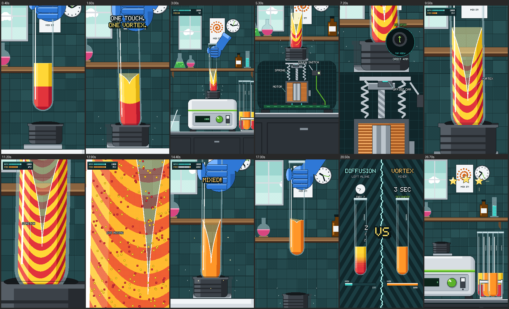

# How a Vortex Mixer Works

A 30-second looping, vertical science short in 8-bit RPG-lab pixel art, with a fun chiptune soundtrack and synced
arcade sound effects. There is no narration: a short hook title, a small game HUD, pop-up words and a few tiny labels
next to the parts they name.

a gloved hand presses a two-layer tube onto the rubber cup → CLICK, the motor and the music drop in → a vortex opens in
the tube → the mixer on a lab bench, RPM climbing → an x-ray of the casing: the motor, the touch switch, the springs →
the offset cam, and a top-view window: the cup orbits 4 mm without spinning → into the tube in slow motion: the vortex
funnel, the boundary stretched into thinner and thinner bands, the dyes mingling → MIXED! → the tube comes off, the
motor winds down, the orange liquid settles → a battle screen: DIFFUSION vs VORTEX (days vs seconds) → VORTEX WINS! →
the tube clinks into the rack, three stars → the tape rewinds to the first frame, and the film loops.



- **Format.** 1080×1920 (9:16 vertical), 30 fps, exactly 30.0 s (15 bars of 4/4 at 120 BPM), H.264 video with
  48 kHz stereo AAC. The default export is **`out/vortex-mixer-animation.mp4`**, relative to this folder.
- **Look.** Every frame is drawn in code on a 270×480 canvas and scaled exactly 4× nearest-neighbour: chunky, crisp
  pixels, stepped 1-px outlines, flat colours and at most a checker or ordered dither. The lab is three parallax layers
  (a teal tile wall with a window, a clock and a poster; a shelf of flasks, one bubbling; the bench with a beaker and a
  tube rack). Each colour has one job:
  - a white mixer with lime-green accents and a black rubber cup;
  - a red dye layer that sinks, a yellow one that floats, and the orange they make when mixed;
  - clear glass with white glints, blue nitrile gloves, a teal game HUD.
- **Game feel.**
  - **Hook.** The hook title pops in only after the click: ONE TOUCH. / ONE VORTEX.
  - **Pop-ups and labels.** Pop-up words appear on the beats (TOUCH!, VORTEX!, MIXED!). Small labels type themselves
    in next to the parts.
  - **HUD.** A small HUD with RPM and MIX meters shows while those numbers are changing.
  - **Impacts.** They get screen shakes and 8-bit impact stars.
  - **Rewards.** MIXED! is an item-get moment, followed by a VS battle screen and a three-star rating.
- **Camera.** One continuous, playful move inside the lab:
  - close-up, then a pull-back to the bench;
  - down into the x-ray of the casing, then up the shaft to the cam;
  - a pan up into the liquid, in slow motion, then a glide down the swirl and a dive to the dye particles;
  - back out for MIXED!, following the tube up.
  
  It scrolls in whole pixels and every move is eased. The battle screen slides in over the lab like two doors and
  slides back out.
- **Loop.** The last three seconds are a VHS-style tape rewind of the whole film. It runs slow-fast-slow and lands
  exactly on the first frame: the last frame differs from the first by 0.07/255 on average (99.9% identical pixels),
  and the picture never freezes. The sound is the whole mix played backward at tape speed, so the reversed opening
  leads straight into the real one.
  `python render.py --loops 3` also writes the loop three times back to back (90 s), to check the join.

## Render it yourself

Working directory: **`belajar-python/vortex-mixer-animation`** (this folder). You need Python 3.9 or newer and git.
ffmpeg comes from the `imageio-ffmpeg` package in `requirements.txt`; a system ffmpeg on PATH is used if you have one.

Clone (skip if you already have the repo):

```bash
git clone -b ccr-90de552e-iir9tw https://github.com/Pudidil-dev/belajar-python.git
```

If you cloned it earlier, update it instead (run inside `belajar-python`):

```bash
git pull origin ccr-90de552e-iir9tw
```

Go to the project:

```bash
cd belajar-python/vortex-mixer-animation
```

Install the dependencies (numpy, Pillow, imageio-ffmpeg):

```bash
pip install -r requirements.txt
```

If pip refuses with an "externally-managed-environment" error, make a virtual environment first, then run the
`pip install` again:

```bash
python -m venv .venv
```

```bash
source .venv/bin/activate
```

(On Windows: `.venv\Scripts\activate`.)

Preview (540×960, fast encode, written to `out/vortex-mixer-animation-preview.mp4`):

```bash
python render.py --preview
```

Render the film (1080×1920, 30 fps, H.264 + stereo AAC):

```bash
python render.py
```

The film is written to **`out/vortex-mixer-animation.mp4`**. The music, effects and mix are written next to it as WAV
stems (`out/music.wav`, `out/sfx.wav`, `out/mix.wav`). On a 4-core machine the full render takes about a minute and the
preview about 35 s. With [uv](https://docs.astral.sh/uv/) instead of pip, no install step is needed:

```bash
uv run --no-project --with numpy --with pillow --with imageio-ffmpeg python render.py
```

On Windows, use `py render.py` if `python` is not on PATH.

**Options**

| Command | What it does |
|---|---|
| `python render.py --sheet 0:30:1` | one contact sheet of the whole film in `out/sheet.png` (start:end:step, seconds) |
| `python render.py --stills 1.6,9.5,20.5` | full-size PNG frames in `out/stills/` |
| `python render.py --from 8 --to 14` | only a slice of the film |
| `python render.py --fps 60` | 60 fps |
| `python render.py --scale 8` | 2160×3840 (4K vertical) |
| `python render.py --loops 3` | also `out/vortex-mixer-animation-loop3x.mp4`: the seamless loop played 3 times (any N) |
| `python render.py --audio-only` | only the soundtrack (music, effects, mix) |
| `python render.py --sprites` | export the sprites to `assets/sprites/` (see below) |
| `python render.py --no-audio` | the picture without sound |
| `python render.py --out PATH` | a different output file (or folder, for stills, sprites and audio) |
| `python render.py --jobs 2` | fewer CPU cores (the default uses all) |

### Render configuration

`render.json` holds the defaults; command-line flags override them.

| Key | Default | Meaning |
|---|---|---|
| `output` | `out/vortex-mixer-animation.mp4` | where `python render.py` writes the film |
| `fps` | `30` | frame rate |
| `scale` | `4` | pixel size: the 270×480 canvas × 4 = 1080×1920 |
| `crf`, `preset`, `tune` | `16`, `medium`, `animation` | x264 quality, speed and tuning |
| `audio_bitrate` | `256k` | AAC bitrate |
| `loudness_lufs` | `-14.0` | integrated loudness of the mix (true peak is kept below −1 dBTP) |
| `preview` | 2× scale, `veryfast`, crf 20 | the `--preview` settings and output path |
| `sprites` | `assets/sprites` | where `--sprites` writes the PNGs |

## The film, beat by beat

120 BPM: a bar is 2 s. Every sound effect is timed from `engine/timeline.py`, the same clock that drives the picture.

| Time | Picture | On screen | Sound |
|---|---|---|---|
| 0–2 | **The hook.** Close on a test tube with a red layer under a yellow one, already coming down in a gloved hand. It lands in the mixer's rubber cup (impact star, screen shake); the cup dips and the touch switch closes. One 16th later the motor starts, the tube buzzes and the liquid begins to swirl into a funnel. | TOUCH! · ONE TOUCH. / ONE VORTEX. | four toms falling with the tube, a falling whoosh, CLICK and the cup's spring alone, then the drop: the motor hum and the music start together |
| 2–4 | **The reveal.** Pull back to the mixer on the lab bench: the RPM display climbs to 2800, the cup orbits (a blur and buzz lines), the rack's tubes rattle, a deep vortex opens. | VORTEX! · RPM and MIX meters | a power-up ping on VORTEX!; the main theme; the motor hum rises to C3 and pulses in 16ths |
| 4–6 | **The x-ray.** A scan line slices the casing open: the motor (copper windings, a turning rotor), the circuit board and speed control, the springs, and the microswitch, whose light is on because the pressed cup holds its lever down. | MOTOR · TOUCH SWITCH · SPRING | a scan zap, label blips, a clockwork groove |
| 6–8 | **The orbit.** Up the shaft to the offset cam: its pin runs round off-centre and carries the cup's mount with it. A top-view window shows the cup going round a small circle while an arrow on it keeps pointing the same way. | OFFSET CAM · ORBIT 4MM · NO SPIN · TOP VIEW | a circling "orbit" figure in the music |
| 8–10 | **Into the tube**, in slow motion: the funnel. The liquid climbs the glass and dips in the middle, and the red-yellow boundary bows and starts to wind. | VORTEX · MIX meter | time slows (a falling swell); the motor hum sinks to a slow, deep wub; bells over a half-time beat |
| 10–12 | The camera glides down the swirl: the boundary is wound into helical bands, thinner and thinner. | STRETCH | |
| 12–14 | Very close: red and yellow dye particles in their bands wander across them as the bands get thin, until red and yellow sit side by side everywhere and the liquid reads orange. | DYE MIXING | bubbles popping up a scale on the offbeats, a snare roll, a riser as time speeds back up |
| 14–16 | **MIXED!** Back to normal speed: the liquid is evenly orange; sparkles all round the tube. | MIXED! · MIX 100% | the item-get fanfare and a bell |
| 16–18 | **Lift-off.** The hand lifts the tube: the cup springs up, the switch opens, the motor winds down, the funnel collapses and the orange liquid sloshes and settles. | | a pop and a spring; the whole band winds down with the motor (a tape stop); sloshes; a snare pickup |
| 18–24 | **Battle screen: DIFFUSION vs VORTEX.** Left alone, a two-layer tube only blurs while a clock races through DAY 1, 2, 3 and its MIX bar crawls to 50%. The vortexed tube's bar fills in seconds. | DIFFUSION · LEFT ALONE · DAY 1–3 · VS · VORTEX · 3 SEC · SECONDS! · VORTEX WINS! | a whoosh, the VS slam, battle music, a racing clock, day dings, an original victory jingle with a sparkle run |
| 24–27 | The tube flies over to the rack and clinks into its hole; three stars pop one by one while the camera eases in. | ★ ★ ★ | a clink, three rising star dings, a ta-da chord |
| 27–30 | **Rewind.** A VHS-style tape rewind runs the whole film backward (the orange un-mixes, for fun) and lands on the first frame. | the rewind icon | the mix played backward, a tape whir |

## The science (as drawn)

- **The orbit, not a spin.** The motor's shaft carries an offset (eccentric) part, and the rubber cup is mounted on
  it off-centre. As the shaft turns, the cup's centre runs round a small circle (an orbit of a few millimetres; 4 mm
  is a common figure) instead of spinning in place. The film's x-ray shows this as a cam with an off-centre pin under
  the cup's mount, and the top-view window shows the cup orbiting while keeping its orientation. That window
  exaggerates the 4 mm orbit about three times so it can be seen.
- **Touch mode.** In touch mode the motor runs only while a tube presses on the cup. The film shows the cup dipping
  against springs and closing a microswitch, and the motor stopping as soon as the tube is lifted. Most mixers also
  have a continuous mode; the mode switch in the film is set to TOUCH. The exact switch hardware varies by model; the
  microswitch here is a simple illustration of the principle.
- **Speed.** Typical vortex mixers reach about 2,500–3,000 rpm; the film's display tops out at 2800 rpm.
- **The vortex.** The orbit is passed to the bottom of the tube. The liquid is flung round the wall and drawn into a
  swirling funnel: it climbs the glass and dips in the middle.
- **Why it mixes so fast.** The swirl stretches and folds the boundary between the two layers into thin bands. The
  thinner the bands, the shorter the distance the dye molecules must travel, and diffusion finishes the job almost at
  once. Left alone, the same two layers mix only by diffusion across the whole layer. A rough estimate for a small dye
  molecule (D ≈ 5×10⁻¹⁰ m²/s): spreading over about 1–2 cm takes on the order of days (t ≈ L²/2D). The battle screen
  shows this as days against seconds, and its DAY counter and 50% bar are illustrative, not measured.
- **Simplified on purpose.**
  - The dye particles are drawn huge, and the helical bands are a schematic of the stretching.
  - The slow motion is about 30× slower than real time.
  - The two dye layers stand for any two liquids of different density (for example, a dense sugar solution under
    water).
  - The ending rewind un-mixes the liquid for fun; that cannot happen in reality.

Sources checked (through web-search summaries in this session; the pages themselves were not opened):
- ConductScience: [Mini vortex mixer](https://conductscience.com/lab/mini-vortex-mixer) (the off-centre drive shaft
  traces an orbit; pressing a tube on the cup transfers the orbit and forms the vortex)
- Pipette.com: [What is a Vortex Mixer?](https://pipette.com/what-is-a-vortex-mixer/)
- Drawell: [2023 best knowledge guide to vortex mixers](https://drawellanalytical.com/2023-best-knowledge-guide-to-vortex-mixers)
  (eccentric rotation, the rubber cup)
- Thermo Scientific: [Digital Vortex Mixer manual](https://assets.thermofisher.com/TFS-Assets/LED/manuals/Digital%20Vortex%20Mixer%2020190926.pdf)
  (orbit diameter 4 mm, 200–3000 rpm)
- VWR: [Mini Vortex Mixer](https://avantorsciences.com/ca/en/product/39461961/vwr-mini-vortex-mixer) (4.5 mm orbit,
  2750 rpm, touch activation)
- US patent 4,747,693: [Laboratory mixer](https://patents.google.com/patent/US4747693)

## How it is made

- **Picture** (`engine/`). Every frame is drawn in code on a 270×480 canvas and scaled exactly 4×; nothing is a
  bitmap that gets enlarged. The world is a 2D side view in millimetres seen by one camera, and every object is
  redrawn at the camera's own scale, so each zoom has its own detail:
  - the lab (1.6–2 px/mm): the parallax layers, the mixer, the rack;
  - the x-ray (2.5–6 px/mm): motor, windings, shaft, cam, springs, switch, board;
  - the tube (4–13 px/mm): the funnel and the bands;
  - the dye close-up (34 px/mm): single dye particles.
- **The liquid** is drawn per pixel in the tube's own frame:
  - **The funnel.** The surface climbs the wall and a cone dips in the middle. The cone is drawn half see-through,
    with bright walls.
  - **The bands.** The red-yellow boundary is wound into helical bands. Seen from the side, a helix on a cylinder is
    an S-shaped stripe, which is what the bands are drawn as.
  - **Mixing.** The swirled zone grows from the boundary and the bands get thinner. Once they are finer than a pixel
    they blend through an ordered dither, and the liquid turns orange.
  - **Dye particles.** Close up, particles sit in their bands and wander across them as the bands thin.
- **Slow motion** comes from one time-warp: every turning thing (the cam, the cup's orbit, the swirl) follows the
  same integrated motor turns, so they all slow down together, and so does the motor's hum.
- **Sound** (`engine/audio.py`). Everything is synthesized, with no samples.
  - **Chip voices:** band-limited pulse waves, an NES-style triangle bass, LFSR noise drums, echo and FM bells.
  - **Music:** 120 BPM in C major, 15 bars, section by section:
    - the hook theme drops in one 16th after the click;
    - a clockwork groove and a circling figure for the x-ray;
    - bells over a half-time beat in the slow motion, then a snare roll into an item-get fanfare;
    - a tape stop when the motor stops;
    - battle music in A minor and an original victory jingle;
    - star dings and a ta-da.
  - **The motor** is part of the music. Its hum is tuned to the key (C3 at full speed), pulses in 16ths, and sinks to
    a deep, slow wub in the slow motion.
  - **Effects stay on top.** Each effect was measured against everything else playing at that moment (the music, the
    motor hum and the swirl), band by band:
    - the small game pings are pitched up (mostly an octave) to about 2–5.6 kHz, above the melody and the motor;
    - the music ducks for a moment under the click, VORTEX!, MIXED!, the VS slam, VORTEX WINS! and the clink;
    - the swirl drops back under the dye bubbles.
  - **Loudness:** the mix is −14 LUFS with true peak below −1 dBTP.

## Assets

- **Sprites** (`assets/sprites/`). 15 PNGs exported from the drawing code, plus `_sheet.png`, a labelled overview:
  - 5 sprites with transparency: the mixer, the tube with two layers, the tube with the vortex, the mixed tube, and
    the tube in a gloved hand;
  - 10 full-frame tiles of key moments.
  
  The code is the source: to change a sprite, edit `engine/` and run `python render.py --sprites`.
- **Original audio** (`assets/audio/`). `music.wav`, `sfx.wav` and `mix.wav`: 48 kHz, 16-bit, stereo, exactly 30 s.
  To refresh them, run `python render.py --audio-only --out assets/audio`.

## Files

- `render.py`: the command line (film, preview, stills, contact sheets, loops, audio only, sprites).
- `render.json`: the render configuration.
- `requirements.txt`: numpy, Pillow, imageio-ffmpeg.
- `engine/`:
  - `timeline.py`: one clock for picture and sound (beats, events, the motor's speed, the slow-motion time-warp, the
    vortex, the mixing, the rewind curve).
  - `palette.py`, `gfx.py`, `pixfont.py`: the palette, the pixel toolkit, the bitmap fonts.
  - `world.py`: the millimetre world, the 2D camera and the pixel shape masks.
  - `lab.py`: the lab's parallax layers, the bench, the beaker and the rack.
  - `mixer.py`: the mixer (body, panel, display, knob, switch, the orbiting rubber cup) and its x-ray.
  - `tube.py`: the tube, the liquid (layers, funnel, bands, mixing, dye particles) and the gloved hand.
  - `hud.py`: the hook title, the HUD meters, pop-up words, labels and the top-view orbit window.
  - `fx.py`: impact stars, sparkles, the rating stars and the VHS rewind look.
  - `versus.py`: the DIFFUSION vs VORTEX battle screen.
  - `scenes.py`: the camera path, screen shake and frame assembly.
  - `sprites.py`: the sprite export.
  - `audio.py`: synthesizer, score, effects, the motor hum, the tape stop, the rewind, master.
- `assets/sprites/`, `assets/audio/`: the exported sprites and the original soundtrack.
- `镜头表.md`: the shot list (style lock, palette, 14 shots).
- `docs/交付说明.md`: delivery notes and the quality-gate results.
- `docs/storyboard.png`: one frame from each beat.
