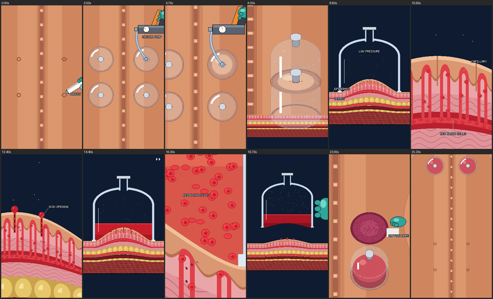

# How Wet Cupping Works

A 26-second looping, vertical medical animation in 2D 8-bit pixel art, with an original chiptune loop and synced
sound effects. There is no narration and there are no subtitles: a few tiny labels name the parts, right next to them.
It shows the mechanics only. It makes no claim that cupping removes toxins or cures anything.

top view → the lancet taps four spots → clear cups drop on → the hand pump: PUMP, PUMP, WHOOSH, the skin rises → the
camera tips down into a side cutaway → the skin domes up into the low-pressure cup → zoom into the capillaries and
their red blood cells → blood leaves through the tiny openings → it collects in the cup until the cup is about a
third full → a micro close-up of red blood cells in the collected blood → PSSSH, air back in → POP, the cup lifts
straight up with the blood inside → the round reddish-purple mark → gauze wipes the left-over blood, the mark stays → zoom out and slide
down the spine to the next, clean spots → loop.



- **Format.** 1080×1920 (9:16 vertical), 30 fps, exactly 26.0 s (13 bars of 4/4 at 120 BPM), H.264 video with
  48 kHz stereo AAC. The default export is **`out/wet-cupping-animation.mp4`**, relative to this folder.
- **Look.** Every frame is drawn in code on a 270×480 canvas and scaled exactly 4× nearest-neighbour, so the pixels
  stay chunky and crisp. The palette and its jobs:
  - a dark navy background and warm skin;
  - clear glass cups with white glints, so the red blood inside reads clearly;
  - teal nitrile gloves;
  - a reddish-purple cupping mark.
  
  The art has bold silhouettes, stepped 1-px outlines, flat colours, at most a checker dither, and no gradients or 3D
  models. There is no gore: the blood is a clean, friendly red with no splashes, and it stays inside the cup.
- **Labels.** LANCET, VACUUM PUMP, LOW PRESSURE, EPIDERMIS, DERMIS, CAPILLARY, RED BLOOD CELLS, SKIN OPENING, AIR IN,
  CUPPING MARK.
  - They use a 5×7 pixel font at 1×: white with a dark outline, and no box.
  - Each one sits beside the thing it names and moves with it, with a thin leader line when it has to sit a little
    away.
  - Each types itself in quickly and disappears when its moment is over.
  - A small ▶▶ mark in the top-right corner shows when time is sped up.
- **Camera.** One continuous camera, with no cuts and no fades:
  - it holds the top view for the lancet and the cups, then leans in on the pump;
  - it tips down to a side view while the near half of the back is sliced away (the x-ray-style cutaway);
  - it zooms into the capillaries, slides to an opening, pulls back, follows the blood into the cup and dives into it;
  - it follows the cup up, then tips back up to an angled view of the mark;
  - finally it zooms out and slides down the spine.
  
  It scrolls in whole pixels and every move is eased.
- **Loop.** The end frames a second, clean set of four marked spots exactly like the opening, and the lancet comes in
  again. The back's pattern repeats every 240 mm along the spine, so this set looks just like the first. The first
  set's mark and three cups are still on the back: they leave the picture by scrolling out of frame and never vanish
  on screen.
  - The last frame matches the first on 99.8% of its pixels (mean difference 0.2/255), and the last two frames still
    differ, so the picture never freezes. There is no fade, no freeze and no jump.
  - The music's last bar (a C7 turnaround with a tom fill) resolves into the first, and every echo and reverb tail
    wraps onto the start, so the sound loops seamlessly too.
  - `python render.py --loops 3` also writes the loop three times back to back (78 s), to check the join.

## Render it yourself

Working directory: **`belajar-python/wet-cupping-animation`** (this folder). You need Python 3.9 or newer and git.
ffmpeg comes from the `imageio-ffmpeg` package in `requirements.txt`; a system ffmpeg on PATH is used if you have one.

Clone (skip if you already have the repo):

```bash
git clone -b ccr-90de552e-iir9tw https://github.com/Pudidil-dev/belajar-python.git
```

If you cloned it earlier, update it instead (run inside `belajar-python`):

```bash
git pull origin ccr-90de552e-iir9tw
```

Go to the project:

```bash
cd belajar-python/wet-cupping-animation
```

Install the dependencies (numpy, Pillow, imageio-ffmpeg):

```bash
pip install -r requirements.txt
```

If pip refuses with an "externally-managed-environment" error, make a virtual environment first, then run the
`pip install` again:

```bash
python -m venv .venv
```

```bash
source .venv/bin/activate
```

(On Windows: `.venv\Scripts\activate`.)

Preview (540×960, fast encode, written to `out/wet-cupping-animation-preview.mp4`):

```bash
python render.py --preview
```

Render the film (1080×1920, 30 fps, H.264 + stereo AAC):

```bash
python render.py
```

The film is written to **`out/wet-cupping-animation.mp4`**, which is
`belajar-python/wet-cupping-animation/out/wet-cupping-animation.mp4`. The music, effects and mix are written next to it
as WAV stems (`out/music.wav`, `out/sfx.wav`, `out/mix.wav`). To write the film to an `out/` folder at the root of the
repository instead, run `python render.py --out ../out/wet-cupping-animation.mp4`.

On a 4-core machine the soundtrack takes about 10 s and the frames about 40 s; the preview takes about 30 s in all.
With [uv](https://docs.astral.sh/uv/) instead of pip, no install step is needed:

```bash
uv run --no-project --with numpy --with pillow --with imageio-ffmpeg python render.py
```

On Windows, use `py render.py` if `python` is not on PATH.

**Options**

| Command | What it does |
|---|---|
| `python render.py --sheet 0:26:1` | one contact sheet of the whole film in `out/sheet.png` (start:end:step, seconds) |
| `python render.py --stills 0.9,10.6,23` | full-size PNG frames in `out/stills/` |
| `python render.py --from 7 --to 13` | only a slice of the film |
| `python render.py --fps 60` | 60 fps |
| `python render.py --scale 8` | 2160×3840 (4K vertical) |
| `python render.py --loops 3` | also `out/wet-cupping-animation-loop3x.mp4`: the seamless loop played 3 times (any N) |
| `python render.py --audio-only` | only the soundtrack (music, effects, mix) |
| `python render.py --sprites` | export the sprites to `assets/sprites/` (see below) |
| `python render.py --no-audio` | the picture without sound |
| `python render.py --out PATH` | a different output file (or folder, for stills, sprites and audio) |
| `python render.py --jobs 2` | fewer CPU cores (the default uses all) |

### Render configuration

`render.json` holds the defaults; command-line flags override them.

| Key | Default | Meaning |
|---|---|---|
| `output` | `out/wet-cupping-animation.mp4` | where `python render.py` writes the film |
| `fps` | `30` | frame rate |
| `scale` | `4` | pixel size: the 270×480 canvas × 4 = 1080×1920 |
| `crf`, `preset`, `tune` | `16`, `medium`, `animation` | x264 quality, speed and tuning |
| `audio_bitrate` | `256k` | AAC bitrate |
| `loudness_lufs` | `-14.0` | integrated loudness of the mix (true peak is kept below −1 dBTP) |
| `preview` | 2× scale, `veryfast`, crf 20 | the `--preview` settings and output path |
| `sprites` | `assets/sprites` | where `--sprites` writes the PNGs |

## The film, beat by beat

120 BPM: a bar is 2 s. Every sound effect is timed from `engine/timeline.py`, the same clock that drives the picture.

| Time | Picture | Labels | Sound |
|---|---|---|---|
| 0–2 | **The hook, from above.** A patient lies face down; four spots on the back are marked with small rings. A gloved hand brings in a lancet pen and taps each spot. Each tap leaves three tiny openings and a little spark. | LANCET | TIK on every tap (a click and a high blip), the lancet whooshing in and out |
| 2–4 | Four clear cups drop onto the spots one by one, with a small bounce. The hand pump slides in and its clear hose clicks onto the valve of the main cup (upper right). | VACUUM PUMP | a glass "tunk" and a rising blip per cup, the hose CLICK |
| 4–5.7 | **The pump.** Three squeezes: air dots leave the cup through the hose, the gauge needle swings over, and with each squeeze the skin inside the cup rises a step. The WHOOSH as the suction settles; the hose comes off and the pump leaves. | | PUMP, PUMP, PUMP, then WHOOSH. The music plays stop-time here: the band rests on the squeezes and answers between them. |
| 5.7–7 | The camera tips from top-down to side-on while the near half of the back is sliced away at the main cup, revealing the cross-section. | | a whoosh, a scan sweep, a glass ping when the slice is done |
| 7–9 | **Side cutaway.** The cup on the skin, cut in half: epidermis, dermis with its small vessels, fat and muscle. Inside the cup only a few air dots are left (low pressure), and the skin keeps rising into a dome. The pull fades with depth: the skin and dermis stretch most, the muscle hardly moves, and nothing is pulled out of the skin. The other cups are pumped meanwhile. | LOW PRESSURE · EPIDERMIS · DERMIS | a soft, low swell |
| 9–11.6 | Zoom into the top of the dermis: a capillary loop rises into every papilla, and red blood cells move through the loops and along a small vessel below. The vessels widen a little and tiny spots of blood (petechiae) appear in the upper dermis. | CAPILLARY · RED BLOOD CELLS | a zoom whoosh, soft bubbly blips as the cells hop along |
| 11.6–13 | The camera slides to one of the tiny openings: a little blood leaves a cut capillary through it and beads on the skin. | SKIN OPENING | soft plips as the beads form |
| 13–15.5 | **Blood collects** (time-lapse ▶▶). The camera pulls back to the whole cup: beads grow and roll down the dome, and the blood rises inside the cup until it covers the dome and the cup is about a third full (30% of its volume). The camera follows it into the cup. | | a soft whoosh, fast ticks, drips, BLOOP… BLOOP |
| 15.5–18 | **Micro close-up** of the collected blood: red blood cells floating in plasma, beside the skin and the cup wall. The cells emerge as the camera dives in and blend back into the red as it pulls out. The blood starts to thicken as it clots: a step darker, still plainly red. Then the camera pulls back out to the whole cup. | RED BLOOD CELLS | a third BLOOP, a soft swirl, a whoosh back out |
| 18–21 | **Removal.** A gloved hand opens the valve: PSSSH, air rushes back in, the dome sinks and the blood level drops a little with it. The hand grips the cup and POP, the seal breaks. The cup lifts straight up and stays level, with the collected blood inside (about 30% of the cup), and the camera follows it. | AIR IN | the valve, PSSSH, POP, a rising whoosh |
| 21–24 | The camera tips back up to an angled top view while the cut closes. Where the cup was, a round reddish-purple mark with a few left-over drops of blood. A gloved hand wipes them away with gauze in two strokes; the mark stays. | CUPPING MARK | a whoosh and a bell, SWIPE, SWIPE, a little sparkle when the skin is clean. The music's hook comes back. |
| 24–26 | Zoom out: three cups still on, each about a third full of blood, and one mark. The camera slides down the spine to the next, clean set of four marked spots, framed exactly like the opening, and the lancet comes in again. Then the film loops. | | a zoom-out whoosh, a slide whoosh, the lancet coming in; the C7 turnaround and a tom fill lead back to the top |

## The science (as drawn)

- **Why the skin rises.** The hand pump draws air out of the sealed cup, so the air left inside is at a lower
  pressure than the air outside. The skin is not sucked up by a force inside the cup: the higher pressure around it
  pushes the soft tissue up into the low-pressure space. The air dots inside the cup are a cue for this: fewer dots mean
  lower pressure. A 2020 review names negative pressure as the key factor in cupping.
- **What moves.** The lift is strongest at the surface and fades with depth. So the epidermis and dermis stretch into a
  dome, the fat moves less and the muscle hardly at all. Vessels stay inside the skin; they widen a little under the
  suction.
- **The openings.** The lancet makes three tiny, shallow openings per spot, through the epidermis into the upper dermis,
  where they cut a few capillaries. Under the low pressure blood comes out through them, beads on the skin, runs down
  the dome and collects in the cup. It is ordinary blood (red cells in plasma) that starts to clot in the cup. It is not
  "toxins" or "dirty blood", and the film never says it is: it stays a normal red as it thickens.
- **How much blood.** In this film the blood fills 30% of each cup's volume, about 10.5 ml of the 35 ml cup. How much
  is collected in practice varies; the film makes no claim about it. The domed skin takes up room inside the cup, so
  while the skin is pulled up the blood's surface stands at about 37% of the cup's height. When the air goes back in
  and the skin sinks, the surface drops to about 31%, which is what the lifted cup holds.
- **The mark.** The suction also breaks some tiny capillaries in the upper dermis. The small spots of blood they leave
  under the skin (petechiae) make the round reddish-purple mark, which stays after the skin is wiped clean and
  usually fades within about a week.
- **Removal.** Opening the valve lets air back in, so the pressures even out and the skin sinks back. Then the seal can
  be broken and the cup lifted off. The film lifts it straight up and keeps it level, so the collected blood stays in
  the cup. In practice, practitioners often tip the cup off with gauze held ready to catch the blood.
- **Simplified on purpose.**
  - The layers and cells are schematic and not to scale: a red blood cell is about 7–8 µm across and the epidermis is
    a fraction of a millimetre thick, so both are drawn far bigger than life to be readable.
  - The air dots are a cue; real air is invisible.
  - A common method has two stages: cup first, take the cup off, make the small openings, then put the cup back. The
    film shows the single sequence the brief asked for (prick, then cup).
  - Time is compressed: the collection is sped up (▶▶).
- **What the film does not claim.** It shows the mechanics only. It does not say that cupping removes toxins, cleans
  the blood or cures anything. According to the US National Center for Complementary and Integrative Health (NCCIH),
  most research on cupping is low quality, and wet cupping carries extra risks because it draws blood: hepatitis B and
  C can spread through equipment that is not sterile, and repeated wet cupping can cause anemia from blood loss. The
  film shows gloves and gauze for that reason.

Sources checked (through web-search summaries in this session; the pages themselves were not opened):
- NCCIH (US National Center for Complementary and Integrative Health): [Cupping](https://nccih.nih.gov/news/cupping)
  (weak evidence, the side effects and risks of wet cupping). The page was last updated in November 2018.
- Review, 2020: [sciopen.com, doi 10.1016/j.jtcms.2020.11.001](https://sciopen.com/article/10.1016/j.jtcms.2020.11.001)
  (negative pressure as the key factor of cupping; more rigorous research needed)
- Wikipedia: [Cupping therapy](https://en.wikipedia.com/wiki/Hijama) (insufficient evidence of health benefits; risks,
  especially with wet cupping)
- [Methods of Wet Cupping Therapy (Al-Hijamah): In Light of Modern Medicine and Prophetic Medicine](https://katalog.lib.cas.cz/KNAV/EdsRecord/edsair,edsair.doi...........39c5b5fe685a07d153191568be15bbf8)
  (the two-stage method). This source promotes the practice, so only its description of the method is used here.
- Secondary sources from the same searches, on the marks and bruising (capillaries breaking in the papillary dermis,
  petechiae, bruising that fades within about a week):
  [Banner Health](https://www.bannerhealth.com/healthcareblog/teach-me/does-cupping-therapy-really-work),
  [Chiropractic Economics](https://www.chiroeco.com/cupping-bruises/amp)

## How it is made

- **Picture** (`engine/`). Every frame is drawn in code on a 270×480 pixel canvas and scaled exactly 4× nearest
  neighbour; nothing is a bitmap that gets enlarged.
  - **The 2.5D camera.** The back is a slab measured in millimetres: x across the back, y along the spine, z out of
    the skin. One orthographic camera looks at it from an elevation angle, from 90° (straight down) to 0° (side-on).
    For every canvas row it works out where that row meets the skin (for the top view) and how high it sits on the cut
    face (for the cross-section). So the top surface and the cutaway are each painted per pixel from flat 2D textures,
    at any angle in between.
  - **The cut plane.** A plane through the main cup removes the near half of the back. It slices in from the near edge
    during the tilt and slides away again on the way back up.
  - **The dome.** Under a cup, the skin height is a smooth bump. Inside the tissue the lift fades with depth (an
    exponential with a 7 mm scale), and each pixel of the cross-section is mapped back to its undeformed depth (solved
    exactly with Newton's method). That is why the layers stretch the way they do.
  - **Redrawn at every scale.** Every zoom level has its own detail:
    - the top and angled views (1–4 px/mm): the back, its spine and the cups;
    - the cutaway (5 px/mm): the layers;
    - the capillaries (18–26 px/mm): the loops, the cells, the openings;
    - the micro close-up (52 px/mm): single red blood cells in plasma.
  - **The cups** are drawn exactly for any angle: the rim and wall ellipses, a band between them, an ellipsoid top and
    a steel valve. When the cut passes through the main cup, it switches to a cut-in-half profile with hatched glass
    walls.
  - **The blood** is a volume: 30% of the cup. Its surface height follows from that volume and the dome under it (in
    closed form), so it covers the dome while the skin is pulled up and drops when the air goes back in. Seen at an
    angle, each cup shows the blood's surface as an ellipse and, below it, the band of blood behind the front wall. In
    the close-up, the plasma around the cells comes in through an ordered dither as the camera zooms, so the pool never
    changes colour in one frame.
  - **The loop** is built into the world. A second, identical set of spots sits 240 mm further down the spine, and the
    vertebrae's spacing (24 mm) divides that distance. So the last frame, framed on the second set, looks like the
    first.
- **Sound** (`engine/audio.py`). Everything is synthesized, with no samples.
  - **Chip voices:** band-limited pulse waves, an NES-style triangle bass, LFSR noise drums, echo and FM bells.
  - **Music:** 120 BPM in F major, 13 bars. Bar by bar:
    - a square-wave hook (A5 C6 F6 C6 | E6 D6 C6 G5) opens the loop;
    - the cups drop in on a rising line;
    - the pump bar is a stop-time break that answers each squeeze with a step up;
    - soft bars for the low pressure and the micro close-up, and bouncy staccato for the cells;
    - the melody rests for the psssh and the pop;
    - the hook comes back over the wipe;
    - a C7 turnaround with a tom fill leads back into the top.
  - **Space for the key moments.** The music drops out under the three PUMPs and the WHOOSH and leaves the stage to
    the PSSSH and the POP. It dips under the TIKs, BLOOPs and SWIPEs. Measured per frequency band against the music
    as you hear it, every effect is louder than the music in its own loudest band:
    - the pumps, the whoosh, the psssh and the pop by about 19 dB or more;
    - the bloops by 15–21 dB;
    - the short, high tiks and swipes by 3–15 dB (the first tik, on the hook's top note, is the closest call).
  - **Effects:** TIK, glass "tunk", CLICK, PUMP, WHOOSH, soft drips and plips, BLOOP, PSSSH, POP, SWIPE, the sparkle
    when the skin is clean, and camera whooshes. All of them run on the picture's clock.
  - **Loudness:** the mix is −14 LUFS with true peak below −1 dBTP.

## Assets

- **Sprites** (`assets/sprites/`). 13 PNGs exported from the drawing code, plus `_sheet.png`, a labelled overview:
  - 8 transparent sprites: the lancet in a gloved hand, the cup from the top, at an angle and cut in half, the pump
    with its hose, the gauze in a gloved hand, and the hand on the valve and lifting the cup;
  - 5 full-frame tiles: the back, the cutaway, the capillaries, the collected blood and the mark.
  
  The code is the source. To change a sprite, edit `engine/tools.py`, `engine/cups.py`, `engine/back.py` or
  `engine/tissue.py`, then run `python render.py --sprites`.
- **Original audio** (`assets/audio/`). `music.wav`, `sfx.wav` and `mix.wav`: 48 kHz, 16-bit, stereo, exactly 26 s,
  loop-ready. `python render.py` regenerates the same stems into `out/` every time it renders the film. To refresh
  these copies, run `python render.py --audio-only --out assets/audio`.

## Files

- `render.py`: the command line (film, preview, stills, contact sheets, loops, audio only, sprites).
- `render.json`: the render configuration.
- `requirements.txt`: numpy, Pillow, imageio-ffmpeg.
- `engine/`:
  - `timeline.py`: one clock for picture and sound (the beats, every event, easing).
  - `palette.py`, `gfx.py`, `pixfont.py`: the palette, the pixel toolkit (upscaling, dither), the bitmap font.
  - `view.py`: the 2.5D camera (top view, side view and any angle between, with the cut plane) and the pixel shape
    masks.
  - `state.py`: where everything is at time t (the spots, cup heights, dome heights, how much blood each cup holds and
    how high it stands, air left in the cup).
  - `back.py`: the back from above (spine, vertebrae, shoulder blades), the marker rings, openings, mark and left-over
    blood.
  - `tissue.py`: the cross-section (layers, vessels, capillary loops, petechiae, openings) and the blood (cells, beads,
    pool, clot).
  - `cups.py`: the clear cups at any angle with the blood inside them, and the cut-in-half profile.
  - `tools.py`: the lancet pen, the hand pump and hose, the gauze, and the hand on the valve.
  - `fx.py`: the air dots, the tap sparks and the clean sparkle.
  - `captions.py`: the small labels that follow the objects, and the fast-forward mark.
  - `scenes.py`: the camera path, the cut plane and frame assembly.
  - `sprites.py`: the sprite export.
  - `audio.py`: synthesizer, score, effects, master.
- `assets/sprites/`, `assets/audio/`: the exported sprites and the original soundtrack.
- `镜头表.md`: the shot list (style lock, palette, 12 shots).
- `docs/交付说明.md`: delivery notes and the quality-gate results.
- `docs/storyboard.png`: one frame from each beat.
